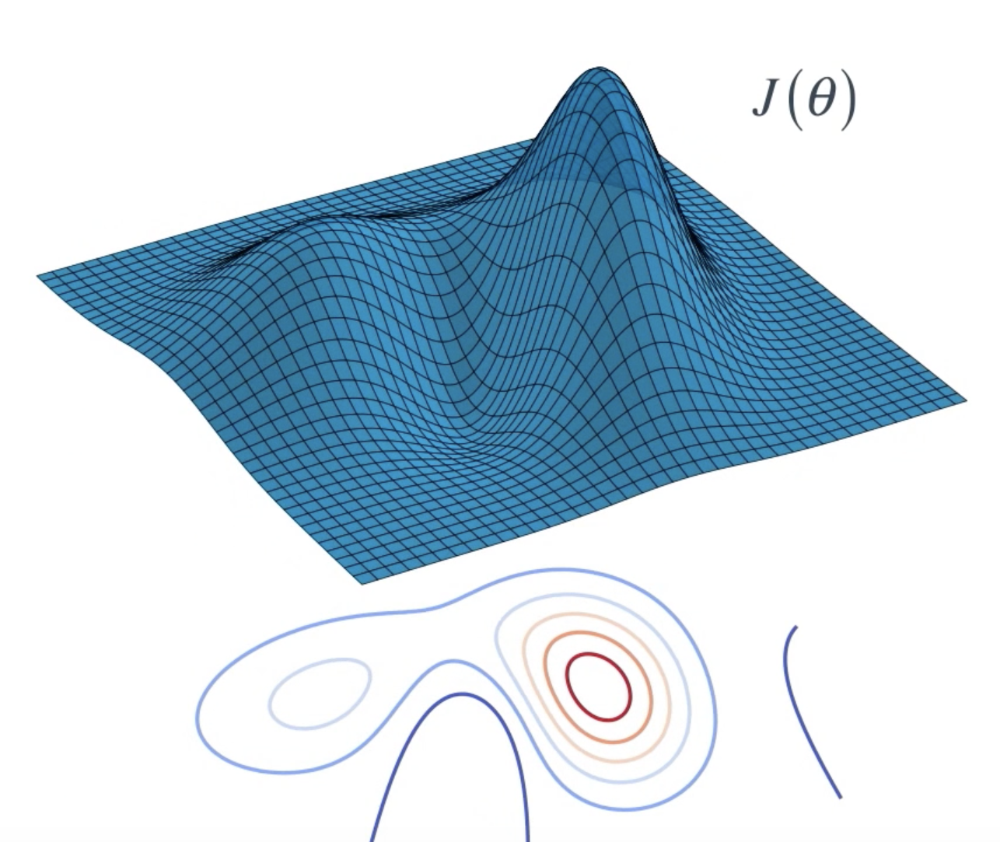

# Introduction to Policy-Based Methods

In this lesson, you will study direct policy optimization methods, including hill climbing, simulated annealing, adaptive noise scaling, the cross-entropy method, and evolution strategies.

## Motivation

Value-based methods first estimate a value function and then derive a policy from it. Policy-based methods instead optimize the policy directly.

A deterministic policy maps each state to one action:

$$ \pi_{\theta}: \mathcal{s_t} 
\rightarrow \mathcal{a_t}. $$

A stochastic policy defines a probability distribution over actions:

$$ a_t \sim \pi_{\theta}(\cdot \mid s_t), \qquad \pi_{\theta}(a_t \mid s_t)=P(A=a_t\mid S=s_t). $$

Direct policy optimization is particularly useful when:

- the action space is continuous;
- the number of candidate actions is large;
- a stochastic policy is required; or
- directly mapping states to actions is more efficient than evaluating every action separately.

## CartPole and Example Implementations

- [Bipedal evolution-strategy implementation](https://github.com/alirezamika/bipedal-es)
- [Evolution strategies library](https://github.com/alirezamika/evostra)
- [CartPole solution methods](https://kvfrans.com/simple-algoritms-for-solving-cartpole/)
- [OpenAI CartPole example repository](https://github.com/kvfrans/openai-cartpole)

## Summary

<figure align="center">

</figure>

## Policy-Based Methods

- With **value-based methods**, the agent uses its experience with the environment to maintain an estimate of the optimal action-value function. The optimal policy is then obtained from the optimal action-value function estimate.
- **Policy-based methods** directly learn the optimal policy, without having to maintain a separate value function estimate.

## Policy Function Approximation

- In deep reinforcement learning, it is common to represent the policy with a neural network.
  - This network takes the environment state as **input**.
  - If the environment has discrete actions, the **output** layer has a node for each possible action and contains the probability that the agent should select each possible action.
- The weights in this neural network are initially set to random values. Then, the agent updates the weights as it interacts with (*and learns more about*) the environment.

## More on the Policy

- Policy-based methods can learn either stochastic or deterministic policies, and they can be used to solve environments with either finite or continuous action spaces.

## Hill Climbing

- **Hill climbing** is an iterative algorithm that can be used to find the weights $\theta$ for an optimal policy.
- At each iteration:
  1. We slightly perturb the values of the current best estimate for the weights $\theta_{\text{best}}$ to yield a new set of weights.
  2. These new weights are then used to collect an episode. If the new weights $\theta_{\text{new}}$ result in a higher return than the old weights, then we set

     $$ \theta_{\text{best}} \leftarrow \theta_{\text{new}}. $$

## Beyond Hill Climbing

- **Steepest ascent hill climbing** is a variation of hill climbing that chooses a small number of neighboring policies at each iteration and selects the best among them.
- **Simulated annealing** uses a predefined schedule to control how the policy space is explored and gradually reduces the search radius as we get closer to the optimal solution.
- **Adaptive noise scaling** decreases the search radius with each iteration when a new best policy is found, and otherwise increases the search radius.

## More Black-Box Optimization

- The **cross-entropy method** iteratively suggests a small number of neighboring policies and uses a small percentage of the best-performing policies to calculate a new estimate.
- The **evolution strategies** technique considers the return corresponding to each candidate policy. The policy estimate at the next iteration is a weighted sum of all candidate policies, where policies that obtained higher returns are given higher weights.

## Why Policy-Based Methods?

There are three reasons why we consider policy-based methods:

1. **Simplicity:** Policy-based methods directly address the problem at hand, estimating the optimal policy, without having to store a large amount of additional data (i.e., the action values) that may not be useful.
2. **Stochastic policies:** Unlike value-based methods, policy-based methods can learn true stochastic policies.
3. **Continuous action spaces:** Policy-based methods are well-suited for continuous action spaces.
