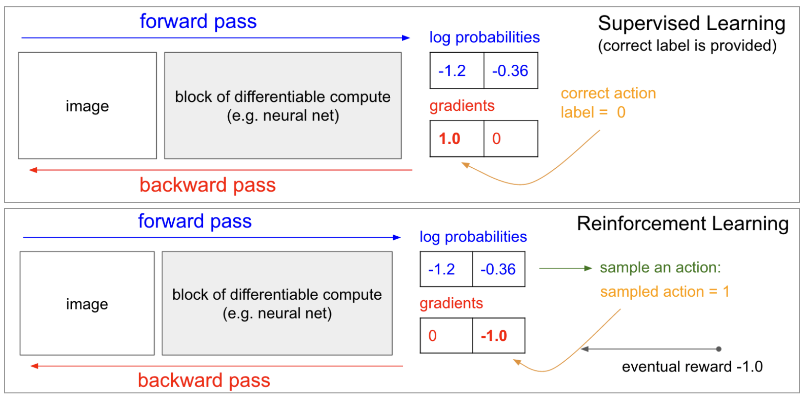
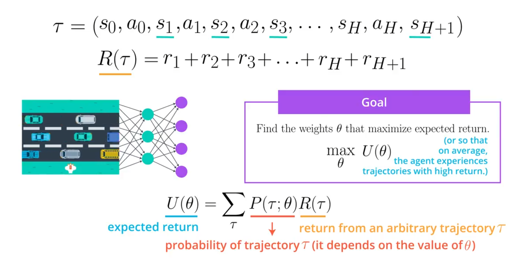
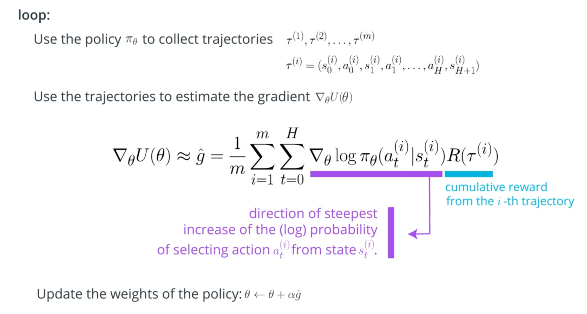
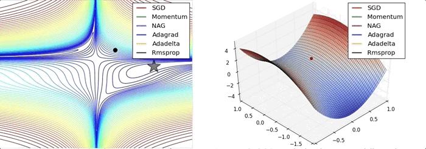
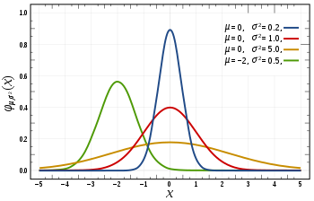
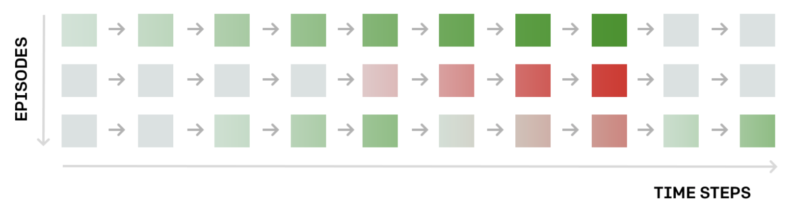

# Policy Gradient Methods
In this lesson, you will study REINFORCE, along with improvements we can make to lower the variance of policy gradient algorithms.

-> explore the connections between policy gradient methods and supervised learning
Andrej Karpathy's [famous blog post](https://karpathy.github.io/2016/05/31/rl/).

<figure align="center">

</figure>

## Problem Setup

<figure align="center">

</figure>

### Important Note

Before moving on, make sure it is clear that the following equation calculates an **expectation**:

$$ U(\theta) = \sum_{\tau} P(\tau;\theta)R(\tau) $$

To see how this corresponds to the **expected return**, note that we have expressed the **return** $R(\tau)$ as a function of the trajectory $\tau$.

We then calculate the weighted average of all possible values that the return $R(\tau)$ can take, where the weights are given by $P(\tau;\theta)$.

Equivalently,

$$ U(\theta) = \mathbb{E}_{\tau \sim P(\tau;\theta)} \left[R(\tau)\right]. $$

Here:

- $\theta$ denotes the parameters of the policy.
- $\tau$ denotes a trajectory.
- $P(\tau;\theta)$ is the probability of trajectory $\tau$ under the policy parameterized by $\theta$.
- $R(\tau)$ is the return obtained from trajectory $\tau$.
- $U(\theta)$ is the expected return under the policy.

### Why Trajectories?

You may be wondering: *Why are we using trajectories instead of episodes?*

The answer is that maximizing the expected return over trajectories, instead of episodes, allows us to search for optimal policies for both **episodic** and **continuing** tasks.

That said, for many episodic tasks, it often makes sense to use the full episode as the trajectory.

In particular, consider a video game in which the reward is only delivered at the end of the episode. In this case, to estimate the expected return, the trajectory should correspond to the full episode. Otherwise, we do not have enough reward information to meaningfully estimate the expected return.

## The REINFORCE Algorithm

You've learned that our goal is to find the values of the weights $\theta$ in the neural network that maximize the expected return $U$:

$$ U(\theta) = \sum_{\tau} P(\tau;\theta)R(\tau), $$

where $\tau$ is an arbitrary trajectory.

One way to determine values of $\theta$ that maximizes this function is through **gradient ascent**. This algorithm is closely related to **gradient descent**, with the following differences:

- Gradient descent is designed to find the **minimum** of a function, whereas gradient ascent is designed to find the **maximum**.
- Gradient descent steps in the direction of the **negative gradient**, whereas gradient ascent steps in the direction of the **gradient**.

Our update step for gradient ascent is:

$$ \theta \leftarrow \theta + \alpha \nabla_{\theta} U(\theta), $$

where $\alpha$ is the step size, which is generally allowed to decay over time.

Once we know how to calculate or estimate this gradient, we can repeatedly apply this update step in the hope that $\theta$ converges to the value that maximizes $U(\theta)$.

## Pseudocode

The algorithm described in the video is known as **REINFORCE**. The pseudocode is summarized below.

1. Use the policy $\pi_\theta$ to collect $m$ trajectories

   $$ \left\{ \tau^{(1)}, \tau^{(2)}, \ldots, \tau^{(m)} \right\} $$

   with horizon $H$. We refer to the $i$-th trajectory as

   $$ \tau^{(i)} = \left( s_0^{(i)}, a_0^{(i)}, \ldots, s_H^{(i)}, a_H^{(i)}, s_{H+1}^{(i)} \right). $$

2. Use the trajectories to estimate the gradient $\nabla_\theta U(\theta)$:

   $$ \nabla_\theta U(\theta) \approx \hat{g} := \frac{1}{m} \sum_{i=1}^{m} \sum_{t=0}^{H} \nabla_\theta \log \pi_\theta \left( a_t^{(i)} \mid s_t^{(i)} \right) R\left(\tau^{(i)}\right). $$

3. Update the weights of the policy:

   $$ \theta \leftarrow \theta + \alpha \hat{g}, $$

   where $\alpha$ is the learning rate (step size).

4. Repeat steps **1–3**.

<figure align="center">

</figure>

## Derivation

<figure align="center">

</figure>

## Derivation of the REINFORCE Gradient

If you'd like to learn how to derive the equation that we use to approximate the gradient, read the derivation below. Specifically, we want to derive

$$ \nabla_\theta U(\theta) \approx \hat{g} = \frac{1}{m} \sum_{i=1}^{m} \sum_{t=0}^{H} \nabla_\theta \log \pi_\theta \left( a_t^{(i)} \mid s_t^{(i)} \right) R\left(\tau^{(i)}\right). $$

This derivation is **optional** and can be safely skipped.

## Likelihood Ratio Policy Gradient

We begin by exploring how to calculate the gradient $\nabla_\theta U(\theta)$. Recall that

$$ U(\theta) = \sum_{\tau} P(\tau;\theta)R(\tau). $$

Taking the gradient with respect to $\theta$ gives

$$ \begin{aligned} \nabla_\theta U(\theta) &= \nabla_\theta \sum_\tau P(\tau;\theta)R(\tau) \\ &= \sum_\tau \nabla_\theta P(\tau;\theta)R(\tau) \\ &= \sum_\tau P(\tau;\theta)\frac{1}{P(\tau;\theta)}\nabla_\theta P(\tau;\theta)R(\tau) \\ &= \sum_\tau P(\tau;\theta)\frac{\nabla_\theta P(\tau;\theta)}{P(\tau;\theta)}R(\tau) \\ &= \sum_\tau P(\tau;\theta)\nabla_\theta\log P(\tau;\theta)R(\tau). \end{aligned} $$

Let's examine these steps individually.

### Step 1

Line (1) follows directly from

$$ U(\theta) = \sum_\tau P(\tau;\theta)R(\tau), $$

where we have simply taken the gradient of both sides.

### Step 2

In line (2), we use the linearity of differentiation to rewrite the gradient of the sum as the sum of the gradients:

$$ \nabla_\theta \sum_\tau P(\tau;\theta)R(\tau) = \sum_\tau \nabla_\theta P(\tau;\theta)R(\tau). $$

### Step 3

In line (3), we multiply every term by

$$ \frac{P(\tau;\theta)}{P(\tau;\theta)} = 1. $$

Thus,

$$ \nabla_\theta P(\tau;\theta) = P(\tau;\theta) \frac{\nabla_\theta P(\tau;\theta)} {P(\tau;\theta)}. $$

This does not change the expression.

### Step 4

Line (4) simply rearranges the terms:

$$ P(\tau;\theta) \frac{1}{P(\tau;\theta)} \nabla_\theta P(\tau;\theta) = P(\tau;\theta) \frac{\nabla_\theta P(\tau;\theta)} {P(\tau;\theta)}. $$

### Step 5: The Likelihood Ratio Trick

Finally, line (5) follows from the identity

$$ \nabla_x \log f(x) = \frac{\nabla_x f(x)}{f(x)}. $$

Therefore,

$$ \nabla_\theta \log P(\tau;\theta) = \frac{\nabla_\theta P(\tau;\theta)} {P(\tau;\theta)}. $$

Substituting this identity gives

$$ \nabla_\theta U(\theta) = \sum_\tau P(\tau;\theta) \nabla_\theta \log P(\tau;\theta) R(\tau). $$

This manipulation is known as the **likelihood ratio trick**, **log-derivative trick**, or **REINFORCE trick**.

The resulting expression is commonly called the **likelihood ratio policy gradient**:

$$ \boxed{ \nabla_\theta U(\theta) = \sum_\tau P(\tau;\theta) \nabla_\theta \log P(\tau;\theta) R(\tau) } $$

Since the summation has the form of an expectation over trajectories,

$$ \boxed{ \nabla_\theta U(\theta) = \mathbb{E}_{\tau \sim P(\tau;\theta)} \left[ \nabla_\theta \log P(\tau;\theta) R(\tau) \right] } $$

Once we have written the gradient as an expected value, it becomes much easier to estimate using sampled trajectories.

## Sample-Based Estimate

We can approximate the expectation using $m$ sampled trajectories:

$$ \tau^{(1)}, \tau^{(2)}, \ldots, \tau^{(m)} \sim P(\tau;\theta). $$

The likelihood ratio policy gradient can then be approximated by the sample average

$$ \boxed{ \nabla_\theta U(\theta) \approx \frac{1}{m} \sum_{i=1}^{m} \nabla_\theta \log P\left(\tau^{(i)};\theta\right) R\left(\tau^{(i)}\right) } $$

where each $\tau^{(i)}$ is a sampled trajectory.

## Finishing the Calculation

Before calculating the expression above, we need to simplify

$$ \nabla_\theta \log P\left(\tau^{(i)};\theta\right). $$

For a trajectory generated in an MDP,

$$ P\left(\tau^{(i)};\theta\right) = \prod_{t=0}^{H} P\left( s_{t+1}^{(i)} \mid s_t^{(i)},a_t^{(i)} \right) \pi_\theta \left( a_t^{(i)} \mid s_t^{(i)} \right). $$

Therefore,

$$ \begin{aligned} \nabla_\theta \log P\left(\tau^{(i)};\theta\right) &= \nabla_\theta \log \left[ \prod_{t=0}^{H} P\left( s_{t+1}^{(i)} \mid s_t^{(i)},a_t^{(i)} \right) \pi_\theta \left( a_t^{(i)} \mid s_t^{(i)} \right) \right] \tag{1} \\ &= \nabla_\theta \left[ \sum_{t=0}^{H} \log P\left( s_{t+1}^{(i)} \mid s_t^{(i)},a_t^{(i)} \right) + \sum_{t=0}^{H} \log \pi_\theta \left( a_t^{(i)} \mid s_t^{(i)} \right) \right] \tag{2} \\ &= \nabla_\theta \sum_{t=0}^{H} \log P\left( s_{t+1}^{(i)} \mid s_t^{(i)},a_t^{(i)} \right) + \nabla_\theta \sum_{t=0}^{H} \log \pi_\theta \left( a_t^{(i)} \mid s_t^{(i)} \right) \tag{3} \\ &= \nabla_\theta \sum_{t=0}^{H} \log \pi_\theta \left( a_t^{(i)} \mid s_t^{(i)} \right) \tag{4} \\ &= \sum_{t=0}^{H} \nabla_\theta \log \pi_\theta \left( a_t^{(i)} \mid s_t^{(i)} \right). \tag{5} \end{aligned} $$

### Step 1: Trajectory Probability

Line (1) shows how to calculate the probability of a trajectory $\tau^{(i)}$:

$$ P\left(\tau^{(i)};\theta\right) = \prod_{t=0}^{H} P\left( s_{t+1}^{(i)} \mid s_t^{(i)},a_t^{(i)} \right) \pi_\theta \left( a_t^{(i)} \mid s_t^{(i)} \right). $$

The trajectory probability therefore depends on two components:

- **Environment dynamics:**

  $$ P\left( s_{t+1}^{(i)} \mid s_t^{(i)},a_t^{(i)} \right) $$

- **Policy action-selection probability:**

  $$ \pi_\theta \left( a_t^{(i)} \mid s_t^{(i)} \right) $$

### Step 2: Logarithm of a Product

Line (2) uses the identity

$$ \log \prod_t x_t = \sum_t \log x_t. $$

This converts the product of probabilities into a sum of log probabilities.

### Step 3: Gradient of a Sum

Line (3) follows from the linearity of the gradient:

$$ \nabla_\theta(A+B) = \nabla_\theta A + \nabla_\theta B. $$

### Step 4: Environment Dynamics Do Not Depend on $\theta$

The transition probabilities of the environment

$$ P(s_{t+1}\mid s_t,a_t) $$

do not depend on the policy parameters $\theta$.

Therefore,

$$ \nabla_\theta \sum_{t=0}^{H} \log P\left( s_{t+1}^{(i)} \mid s_t^{(i)},a_t^{(i)} \right) = 0. $$

Only the policy $\pi_\theta$ depends on $\theta$. Thus,

$$ \nabla_\theta \log P\left(\tau^{(i)};\theta\right) = \nabla_\theta \sum_{t=0}^{H} \log \pi_\theta \left( a_t^{(i)} \mid s_t^{(i)} \right). $$

### Step 5: Final Simplification

Finally, we move the gradient inside the sum:

$$ \boxed{ \nabla_\theta \log P\left(\tau^{(i)};\theta\right) = \sum_{t=0}^{H} \nabla_\theta \log \pi_\theta \left( a_t^{(i)} \mid s_t^{(i)} \right) } $$

## Final REINFORCE Gradient Estimate

Substituting this result into the sample-based estimate gives

$$ \boxed{ \nabla_\theta U(\theta) \approx \hat{g} = \frac{1}{m} \sum_{i=1}^{m} \sum_{t=0}^{H} \nabla_\theta \log \pi_\theta \left( a_t^{(i)} \mid s_t^{(i)} \right) R\left(\tau^{(i)}\right) } $$

This is the gradient estimate used by **REINFORCE**.

## What's Next?

In this lesson, you've learned about the **REINFORCE algorithm**, which was illustrated using a toy environment with a **discrete action space**.

However, REINFORCE can also be used to solve environments with **continuous action spaces**.

For an environment with a continuous action space, the corresponding policy network can have an output layer that parameterizes a **continuous probability distribution**.

For instance, suppose the output layer of the policy network returns the mean $\mu$ and variance $\sigma^2$ of a normal distribution:

$$ \mu, \sigma^2 = \pi_\theta(s_t). $$

<figure align="center">

</figure>

The policy therefore defines a probability distribution over possible continuous actions:

$$ \pi_\theta(a_t \mid s_t) = \mathcal{N}(\mu, \sigma^2). $$

To select an action, the agent passes the current state $s_t$ through the policy network. The resulting mean $\mu$ and variance $\sigma^2$ are then used to sample an action from the normal distribution:

$$ \boxed{ a_t \sim \mathcal{N}(\mu, \sigma^2) } $$

Thus, rather than selecting an action from a finite set of possibilities, such as

$$ a_t \in \{0,1,2\}, $$

the agent can sample a real-valued action:

$$ a_t \in \mathbb{R}. $$

In theory, the standard REINFORCE algorithm can therefore be applied directly to continuous action spaces.

In practice, however, this approach is unlikely to perform particularly well. To improve performance in continuous action spaces, we need to make some modifications to the basic REINFORCE algorithm. These modifications will be introduced in the upcoming lessons.

## Summary

<figure align="center">

</figure>

**REINFORCE** increases the probability of "good" actions and decreases the probability of "bad" actions.

## What Are Policy Gradient Methods?

- **Policy-based methods** are a class of algorithms that search directly for the optimal policy, without simultaneously maintaining value-function estimates.
- **Policy gradient methods** are a subclass of policy-based methods that estimate the parameters of an optimal policy through gradient ascent.
- In this lesson, the policy is represented by a neural network. Our goal is to find the network weights $\theta$ that maximize the expected return.

## The Big Picture

The policy gradient method iteratively adjusts the policy network weights to:

- make state-action pairs $(s,a)$ that resulted in **positive returns more likely**, and
- make state-action pairs $(s,a)$ that resulted in **negative returns less likely**.

In other words, REINFORCE shifts the policy toward actions associated with higher returns.

## Problem Setup

A **trajectory** $\tau$ is a sequence of states and actions:

$$ \tau = (s_0,a_0,\ldots,s_H,a_H,s_{H+1}). $$

We use

$$ R(\tau) $$

to denote the return associated with trajectory $\tau$.

Our goal is to find the policy parameters $\theta$ that maximize the **expected return**

$$ \boxed{ U(\theta) := \sum_\tau P(\tau;\theta)R(\tau) } $$

or, equivalently,

$$ U(\theta) = \mathbb{E}_{\tau\sim P(\tau;\theta)} \left[R(\tau)\right]. $$

## REINFORCE

The REINFORCE algorithm can be summarized as follows.

### 1. Collect Trajectories

Use the current policy $\pi_\theta$ to collect $m$ trajectories

$$ \left\{ \tau^{(1)}, \tau^{(2)}, \ldots, \tau^{(m)} \right\} $$

with horizon $H$.

The $i$-th trajectory is

$$ \tau^{(i)} = \left( s_0^{(i)}, a_0^{(i)}, \ldots, s_H^{(i)}, a_H^{(i)}, s_{H+1}^{(i)} \right). $$

### 2. Estimate the Policy Gradient

Use the trajectories to estimate $\nabla_\theta U(\theta)$:

$$ \boxed{ \nabla_\theta U(\theta) \approx \hat{g} := \frac{1}{m} \sum_{i=1}^{m} \sum_{t=0}^{H} \nabla_\theta \log \pi_\theta \left( a_t^{(i)} \mid s_t^{(i)} \right) R\left(\tau^{(i)}\right) } $$

### 3. Update the Policy

Update the policy parameters using gradient ascent:

$$ \boxed{ \theta \leftarrow \theta + \alpha \hat{g} } $$

where $\alpha$ is the learning rate.

### 4. Repeat

Repeat steps **1–3** until the policy converges or another stopping criterion is reached.

## Derivation

The **likelihood ratio policy gradient** is

$$ \boxed{ \nabla_\theta U(\theta) = \sum_\tau P(\tau;\theta) \nabla_\theta \log P(\tau;\theta) R(\tau) } $$

which can equivalently be written as an expectation:

$$ \nabla_\theta U(\theta) = \mathbb{E}_{\tau\sim P(\tau;\theta)} \left[ \nabla_\theta \log P(\tau;\theta) R(\tau) \right]. $$

We can approximate this expectation using $m$ sampled trajectories:

$$ \boxed{ \nabla_\theta U(\theta) \approx \frac{1}{m} \sum_{i=1}^{m} \nabla_\theta \log P\left(\tau^{(i)};\theta\right) R\left(\tau^{(i)}\right) } $$

For a trajectory generated by policy $\pi_\theta$, we derived

$$ \boxed{ \nabla_\theta \log P\left(\tau^{(i)};\theta\right) = \sum_{t=0}^{H} \nabla_\theta \log \pi_\theta \left( a_t^{(i)} \mid s_t^{(i)} \right) } $$

because the environment transition probabilities do not depend on the policy parameters $\theta$.

Substituting this expression into the sample-based gradient estimate gives the REINFORCE estimator:

$$ \boxed{ \nabla_\theta U(\theta) \approx \frac{1}{m} \sum_{i=1}^{m} \sum_{t=0}^{H} \nabla_\theta \log \pi_\theta \left( a_t^{(i)} \mid s_t^{(i)} \right) R\left(\tau^{(i)}\right) } $$

## What's Next?

- REINFORCE can be applied to Markov Decision Processes (MDPs) with either **discrete** or **continuous action spaces**.
- For discrete actions, $\pi_\theta(a\mid s)$ typically represents a categorical probability distribution.
- For continuous actions, $\pi_\theta(a\mid s)$ can instead represent a continuous probability distribution, such as a Gaussian distribution:

$$ a_t \sim \mathcal{N}\left(\mu_\theta(s_t),\sigma_\theta^2(s_t)\right). $$
