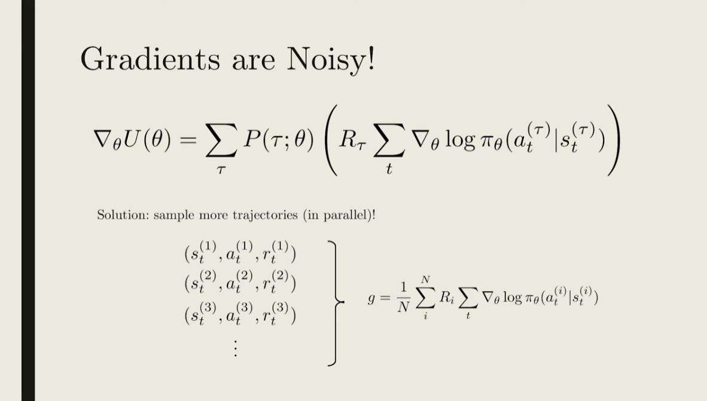
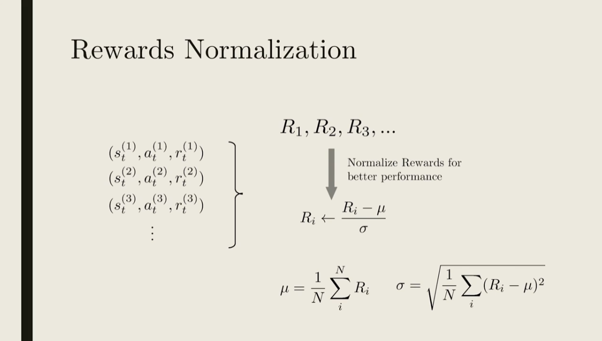
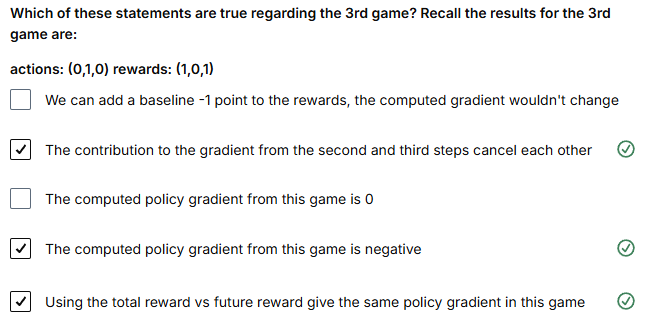
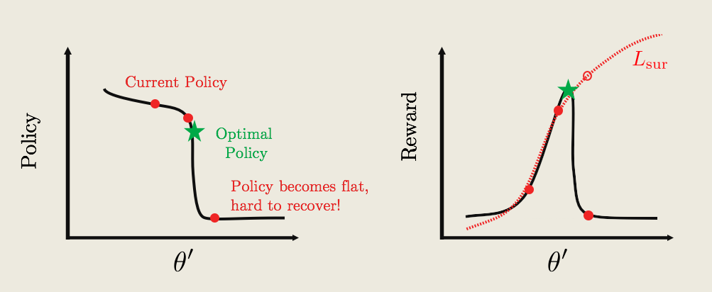
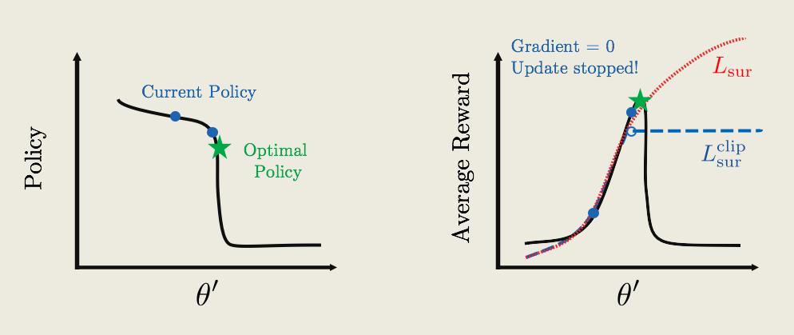
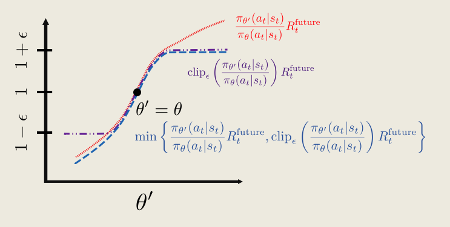

# Proximal Policy Optimization
In this lesson, you will learn about Proximal Policy Optimization (PPO), a cutting-edge policy gradient method.

## Preview

State-of-the-art RL algorithms contain many important tweaks in addition to simple value-based or policy-based methods. One of these key improvements is called Proximal Policy Optimization (PPO) -- also closely related to Trust Region Policy Optimization (TRPO). It has allowed faster and more stable learning. From developing agile robots, to creating expert level gaming AI, PPO has proven useful in a wide domain of applications, and has become part of the standard toolkits in complicated learning environments.

In this lesson, we will first review the most basic policy gradient algorithm -- REINFORCE, and discuss issues associated with the algorithm. We will get an in-depth understanding of why these problems arise, and find ways to fix them. The solutions will lead us to PPO. Our lesson will focus on learning the intuitions behind why and how PPO improves learning, and implement it to teach a computer to play Atari-Pong, using only the pixels as input (see video below). Let's dive in!

The idea of PPO was published by the team at OpenAI, and you can read their paper through this [PPO paper](https://arxiv.org/abs/1707.06347)

## Beyond REINFORCE

## Improving REINFORCE

Here, we briefly review the key ingredients of the **REINFORCE algorithm** and introduce its main limitations.

## REINFORCE Review

REINFORCE works as follows.

### 1. Initialize a Policy and Collect a Trajectory

First, initialize a random policy

$$ \pi_\theta(a \mid s), $$

where $\theta$ represents the parameters of the policy.

Using this policy, collect a trajectory consisting of states, actions, and rewards:

$$ s_1, a_1, r_1,\; s_2, a_2, r_2,\; s_3, a_3, r_3,\ldots $$

### 2. Compute the Return and Policy Gradient

Compute the total return of the trajectory:

$$ R = r_1 + r_2 + r_3 + \cdots $$

and use it to estimate the gradient of the expected return:

$$ \boxed{ g = R \sum_t \nabla_\theta \log \pi_\theta(a_t \mid s_t) } $$

The return $R$ determines whether the probabilities of the actions taken along the trajectory should be increased or decreased.

### 3. Update the Policy

Update the policy parameters using **gradient ascent** with learning rate $\alpha$:

$$ \boxed{ \theta \leftarrow \theta + \alpha g } $$

The process is then repeated with the updated policy.

---

## Main Problems of REINFORCE

Although REINFORCE provides a conceptually simple policy-gradient algorithm, it has three important limitations.

### 1. Inefficient Updates

The update process is very **inefficient**:

1. Run the current policy.
2. Collect a trajectory.
3. Compute a gradient estimate.
4. Perform an update.
5. Discard the trajectory.

The collected experience is therefore used only once before being thrown away.

### 2. High-Variance / Noisy Gradient Estimates

The gradient estimate

$$ g = R \sum_t \nabla_\theta \log \pi_\theta(a_t \mid s_t) $$

can be very **noisy**.

A single sampled trajectory may, simply by chance, perform much better or worse than what is typical for the current policy.

Thus,

$$ g \approx \nabla_\theta U(\theta) $$

may be a poor estimate when calculated from only a small number of trajectories.

This problem is generally referred to as **high variance** in the policy-gradient estimate.

### 3. Credit Assignment Problem

REINFORCE also has a **credit assignment** problem.

A trajectory may contain many different actions:

$$ a_1,a_2,\ldots,a_T, $$

some of which may have been good decisions while others may have been poor decisions.

With the basic formulation,

$$ g = R \sum_t \nabla_\theta \log \pi_\theta(a_t \mid s_t), $$

the same trajectory return $R$ is applied to all actions.

It therefore does not directly distinguish which individual actions were responsible for the final outcome.

For example, a trajectory might contain

$$ \underbrace{a_1}_{\text{good}}, \quad \underbrace{a_2}_{\text{good}}, \quad \underbrace{a_3}_{\text{bad}}, \quad \underbrace{a_4}_{\text{good}}, $$

but all four actions are reinforced according to the same overall return $R$.

---

## Summary of the Problems

| Problem | Consequence |
|---|---|
| **Inefficient updates** | Collected trajectories are used once and then discarded. |
| **Noisy gradients** | Individual trajectories may produce high-variance gradient estimates. |
| **Credit assignment** | The total trajectory return does not clearly identify which individual actions were responsible for success or failure. |

These shortcomings motivate several improvements to the basic REINFORCE algorithm.

The upcoming methods address these issues by improving **sample efficiency**, **reducing gradient variance**, and providing better **credit assignment**.

These ideas ultimately form important components of more advanced policy-gradient algorithms such as **Proximal Policy Optimization (PPO)**.

Here, we briefly review key ingredients of the **REINFORCE** algorithm.

REINFORCE works as follows:

First, we initialize a random policy $\pi_\theta(a;s)$, and using the policy we collect a trajectory, or a list of (state, actions, rewards) at each time step:

$$ s_1, a_1, r_1, s_2, a_2, r_2, \ldots $$

Second, we compute the total reward of the trajectory

$$ R = r_1 + r_2 + r_3 + \ldots $$

and compute an estimate of the gradient of the expected reward, $g$:

$$ g = R \sum_t \nabla_\theta \log \pi_\theta(a_t \mid s_t) $$

Third, we update our policy using gradient ascent with learning rate $\alpha$:

$$ \theta \leftarrow \theta + \alpha g $$

The process then repeats.

## What Are the Main Problems of REINFORCE?

There are three issues:

1. The update process is very **inefficient**! We run the policy once, update once, and then throw away the trajectory.
2. The gradient estimate $g$ is very **noisy**. By chance, the collected trajectory may not be representative of the policy.
3. There is no clear **credit assignment**. A trajectory may contain many good/bad actions, and whether these actions are reinforced depends only on the final total output.

In the following concepts, we will go over ways to improve the REINFORCE algorithm and resolve all three issues. All of the improvements will be utilized and implemented in the **PPO algorithm**.

## Noise Reduction
**Note:** In the subtitle around 2:09, "This batch-normalisation technique" is incorrectly written as "Dispatch normalisation technique".

<figure align="center">

</figure>

<figure align="center">

</figure>

The way we optimize the policy is by maximizing the average rewards $U(\theta)$. To do that, we use stochastic gradient ascent.

Mathematically, the gradient is given by an average over all possible trajectories:

$$ \nabla_\theta U(\theta) = \sum_\tau P(\tau;\theta) \left( R_\tau \sum_t \nabla_\theta \log \pi_\theta \left( a_t^{(\tau)} \mid s_t^{(\tau)} \right) \right) $$

There could easily be well over millions of trajectories for simple problems, and infinitely many for continuous problems.

For practical purposes, we simply take one trajectory to compute the gradient and update our policy. So, a lot of times, the result of a sampled trajectory comes down to chance and does not contain that much information about our policy.

How does learning happen then? The hope is that after training for a long time, the tiny signal accumulates.

The easiest option to reduce the noise in the gradient is to simply **sample more trajectories**. Using distributed computing, we can collect multiple trajectories in parallel, so that it will not take too much time.

We can then estimate the policy gradient by averaging across all the different trajectories:

$$ \begin{aligned} &s_t^{(1)}, a_t^{(1)}, r_t^{(1)} \\ &s_t^{(2)}, a_t^{(2)}, r_t^{(2)} \\ &s_t^{(3)}, a_t^{(3)}, r_t^{(3)} \\ &\vdots \end{aligned} \quad \Longrightarrow \quad g = \frac{1}{N} \sum_{i=1}^{N} R_i \sum_t \nabla_\theta \log \pi_\theta \left( a_t^{(i)} \mid s_t^{(i)} \right) $$

## Rewards Normalization

There is another bonus for running multiple trajectories: we can collect all the total rewards and get a sense of how they are distributed.

In many cases, the distribution of rewards shifts as learning happens. A reward of $1$ might be really good in the beginning, but really bad after 1000 training episodes.

Learning can be improved if we normalize the rewards, where $\mu$ is the mean and $\sigma$ is the standard deviation:

$$ R_i \leftarrow \frac{R_i - \mu}{\sigma}, $$

where

$$ \mu = \frac{1}{N} \sum_{i=1}^{N} R_i, $$

and

$$ \sigma = \sqrt{ \frac{1}{N} \sum_{i=1}^{N} (R_i-\mu)^2 }. $$

When all the $R_i$ are the same, $\sigma = 0$. In this case, we can set all normalized rewards to $0$ to avoid numerical problems.

This **batch-normalization technique** is also used in many other problems in AI (e.g., image classification), where normalizing the input can improve learning.

Intuitively, normalizing the rewards roughly corresponds to picking half the actions to encourage and half to discourage, while also making sure the steps for gradient ascent are not too large or too small.

### Credit Assignment
Going back to the gradient estimate, we can take a closer look at the total reward $R$, which is just the sum of the rewards at each step:

$$ R = r_1 + r_2 + \ldots + r_{t-1} + r_t + \ldots $$

The gradient estimate is:

$$ g = \sum_t \left( \ldots + r_{t-1} + r_t + \ldots \right) \nabla_\theta \log \pi_\theta(a_t \mid s_t) $$

Let's think about what happens at time step $t$. Even before an action is decided, the agent has already received all the rewards up until step $t-1$.

So, we can think of that part of the total reward as the **reward from the past**. The rest is denoted as the **future reward**:

$$ R = \underbrace{ r_1 + r_2 + \ldots + r_{t-1} }_{R_t^{\text{past}}} + \underbrace{ r_t + r_{t+1} + \ldots }_{R_t^{\text{future}}} $$

Because we have a Markov process, the action at time step $t$ can only affect the future reward, so the past reward shouldn't contribute to the policy gradient.

To properly assign credit to the action $a_t$, we should therefore ignore the past reward.

A better policy gradient would simply have the future reward as the coefficient:

$$ g = \sum_t R_t^{\text{future}} \nabla_\theta \log \pi_\theta(a_t \mid s_t) $$

## Notes on Gradient Modification

You might wonder: *Why is it okay to just change our gradient? Wouldn't that change our original goal of maximizing the expected reward?*

It turns out that, mathematically, ignoring past rewards might change the gradient for each specific trajectory, but it does not change the **averaged gradient**.

So even though the gradient is different during training, on average we are still maximizing the average reward.

In fact, the resulting gradient is less noisy, so training using future rewards should speed things up.

## Policy Gradient Quiz

## Policy Gradient Example

Suppose we are training an agent to play a computer game. There are only two possible actions:

- **0:** Do nothing
- **1:** Move

There are three time steps in each game, and the policy is completely determined by one parameter $\theta$, such that:

- The probability of **moving** is

  $$ P(a = 1) = \theta $$

- The probability of **doing nothing** is

  $$ P(a = 0) = 1 - \theta $$

Initially,

$$ \theta = 0.5 $$

Three games are played, with the following results:

| Game | Actions | Rewards |
|------|---------|---------|
| 1 | $(1,0,1)$ | $(1,0,1)$ |
| 2 | $(1,0,0)$ | $(0,0,1)$ |
| 3 | $(0,1,0)$ | $(1,0,1)$ |

Question 1:
What are the future rewards for the first game?
Recall the results for game 1 are: actions: (1,0,1) rewards: (1,0,1)

## Future Rewards for Game 1

For **Game 1**, the immediate rewards are:

$$ (r_1, r_2, r_3) = (1, 0, 1) $$

The quiz asks for the **future rewards**, meaning the cumulative reward from each timestep until the end of the game.

Assuming no discounting, i.e.

$$ \gamma = 1, $$

the future reward at timestep $t$ is

$$ G_t = \sum_{k=t}^{T} r_k. $$

### Timestep 3

$$ G_3 = r_3 = 1 $$

### Timestep 2

$$ G_2 = r_2 + r_3 = 0 + 1 = 1 $$

### Timestep 1

$$ G_1 = r_1 + r_2 + r_3 = 1 + 0 + 1 = 2 $$

Therefore, the future-reward vector is

$$ \boxed{(2,1,1)} $$

```python
rewards = [1, 0, 1]

future_rewards = []
G = 0

for r in reversed(rewards):
    G = r + G
    future_rewards.insert(0, G)

print(future_rewards)
```

```text
[2, 1, 1]
```

This backward accumulation is exactly the pattern you will commonly use when implementing REINFORCE / policy-gradient returns.

Question 2:

What is the policy gradient computed from the second game, using future rewards?

actions: (1,0,0) rewards: (0,0,1)

## Policy Gradient for Game 2

For **Game 2**, the results are:

- Actions: $(1,0,0)$
- Rewards: $(0,0,1)$
- Initial policy parameter: $\theta = 0.5$

First, compute the **future rewards**:

$$ G = (1,1,1) $$

because

$$ G_3 = 1, $$

$$ G_2 = 0 + 1 = 1, $$

and

$$ G_1 = 0 + 0 + 1 = 1. $$

The policy is defined as

$$ \pi(a=1) = \theta $$

and

$$ \pi(a=0) = 1-\theta. $$

For **REINFORCE**, the policy-gradient contribution is

$$ \nabla_\theta J = \sum_t G_t \nabla_\theta \log \pi(a_t). $$

At

$$ \theta = 0.5, $$

we calculate the gradients for the two possible actions.

### Action 1

For $a=1$:

$$ \frac{\partial}{\partial\theta}\log(\theta) = \frac{1}{\theta} = \frac{1}{0.5} = 2. $$

### Action 0

For $a=0$:

$$ \frac{\partial}{\partial\theta}\log(1-\theta) = -\frac{1}{1-\theta} = -\frac{1}{0.5} = -2. $$

Game 2 has the actions

$$ (1,0,0). $$

Since the future rewards are

$$ (1,1,1), $$

the three policy-gradient contributions are

$$ 1(2), \qquad 1(-2), \qquad 1(-2). $$

Therefore,

$$ \nabla_\theta J = 2 - 2 - 2 = \boxed{-2}. $$

**Correct answer: `-2`**

### Intuition

Game 2 contains:

- one action `1` $\rightarrow$ gradient contribution $+2$
- two actions `0` $\rightarrow$ gradient contribution $-2$ each

Because every action has the same future reward $G_t=1$, the total policy gradient is

$$ (+2) + (-2) + (-2) = -2. $$

Hence,

$$ \boxed{\nabla_\theta J=-2} $$

Question 3:
Which of these statements are true regarding the 3rd game? Recall the results for the 3rd game are:

actions: (0,1,0) rewards: (1,0,1)

<figure align="center">

</figure>

Good job! The first choice is wrong because adding a baseline only keep the average gradient the same, while each computed gradient could differ. The third choice is also wrong because the future reward is (2,1,1), and the computed gradient is -2/0.5 = -4. The last choice is correct because the total reward = 2, and the second and third time-step cancel each other anyway.

## Pong with REINFORCE
__(notebook workspace)__

### Additional Notes
- The performance for the REINFORCE version may be poor. You can try training with a smaller tmax=100 and more number of episodes=2000 to see concrete results.
- Try normalizing your future rewards over all the parallel agents, it can speed up training
- Simpler networks might perform better than more complicated ones! The original input contains 80x80x2=12800 numbers, you might want to ensure that this number steadily decreases at each layer of the neural net.
- Training performance may be significantly worse on local machines. I had worse performance training on my own windows desktop with a 4-core CPU and a GPU. This may be due to the slightly different ways the emulator is rendered. So please run the code on the workspace first before moving locally
- It may be beneficial to train multiple epochs, say first using a small tmax=200 with 500 episodes, and then train again with tmax = 400 with 500 episodes, and then finally with a even larger tmax.
- Remember to save your policy after training!
- For a challenge, try the 'Pong-v4' environment, this includes random frameskips and takes longer to train.

## Importance Sampling

### 1. Policy Update in REINFORCE

Let’s go back to the REINFORCE algorithm. We start with a policy, $\pi_\theta$, then using that policy, we generate a trajectory (or multiple ones to reduce noise) $(s_t,a_t,r_t)$. Afterward, we compute a policy gradient, $g$, and update:

$$ \theta' \leftarrow \theta + \alpha g. $$

At this point, the trajectories we’ve just generated are simply thrown away. If we want to update our policy again, we would need to generate new trajectories once more, using the updated policy.

You might ask, why is all this necessary? It’s because we need to compute the gradient for the current policy, and to do that the trajectories need to be representative of the current policy.

But this sounds a little wasteful. What if we could somehow recycle the old trajectories, by modifying them so that they are representative of the new policy? So that instead of just throwing them away, we recycle them!

Then we could just reuse the recycled trajectories to compute gradients, and to update our policy, again, and again. This would make updating the policy a lot more efficient. So, how exactly would that work?

### 2. Importance Sampling

This is where importance sampling comes in. Let’s look at the trajectories we generated using the policy $\pi_\theta$. It had a probability $P(\tau;\theta)$ to be sampled.

Now just by chance, the same trajectory can be sampled under the new policy, with a different probability $P(\tau;\theta')$.

Imagine we want to compute the average of some quantity, say $f(\tau)$. We could simply generate trajectories from the new policy, compute $f(\tau)$ and average them.

Mathematically, this is equivalent to adding up all the $f(\tau)$, weighted by a probability of sampling each trajectory under the new policy.

$$ \sum_\tau P(\tau;\theta')f(\tau) $$

Now we could modify this equation, by multiplying and dividing by the same number, $P(\tau;\theta)$, and rearrange the terms.

$$ \sum_\tau \underbrace{P(\tau;\theta)}_{\substack{\text{sampling under}\\\text{old policy }\pi_\theta}} \underbrace{\frac{P(\tau;\theta')}{P(\tau;\theta)}}_{\text{re-weighting factor}} f(\tau) $$

It doesn’t look we’ve done much. But written in this way, we can reinterpret the first part as the coefficient for sampling under the old policy, with an extra re-weighting factor, in addition to just averaging.

Intuitively, this tells us we can use old trajectories for computing averages for new policy, as long as we add this extra re-weighting factor, that takes into account how under or over-represented each trajectory is under the new policy compared to the old one.

The same tricks are used frequently across statistics, where the re-weighting factor is included to un-bias surveys and voting predictions.

### 3. The Re-Weighting Factor

Now let’s take a closer look at the re-weighting factor.

$$ \frac{P(\tau;\theta')}{P(\tau;\theta)} = \frac{\pi_{\theta'}(a_1\mid s_1)\,\pi_{\theta'}(a_2\mid s_2)\,\pi_{\theta'}(a_3\mid s_3)\,\cdots}{\pi_\theta(a_1\mid s_1)\,\pi_\theta(a_2\mid s_2)\,\pi_\theta(a_3\mid s_3)\,\cdots} $$

Because each trajectory contains many steps, the probability contains a chain of products of each policy at different time-step.

This formula is a bit complicated. But there is a bigger problem. When some of policy gets close to zero, the re-weighting factor can become close to zero, or worse, close to $1/0$, which diverges to infinity.

When this happens, the re-weighting trick becomes unreliable. So, in practice, we want to make sure the re-weighting factor is not too far from $1$ when we utilize importance sampling.

## PPO Part 1 - The Surrogate Function

### Re-weighting the Policy Gradient

Suppose we are trying to update our current policy, $\pi_{\theta'}$. To do that, we need to estimate a gradient, $g$. But we only have trajectories generated by an older policy $\pi_\theta$. How do we compute the gradient then?

Mathematically, we could utilize importance sampling. The answer is just what a normal policy gradient would be, times a re-weighting factor $P(\tau;\theta')/P(\tau;\theta)$:

$$ g = \frac{P(\tau;\theta')}{P(\tau;\theta)} \sum_t \frac{\nabla_{\theta'}\pi_{\theta'}(a_t\mid s_t)}{\pi_{\theta'}(a_t\mid s_t)}R_t^{\mathrm{future}} $$

We can rearrange these equations, and the re-weighting factor is just the product of all the policy across each step. I’ve picked out the terms at time-step $t$ here. We can cancel some terms, but we're still left with a product of the policies at different times, denoted by "......".

$$ g = \sum_t \frac{\ldots\,\pi_{\theta'}(a_t\mid s_t)\,\ldots}{\ldots\,\pi_\theta(a_t\mid s_t)\,\ldots}\frac{\nabla_{\theta'}\pi_{\theta'}(a_t\mid s_t)}{\pi_{\theta'}(a_t\mid s_t)}R_t^{\mathrm{future}} $$

Can we simplify this expression further? This is where proximal policy comes in. If the old and current policy is close enough to each other, all the factors inside the "......" would be pretty close to $1$, and then we can ignore them.

Then the equation simplifies:

$$ g = \sum_t \frac{\nabla_{\theta'}\pi_{\theta'}(a_t\mid s_t)}{\pi_\theta(a_t\mid s_t)}R_t^{\mathrm{future}} $$

It looks very similar to the old policy gradient. In fact, if the current policy and the old policy is the same, we would have exactly the vanilla policy gradient. But remember, this expression is different because we are comparing two *different* policies.

### The Surrogate Function

Now that we have the approximate form of the gradient, we can think of it as the gradient of a new object, called the surrogate function:

$$ g = \nabla_{\theta'}L_{\mathrm{sur}}(\theta',\theta) $$

$$ L_{\mathrm{sur}}(\theta',\theta) = \sum_t \frac{\pi_{\theta'}(a_t\mid s_t)}{\pi_\theta(a_t\mid s_t)}R_t^{\mathrm{future}} $$

So using this new gradient, we can perform gradient ascent to update our policy, which can be thought as directly maximize the surrogate function.

But there is still one important issue we haven’t addressed yet. If we keep reusing old trajectories and updating our policy, at some point the new policy might become different enough from the old one, so that all the approximations we made could become invalid.

We need to find a way make sure this doesn’t happen. Let’s see how in part 2.

## PPO Part 2 - Clipping Policy Updates

### The Policy/Reward Cliff

What is the problem with updating our policy and ignoring the fact that the approximations are not valid anymore? One problem is it could lead to a really bad policy that is very hard to recover from. Let's see how:

<figure align="center">

</figure>

**Policy optimization challenges and reward landscapes.**

Say we have some policy parameterized by $\pi_{\theta'}$ (shown on the left plot in black), and with an average reward function (shown on the right plot in black).

The current policy is labelled by the red text, and the goal is to update the current policy to the optimal one (green star). To update the policy we can compute a surrogate function $L_{\mathrm{sur}}$ (dotted-red curve on right plot). So $L_{\mathrm{sur}}$ approximates the reward pretty well around the current policy. But far away from the current policy, it diverges from the actual reward.

If we continually update the policy by performing gradient ascent, we might get something like the red-dots. The big problem is that at some point we hit a cliff, where the policy changes by a large amount. From the perspective of the surrogate function, the average reward is really great. But the actually average reward is really bad!

What’s worse, the policy is now stuck in a deep and flat bottom, so that future updates won’t be able to bring the policy back up! We are now stuck with a really bad policy.

How do we fix this? Wouldn’t it be great if we can somehow stop the gradient ascent so that our policy doesn’t fall off the cliff?

### Clipped Surrogate Function

<figure align="center">

</figure>

**Policy optimization and average reward dynamics in reinforcement learning.**

Here’s an idea: what if we just flatten the surrogate function (blue curve)? What would policy update look like then?

So starting with the current policy (blue dot), we apply gradient ascent. The updates remain the same, until we hit the flat plateau. Now because the reward function is flat, the gradient is zero, and the policy update will stop!

Now, keep in mind that we are only showing a 2D figure with one $\theta'$ direction. In most cases, there are thousands of parameters in a policy, and there may be hundreds/thousands of high-dimensional cliffs in many different directions. We need to apply this clipping mathematically so that it will automatically take care of all the cliffs.

### Clipped Surrogate Function

Here's the formula that will automatically flatten our surrogate function to avoid all the cliffs:

$$ L_{\mathrm{sur}}^{\mathrm{clip}}(\theta',\theta) = \sum_t \min\left\{\frac{\pi_{\theta'}(a_t\mid s_t)}{\pi_\theta(a_t\mid s_t)}R_t^{\mathrm{future}},\operatorname{clip}_{\epsilon}\left(\frac{\pi_{\theta'}(a_t\mid s_t)}{\pi_\theta(a_t\mid s_t)}\right)R_t^{\mathrm{future}}\right\} $$

Now let’s dissect the formula by looking at one specific term in the sum, and set the future reward to $1$ to make things easier.

<figure align="center">

</figure>

**Policy gradient optimization and clipped surrogate objective in reinforcement learning.**

We start with the original surrogate function (red), which involves the ratio

$$ \frac{\pi_{\theta'}(a_t\mid s_t)}{\pi_\theta(a_t\mid s_t)} $$

The black dot shows the location where the current policy is the same as the old policy:

$$ \theta'=\theta $$

We want to make sure the two policy is similar, or that the ratio is close to $1$. So we choose a small $\epsilon$ (typically $0.1$ or $0.2$), and apply the $\operatorname{clip}$ function to force the ratio to be within the interval

$$ [1-\epsilon,1+\epsilon] $$

(shown in purple).

Now the ratio is clipped in two places. But we only want to clip the top part and not the bottom part. To do that, we compare this clipped ratio to the original one and take the minimum (shown in blue).

This then ensures the clipped surrogate function is always less than the original surrogate function:

$$ L_{\mathrm{sur}}^{\mathrm{clip}} \leq L_{\mathrm{sur}} $$

so the clipped surrogate function gives a more conservative "reward".

*The blue and purple lines are shifted slightly for easier viewing.*

## PPO Algorithm Summary

So that’s it! We can finally summarize the PPO algorithm:

1. First, collect some trajectories based on some policy $\pi_\theta$, and initialize theta prime:

   $$ \theta' = \theta $$

2. Next, compute the gradient of the clipped surrogate function using the trajectories.

3. Update $\theta'$ using gradient ascent:

   $$ \theta' \leftarrow \theta' + \alpha \nabla_{\theta'} L_{\mathrm{sur}}^{\mathrm{clip}}(\theta',\theta) $$

4. Then we repeat steps 2–3 without generating new trajectories. Typically, steps 2–3 are only repeated a few times.

5. Set

   $$ \theta = \theta' $$

   go back to step 1, and repeat.

The details of PPO were originally published by the team at OpenAI, and you can read their paper through this [link](https://arxiv.org/abs/1707.06347).

## Pong with PPO

### Additional Notes

- Try normalizing your future rewards over all the parallel agents, it can speed up training.

- Simpler networks might perform better than more complicated ones! The original input contains $80 \times 80 \times 2 = 12800$ numbers, you might want to ensure that this number steadily decreases at each layer of the neural net.

- Training performance may be significantly *worse* on local machines. I had worse performance training on my own Windows desktop with a 4-core CPU and a GPU. This may be due to the slightly different ways the emulator is rendered. So please run the code on the workspace first before moving locally.

- It may be beneficial to train multiple epochs, say first using a small $t_{\max}=200$ with 500 episodes, and then train again with $t_{\max}=400$ with 500 episodes, and then finally with an even larger $t_{\max}$.

- Remember to save your policy after training!

- For a challenge, try the `Pong-v4` environment, this includes random frameskips and takes longer to train.

__(notebook workspace)__