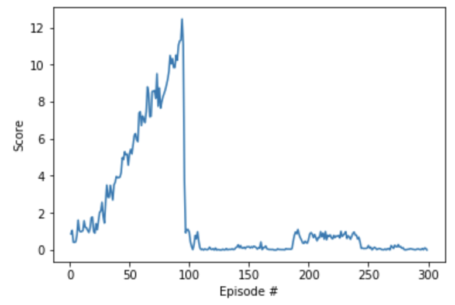
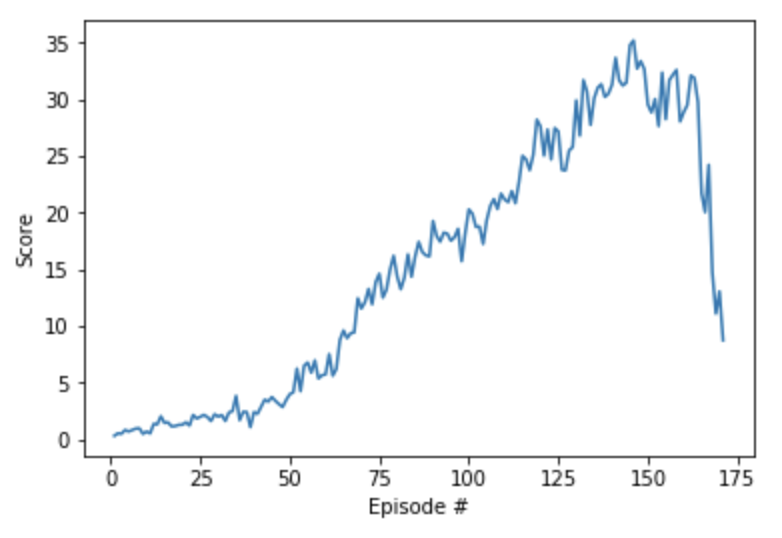
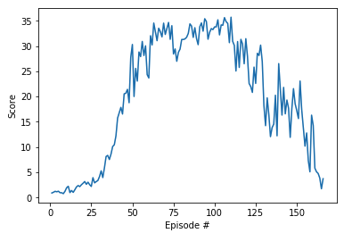
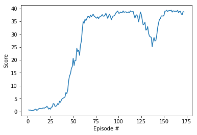

# Continuous Control

## Unity ML-Agents

Unity Machine Learning Agents (ML-Agents) is an open-source Unity plugin that enables games and simulations to serve as environments for training intelligent agents.

For game developers, these trained agents can be used for multiple purposes, including controlling NPC behavior (in a variety of settings such as multi-agent and adversarial), automated testing of game builds and evaluating different game design decisions pre-release.

In this course, you will use Unity's rich environments to design, train, and evaluate your own deep reinforcement learning algorithms. You can read more about ML-Agents by perusing the (GitHub repository)[https://github.com/Unity-Technologies/ml-agents].

Note: The Unity ML-Agent team frequently releases updated versions of their environment. We are using the v0.4 interface. To avoid any confusion, please use the workspace we provide here or work with v0.4 locally.

## The Environment - Introduction

(Reacher)[https://github.com/Unity-Technologies/ml-agents/blob/master/docs/Learning-Environment-Examples.md#reacher] Environment is a continuous control environment where the goal is to move a double-jointed arm to target locations. The agent receives a reward for each step that the hand of the arm is in the goal location. The agent must learn how to control the arm to reach as many goals as possible.

## Benchmark Implementations

### An Amended DDPG Agent

For this project, you can use any algorithm of your choosing to solve the task. You are strongly encouraged to do your own research and devise your own approach toward solving this problem.

In case you get stuck, here are the details of one approach that worked well for us.

In this part of the Nanodegree program, you learned about many potential ways to solve this project. We instead decided to solve the project by making some amendments to the **Deep Deterministic Policy Gradients (DDPG)** algorithm.

#### Attempt 1

The first thing we did was amend the DDPG code to work for multiple agents, in order to solve **version 2** of the environment.

The DDPG code in the DRLND GitHub repository utilizes only a single agent. With each step:

1. The agent adds its experience to the replay buffer.
2. The local actor and critic networks are updated using a sample from the replay buffer.

To make the code work with **20 agents**, we modified the code so that after each step:

1. Each agent adds its experience to a replay buffer that is shared by all agents.
2. The local actor and critic networks are updated **20 times in a row**, once for each agent, using 20 different samples from the replay buffer.

In hindsight, this wasn't a great plan, but it was a start!

The resulting scores are shown below.

<figure align="center">
    
</figure>

You'll notice that we made some rapid improvement pretty early in training because of the extremely large number of updates. Unfortunately, also due to the large number of updates, the agent was incredibly unstable.

Around **episode 100**, performance crashed and did not recover.

Therefore, we focused on determining ways to stabilize this first attempt.

#### Attempt 2

For this second attempt, we reduced the number of agents from **20 to 1** by switching to **version 1** of the environment.

We wanted to know how much stability we could expect from a single agent. The idea was that the code would likely train more reliably if we didn't make so many updates.

And it did train much better.

<figure align="center">
    
</figure>

At one point, we even hit the target score of **30**. However, this score wasn't maintained for very long, and we saw strong indications that the algorithm was going to crash again.

This showed us that we needed to spend more time figuring out how to stabilize the algorithm if we wanted to have a chance of training all **20 agents simultaneously**.

#### Attempt 3

This time, we switched back to **version 2** of the environment and began with the code from **Attempt 1** as a starting point.

The only change we made was to use **gradient clipping** when training the critic network.

The corresponding snippet of code was as follows:

    self.critic_optimizer.zero_grad()
    critic_loss.backward()
    torch.nn.utils.clip_grad_norm(self.critic_local.parameters(), 1)
    self.critic_optimizer.step()

The corresponding scores are plotted below.

<figure align="center">
    
</figure>

This is when we really started to feel hopeful.

We still didn't maintain an average score of **30 over 100 episodes**, but we maintained the score for longer than before. The agent also didn't crash as suddenly as in the previous attempts.

#### Attempt 4

At this point, we decided to get less aggressive with the number of updates per timestep.

Instead of updating the actor and critic networks **20 times at every timestep**, we amended the code to update the networks **10 times after every 20 timesteps**.

The corresponding scores are plotted below.

<figure align="center">
    
</figure>

This was enough to solve the environment!

In hindsight, we probably should have realized this fix much earlier, but this long path to the solution was definitely a useful way to build intuition. :)

### Note

If you are interested in implementing a method that is more stable for this project, consider exploring [this paper](https://arxiv.org/abs/1604.06778).

As discussed in the paper, **Trust Region Policy Optimization (TRPO)** and **Truncated Natural Policy Gradient (TNPG)** should achieve better performance.
(TRPO A3C Asynchonous Medium Post)[https://awjuliani.medium.com/simple-reinforcement-learning-with-tensorflow-part-8-asynchronous-actor-critic-agents-a3c-c88f72a5e9f2]
(Trust Region Policy Optimization (TRPO) and Proximal Policy Optimization (PPO))[https://medium.com/@sanketgujar95/trust-region-policy-optimization-trpo-and-proximal-policy-optimization-ppo-e6e7075f39ed]

You may also want to write your own implementation of **Proximal Policy Optimization (PPO)**, which has also [demonstrated good performance](https://openai.com/index/openai-baselines-ppo/) on continuous-control tasks.

Another option is to explore the [Distributed Distributional Deterministic Policy Gradients (D4PG)](https://openreview.net/forum?id=SyZipzbCb) algorithm as another method for adapting DDPG to continuous control.

(BALANCING CONSTRAINTS AND REWARDS WITH
META-GRADIENT D4PG - paper)[https://arxiv.org/pdf/2010.06324]

