# Actor-Critic Methods
In this lesson, you will learn how to combine value-based and policy-based methods, bringing together the best of both worlds, to solve challenging reinforcement learning problems.

## Introduction

- I partnered with Udacity and Manning to give all students of this Nanodegree the opportunity to obtain a copy of my book at a 40% discount. The more perspectives you get on deep reinforcement learning, the better for you. If you'd like to give it a try, go get chapter 01 for free [here](http://bit.ly/gdrl_u). Make sure to use the discount code `gdrludacity40` at checkout for 40% off. (Grokking)

- I'm very proud to work for Lockheed Martin. Working for a company that does work that matters with a huge impact on the lives of many people is very rewarding (no pun intended). If you are interested in joining us, check out this [link](http://bit.ly/lmco_u). We are always looking for talented individuals with experience in AI (and deep reinforcement learning).

- Last, but not least. I'm an Instructional Associate at Georgia Tech for the Reinforcement Learning and Decision Making graduate course available on the OMSCS program that Udacity helped launch. If you'd like more information regarding this program, take a look [here](http://bit.ly/omscs_u).

- Georgia Institute of Technology: 
    - Reinforcement Learning decision-making Course
    - co-taught by Professor Charles Isbell and Professor Michael Littman

- RL Community Contributors:
    - Professor Rich Sutton, Professor Leslie Caubain

## Motivation

<figure align="center">
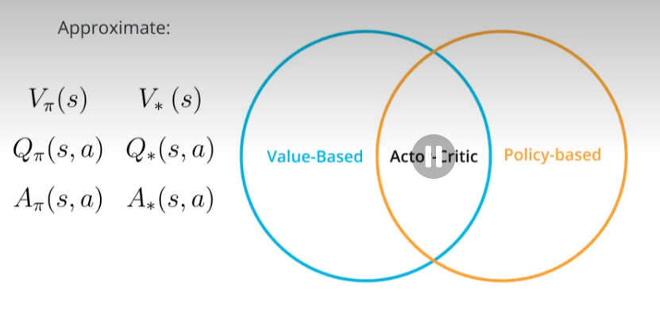
</figure>

## Bias and Variance

<figure align="center">
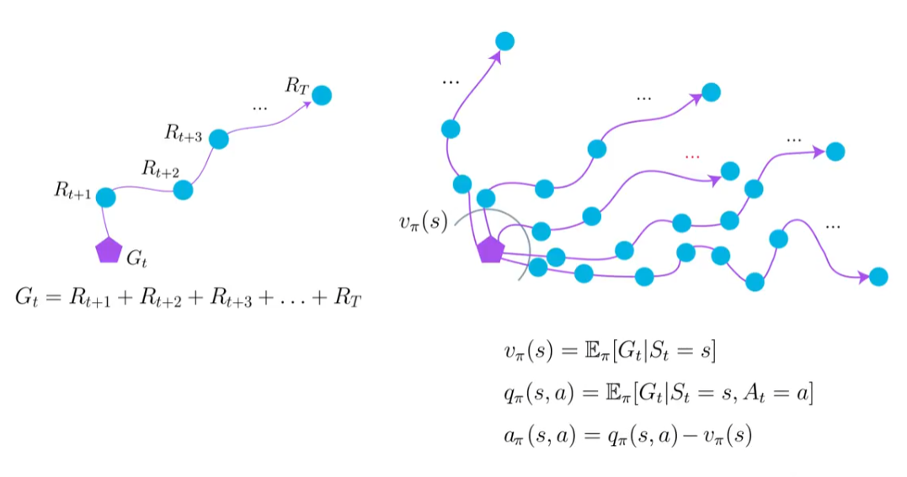
</figure>

## Estimating Expected Returns

<figure align="center">
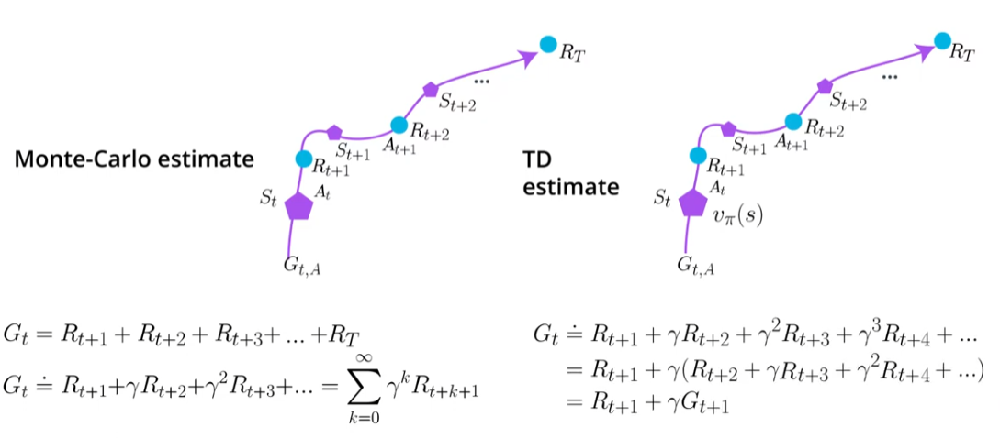
</figure>

<figure align="center">
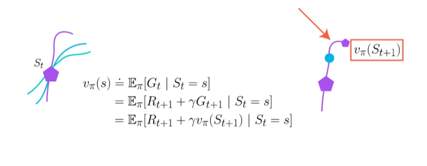
</figure>

__Monte-Carlo trajectories -> high variance; unbiased__
    -> considering complete sequence of estimates towards terminal state 
    -> estimates accros states can vary greatly accros episodes
    -> largely unbiased compared to temporal-differences, because only true obtained rewards are used for computing estimates
    -> estimates will improve when giving lots of data
__temporal-differences -> low variance; biased__
    -> compounds one single time step of randomness (instead of full sequence rollout)
    -> adds bias to calculation due to boostrapping estimates for the next state (not true values, estimating by using estimates)
    -> faster learning but struggles when converging

## Baselines and Critics

The argument you often hear as to why to call a neural network trained with Monte-Carlo estimates a "Critic" is because function approximators, such as a neural network, are biased as a byproduct that they are not perfect. That's a fair point, though, I prefer the distinction based on whether we pick a Monte-Carlo or a TD estimate to train our function approximator. Now, definitely we should not be calling Actor-Critic methods every method that uses 2 neural networks. You'll be surprised!

The important takeaway for you, though, is that there are inconsistencies out there. You often see methods named "Actor-Critic" when they are not. I just want to bring the issue to your attention.

## Basic Actor-Critic Agent

<figure align="center">
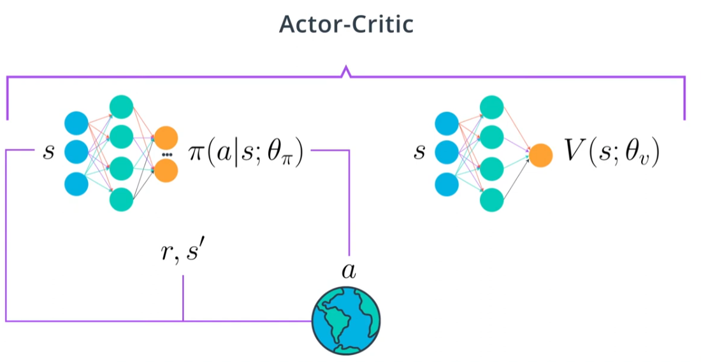
</figure>

<figure align="center">
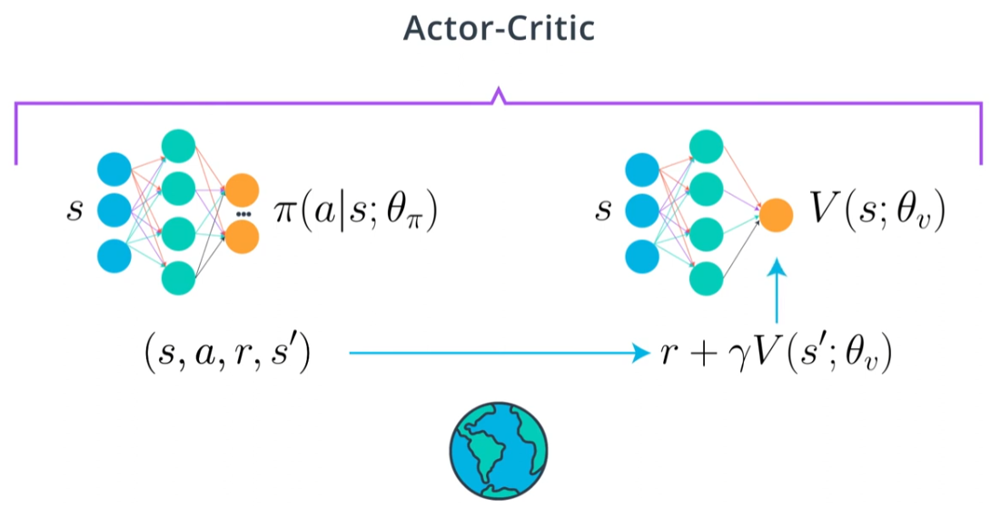
</figure>

<figure align="center">
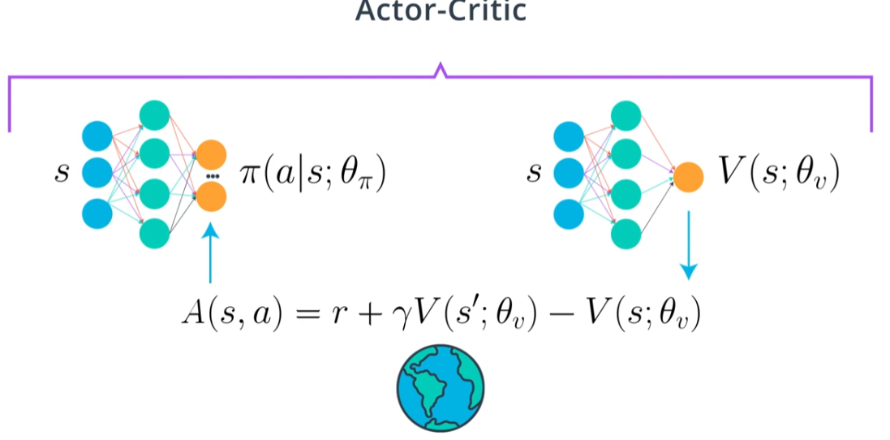
</figure>

## A3C: Asynchronous Advantage Actor-Critic, N-step/ Parallel Training/ Off- vs. On-policy

<figure align="center">
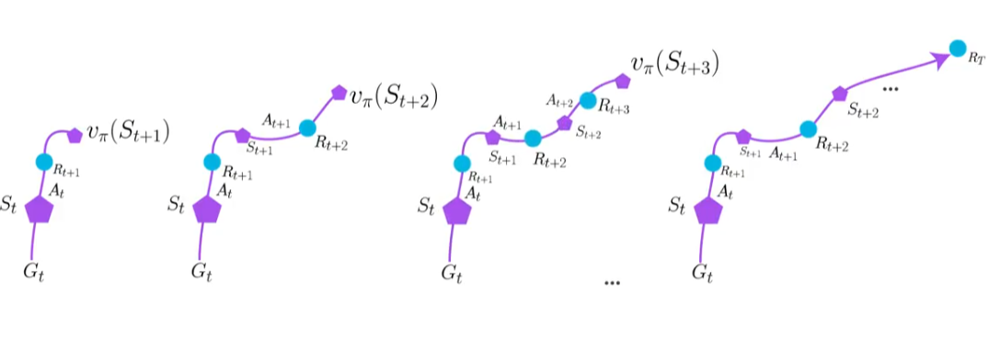
</figure>

-> A3C does not use replay-buffer (as in DQN). The main reason we needed a replay buffer was so that we could decorrelate experienced topple. Interestingly, A3C replaces the replay buffer with parallel training. By creating multiple instances of the environment and agent and running them all at the same time, your agent will receive mini batches of the correlated experiences just as we need. Samples will be decorrelated because agents will likely be experiencing different states at any given time.

<figure align="center">
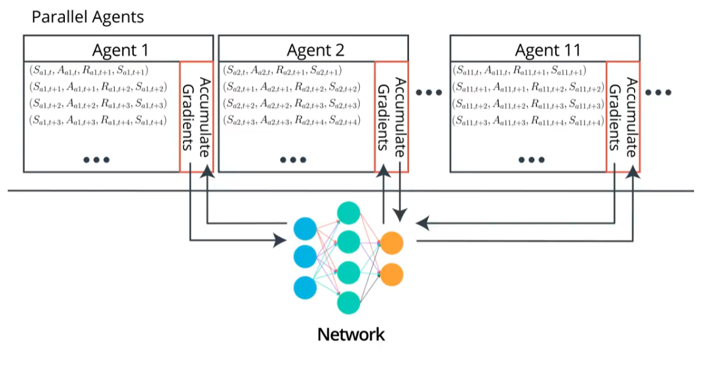
</figure>

On-policy learning is when the policy use for interacting with the environment is also the policy being learned. Off-policy learning is when the policy used for interacting with the environment is different than the policy being learned. Sarsa is a good example of an on-policy learning agent. A sarsa agent uses the same policy to interact with the environment as the policy it is learning. On the other hand, Q-learning is a good example of a off-policy learning agent. A Q-learning agent learns about the optimal policy, though the policy that generates behavior is an exploratory policy, often epsilon greedy. Looking at the update equations for these two methods, helps us understand them better. As you can see in Sarsa the action used for calculating the TD target and the TD error is the action the agent will take in the following time step A prime. In Q-learning however, the action used for calculating the target is the action with the highest value. But this action is not guaranteed to be used by the agent for interaction with the environment in the following time step. In other words, this is not necessarily A prime. The Q-learning agent may choose an exploratory action in the next step. In Sarsa that action exploratory or not is already been chosen. Q-learning learns the deterministic optimal policy even if its behaviour policy is totally random, Sarsa learns the best exploratory policy, that is the best policy that still explores. DQN is also an off-policy learning method, your agent behaves with some exploratory policy say epsilon greedy where they learns about the optimal policy. When using off-policy learning, agents are able to learn from many different sources including experiences generated by all versions of the agent itself thus the replay buffer. However, off-policy learning is known to be unstable and often diverge with deep neural networks. A3C on the other hand is a non-policy learning method. With on-policy learning, you only use the data generated by the policy currently being learned about, and anytime you improve the policy, you toss out old data and go out collect some more. On-policy learning is a bit inefficient in the use of experiences, but it often has more stable and consistent convergence properties. A simple analogy of on and off-policy goes this way. __On-policy is learning from your own hands-on experience for example, the projects in this nano degree. As you can imagine that is a pretty good way of learning, but it is somewhat data inefficient, you can only do so many projects before you run out of time. Off-policy on the other hand is learning from someone else's experience and as such it is more sample efficient because well, you can learn from many different sources.__ However, these way of learning is more prone to misunderstandings, I might not be able to explain things in a way that you understand well. The nano degree analogy in the off-policy case is learning from watching the lessons for example. You learn much faster this way but again, perhaps not as good and deep as you would from your own hands-on experience. Usually a good balance between these two ways of learning allows for the best-performing deep reinforcement learning agents and perhaps the best-performing humans too, who knew? Now, if you're interested in this topic and you want to learn about an agent that combines on and off-policy learning, I recommend you read the paper by Goodall title Q-Prop Sample Efficient Policy Gradient with an off-policy critic.

<figure align="center">
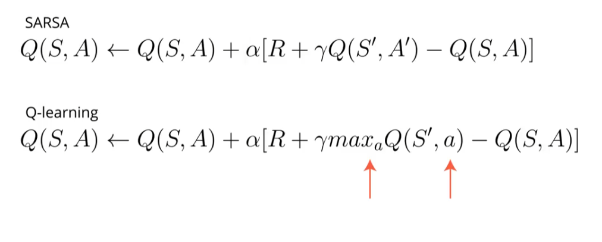
</figure>

Link to the Q-Prop paper: https://arxiv.org/abs/1611.02247

## A2C: Advantage Actor-Critic

<figure align="center">
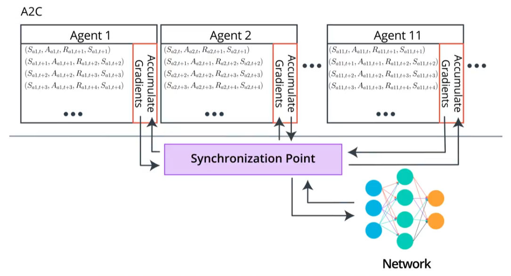
</figure>

## GAE: Generalized Advantage Estimation

