# Actor-Critic Methods
In this lesson, you will learn how to combine value-based and policy-based methods, bringing together the best of both worlds, to solve challenging reinforcement learning problems.

## Introduction

- I partnered with Udacity and Manning to give all students of this Nanodegree the opportunity to obtain a copy of my book at a 40% discount. The more perspectives you get on deep reinforcement learning, the better for you. If you'd like to give it a try, go get chapter 01 for free [here](http://bit.ly/gdrl_u). Make sure to use the discount code `gdrludacity40` at checkout for 40% off. (Grokking)

- I'm very proud to work for Lockheed Martin. Working for a company that does work that matters with a huge impact on the lives of many people is very rewarding (no pun intended). If you are interested in joining us, check out this [link](http://bit.ly/lmco_u). We are always looking for talented individuals with experience in AI (and deep reinforcement learning).

- Last, but not least. I'm an Instructional Associate at Georgia Tech for the Reinforcement Learning and Decision Making graduate course available on the OMSCS program that Udacity helped launch. If you'd like more information regarding this program, take a look [here](http://bit.ly/omscs_u).

- Georgia Institute of Technology: 
    - Reinforcement Learning decision-making Course
    - co-taught by Professor Charles Isbell and Professor Michael Littman

- RL Community Contributors:
    - Professor Rich Sutton, Professor Leslie Caubain

## Motivation

<figure align="center">
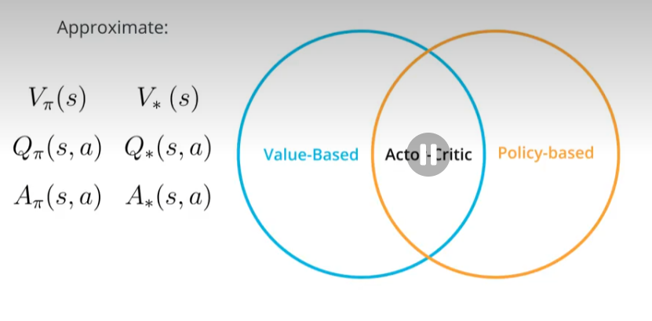
</figure>

## Bias and Variance

<figure align="center">
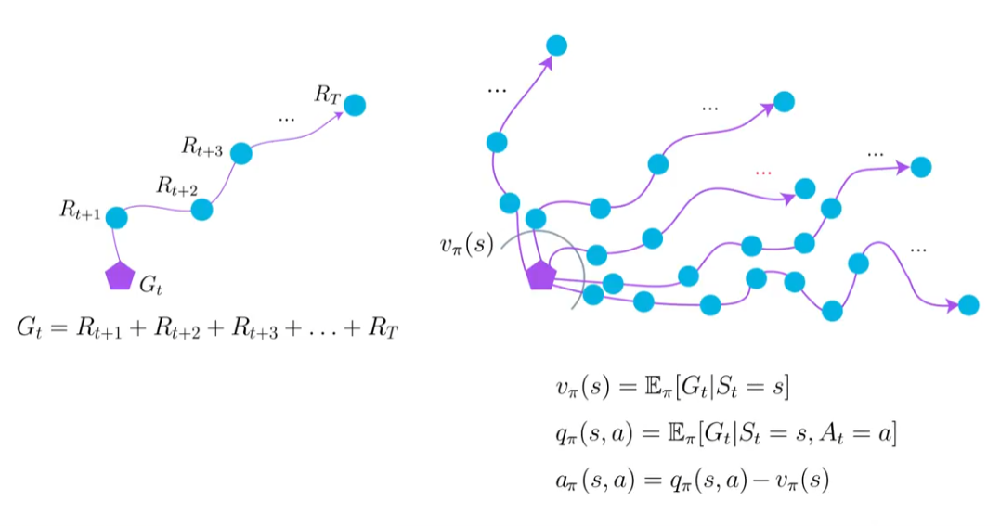
</figure>

## Estimating Expected Returns

<figure align="center">
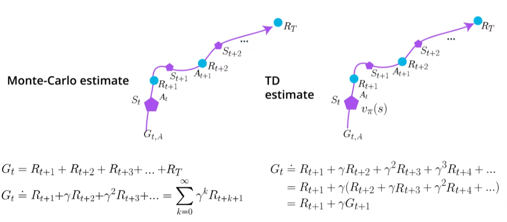
</figure>

<figure align="center">
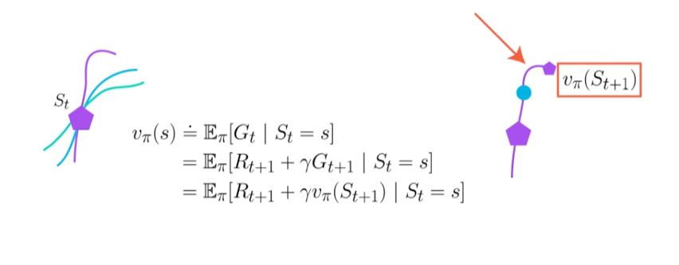
</figure>

__Monte-Carlo trajectories -> high variance; unbiased__
    -> considering complete sequence of estimates towards terminal state 
    -> estimates accros states can vary greatly accros episodes
    -> largely unbiased compared to temporal-differences, because only true obtained rewards are used for computing estimates
    -> estimates will improve when giving lots of data
__temporal-differences -> low variance; biased__
    -> compounds one single time step of randomness (instead of full sequence rollout)
    -> adds bias to calculation due to boostrapping estimates for the next state (not true values, estimating by using estimates)
    -> faster learning but struggles when converging

## Baselines and Critics

The argument you often hear as to why to call a neural network trained with Monte-Carlo estimates a "Critic" is because function approximators, such as a neural network, are biased as a byproduct that they are not perfect. That's a fair point, though, I prefer the distinction based on whether we pick a Monte-Carlo or a TD estimate to train our function approximator. Now, definitely we should not be calling Actor-Critic methods every method that uses 2 neural networks. You'll be surprised!

The important takeaway for you, though, is that there are inconsistencies out there. You often see methods named "Actor-Critic" when they are not. I just want to bring the issue to your attention.

## Basic Actor-Critic Agent

<figure align="center">
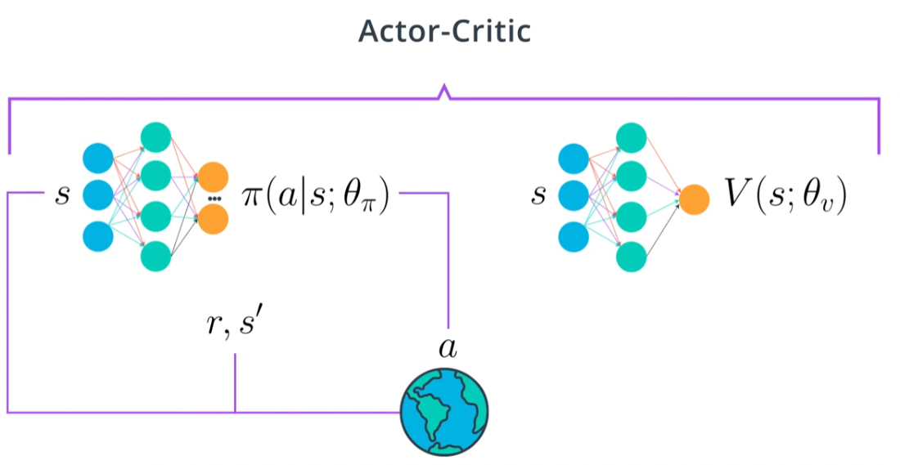
</figure>

<figure align="center">
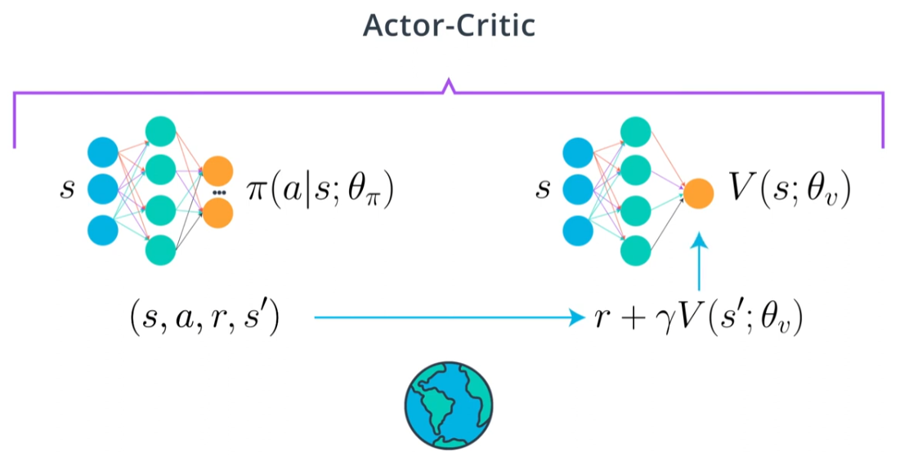
</figure>

<figure align="center">
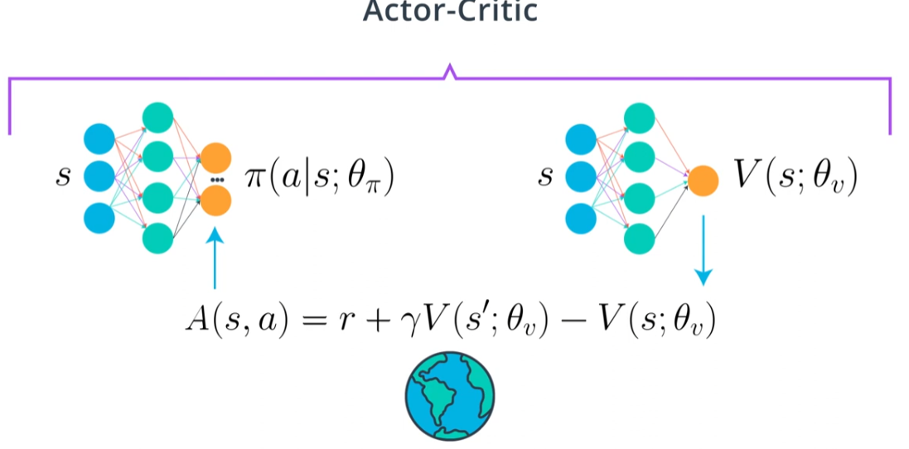
</figure>

## A3C: Asynchronous Advantage Actor-Critic, N-step/ Parallel Training/ Off- vs. On-policy

<figure align="center">
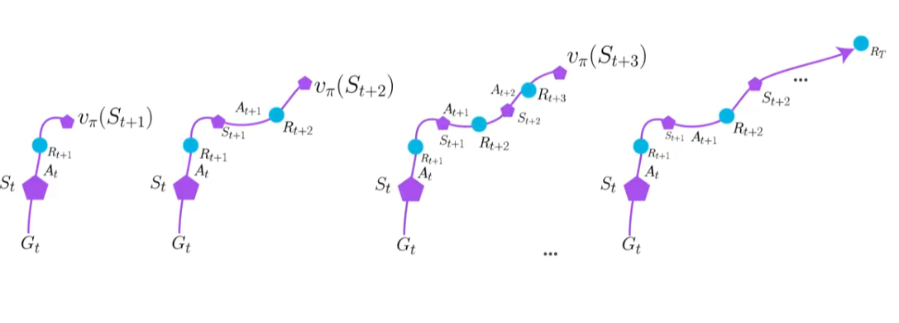
</figure>

-> A3C does not use replay-buffer (as in DQN). The main reason we needed a replay buffer was so that we could decorrelate experienced topple. Interestingly, A3C replaces the replay buffer with parallel training. By creating multiple instances of the environment and agent and running them all at the same time, your agent will receive mini batches of the correlated experiences just as we need. Samples will be decorrelated because agents will likely be experiencing different states at any given time.

<figure align="center">
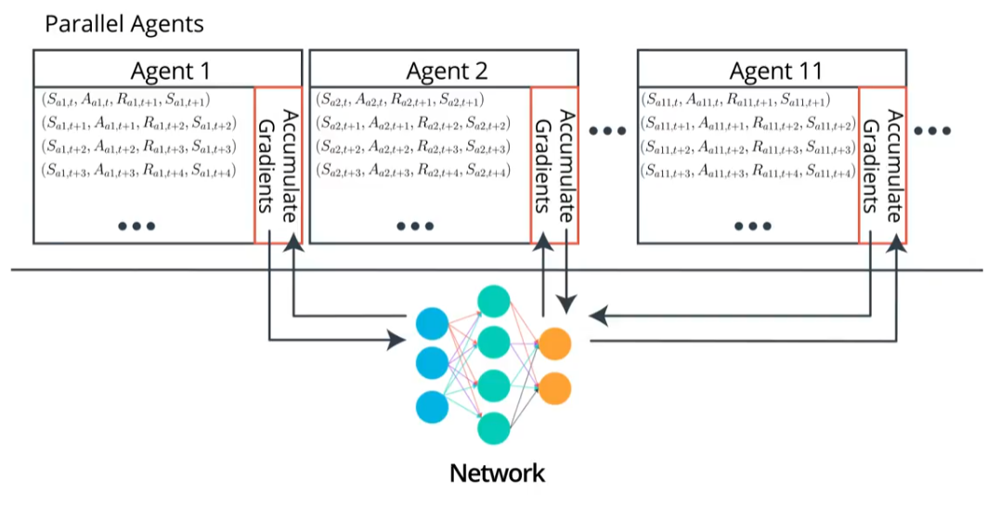
</figure>

On-policy learning is when the policy use for interacting with the environment is also the policy being learned. Off-policy learning is when the policy used for interacting with the environment is different than the policy being learned. Sarsa is a good example of an on-policy learning agent. A sarsa agent uses the same policy to interact with the environment as the policy it is learning. On the other hand, Q-learning is a good example of a off-policy learning agent. A Q-learning agent learns about the optimal policy, though the policy that generates behavior is an exploratory policy, often epsilon greedy. Looking at the update equations for these two methods, helps us understand them better. As you can see in Sarsa the action used for calculating the TD target and the TD error is the action the agent will take in the following time step A prime. In Q-learning however, the action used for calculating the target is the action with the highest value. But this action is not guaranteed to be used by the agent for interaction with the environment in the following time step. In other words, this is not necessarily A prime. The Q-learning agent may choose an exploratory action in the next step. In Sarsa that action exploratory or not is already been chosen. Q-learning learns the deterministic optimal policy even if its behaviour policy is totally random, Sarsa learns the best exploratory policy, that is the best policy that still explores. DQN is also an off-policy learning method, your agent behaves with some exploratory policy say epsilon greedy where they learns about the optimal policy. When using off-policy learning, agents are able to learn from many different sources including experiences generated by all versions of the agent itself thus the replay buffer. However, off-policy learning is known to be unstable and often diverge with deep neural networks. A3C on the other hand is a non-policy learning method. With on-policy learning, you only use the data generated by the policy currently being learned about, and anytime you improve the policy, you toss out old data and go out collect some more. On-policy learning is a bit inefficient in the use of experiences, but it often has more stable and consistent convergence properties. A simple analogy of on and off-policy goes this way. __On-policy is learning from your own hands-on experience for example, the projects in this nano degree. As you can imagine that is a pretty good way of learning, but it is somewhat data inefficient, you can only do so many projects before you run out of time. Off-policy on the other hand is learning from someone else's experience and as such it is more sample efficient because well, you can learn from many different sources.__ However, these way of learning is more prone to misunderstandings, I might not be able to explain things in a way that you understand well. The nano degree analogy in the off-policy case is learning from watching the lessons for example. You learn much faster this way but again, perhaps not as good and deep as you would from your own hands-on experience. Usually a good balance between these two ways of learning allows for the best-performing deep reinforcement learning agents and perhaps the best-performing humans too, who knew? Now, if you're interested in this topic and you want to learn about an agent that combines on and off-policy learning, I recommend you read the paper by Goodall title Q-Prop Sample Efficient Policy Gradient with an off-policy critic.

<figure align="center">
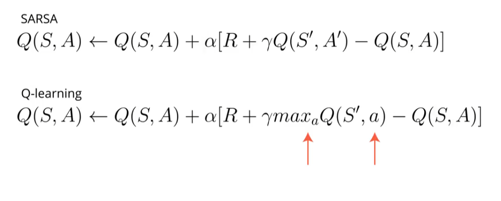
</figure>

Link to the Q-Prop paper: https://arxiv.org/abs/1611.02247

## A2C: Advantage Actor-Critic

A2C Implementation (Shangtong Zhang github)[https://github.com/ShangtongZhang/DeepRL]

<figure align="center">
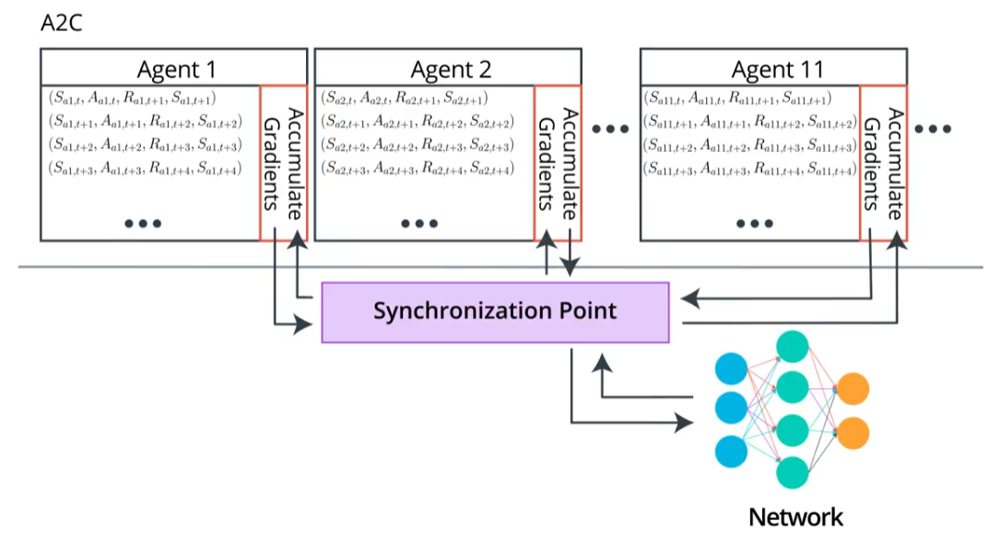
</figure>

| The parallel actors are not independent agents competing to discover a good solution. They are parallel data generators training essentially the same policy.

The algorithmic advantage (of A3C/A2C) is not "let's launch 16 agents and hope one gets lucky." The advantage is primarily better, less-correlated gradient estimates combined with bootstrapped Actor-Critic learning.


## GAE: Generalized Advantage Estimation


## DDPG: Deep Deterministic Policy Gradient, Continuous Actions


## DDPG: Deep Deterministic Policy Gradient, Soft Updates


## Understanding the Algorithmic Advantage of A2C and A3C

At first glance, the idea behind **A2C (Advantage Actor-Critic)** and especially **A3C (Asynchronous Advantage Actor-Critic)** can appear questionable.

Running many agents or environments in parallel may initially look like a brute-force strategy:

> Run multiple agents simultaneously and hope that at least one of them discovers a good solution.

However, this is **not the main algorithmic motivation behind A2C or A3C**.

The important conceptual shift is:

> **The parallel actors are not independent agents competing to discover the best solution. They are parallel data generators used to train essentially the same policy.**

The primary advantages are therefore:

- generation of less-correlated training data,
- reduction of gradient variance,
- improved coverage of the current policy's state distribution,
- increased environment-sampling throughput,
- and, historically for A3C, asynchronous utilization of CPU resources.

The actual learning algorithm remains an **Actor-Critic algorithm**.

---

## 1. Starting with Ordinary Actor-Critic

The easiest way to understand A2C and A3C is to temporarily ignore parallelization entirely and return to ordinary Actor-Critic.

In **REINFORCE**, the policy can be updated using the complete return

$$
G_t = r_t + \gamma r_{t+1} + \gamma^2 r_{t+2} + \cdots
$$

or equivalently,

$$
G_t = \sum_{k=0}^{T-t-1} \gamma^k r_{t+k}.
$$

The policy-gradient update is then based approximately on

$$
\nabla_\theta J(\theta)
\approx
G_t \nabla_\theta \log \pi_\theta(a_t \mid s_t).
$$

The problem is that the observed return $G_t$ can have very high variance.

Two trajectories starting from similar states can produce quite different returns simply because of stochastic transitions and stochastic actions.

Actor-Critic introduces a **critic**

$$
V_\phi(s_t)
$$

that estimates the expected future return from state $s_t$.

Instead of asking

> How much reward followed this action?

we can ask the more informative question

> How much better or worse was the observed outcome than what I expected from this state?

This leads to the **advantage**

$$
A_t = Q(s_t,a_t) - V(s_t).
$$

Since the exact action-value function $Q(s_t,a_t)$ is normally unavailable, it has to be estimated.

---

## 2. Bootstrapping and n-Step Actor-Critic

Actor-Critic does not necessarily have to wait until the trajectory terminates.

Instead, it can observe several rewards and then use the critic to estimate everything beyond that point.

An $n$-step return can be written as

$$
G_t^{(n)} =
\sum_{k=0}^{n-1}\gamma^k r_{t+k}
+
\gamma^n V_\phi(s_{t+n}).
$$

The advantage estimate becomes

$$
A_t =
G_t^{(n)} - V_\phi(s_t).
$$

The actor update is then approximately

$$
\nabla_\theta J(\theta)\approx A_t
\nabla_\theta
\log \pi_\theta(a_t \mid s_t).
$$

Conceptually, this means:

> Was action $a_t$ better or worse than what the critic expected from state $s_t$?

This is ordinary **n-step Actor-Critic**.

At this point, neither A2C nor A3C requires multiple independently learning agents.

---

## 3. The Problem A3C Was Trying to Solve

Consider a single agent interacting sequentially with an environment:

```text
(s_t,     a_t,     r_t)
(s_{t+1}, a_{t+1}, r_{t+1})
(s_{t+2}, a_{t+2}, r_{t+2})
(s_{t+3}, a_{t+3}, r_{t+3})
...
```

These observations are generally **temporally correlated**.

For example, consider a driving environment:

```text
t0   straight road
t1   straight road
t2   straight road
t3   straight road
t4   slight curve
t5   slight curve
t6   slight curve
t7   slight curve
```

The state at time $t+1$ directly results from the state and action at time $t$.

Therefore,

$$
s_{t+1} \sim P(s_{t+1} \mid s_t,a_t).
$$

Consequently, consecutive samples are not independent.

A minibatch consisting of

$$
(s_t,s_{t+1},s_{t+2},\ldots)
$$

can therefore contain strongly correlated information.

This is undesirable for stochastic gradient optimization.

---

## 4. How DQN Addresses This Problem

Value-based methods such as DQN introduced a **replay buffer**.

The interaction sequence becomes

```text
Environment
     |
     v
Replay Buffer
     |
     v
Random Sampling
     |
     v
Neural Network
```

Instead of training exclusively on consecutive transitions, DQN stores many transitions

$$
(s_t,a_t,r_t,s_{t+1})
$$

inside a replay buffer.

Training batches can then be randomly sampled from different positions in the agent's history.

This substantially reduces temporal correlation.

---

## 5. Why a Replay Buffer Is More Difficult for Policy-Gradient Methods

Policy-gradient methods are naturally closely connected to the policy that generated their trajectories.

Suppose a trajectory was generated using an older policy

$$
\pi_{\theta_{\text{old}}}.
$$

After several updates, the agent instead uses

$$
\pi_{\theta_{\text{new}}}.
$$

If old experiences are repeatedly sampled from a replay buffer, they were not generated according to the current policy.

In general,

$$
\pi_{\theta_{\text{old}}}(a \mid s)
\neq
\pi_{\theta_{\text{new}}}(a \mid s).
$$

This introduces an **off-policy distribution mismatch**.

It does not mean replay is fundamentally impossible for policy-gradient or Actor-Critic methods. Algorithms such as SAC explicitly make off-policy learning possible.

However, methods such as A2C and A3C belong to the family of **on-policy Actor-Critic methods**.

They therefore take a different approach.

---

## 6. The Central Idea Behind Parallel Environments

Instead of decorrelating experience by storing and randomly replaying old trajectories, A2C/A3C can generate several **fresh trajectories simultaneously**.

Conceptually:

```text
                     Shared Policy πθ
                           |
          +--------+-------+-------+--------+
          |        |       |       |        |
          v        v       v       v        v
        Env 1    Env 2   Env 3   Env 4   ... Env N
          |        |       |       |        |
          v        v       v       v        v
         τ1       τ2      τ3      τ4       τN
          |        |       |       |        |
          +--------+-------+-------+--------+
                           |
                           v
                    Policy Update
```

The important point is:

> These environments do not normally represent $N$ completely independent policies competing against one another.

Instead, they generate multiple trajectory segments using the same or closely related policy parameters.

Thus,

$$
\tau_1,\tau_2,\ldots,\tau_N\sim
\pi_\theta.
$$

The purpose of parallelism is primarily **data collection**.

---

## 7. Parallelism as Variance Reduction

Suppose a single rollout produces a stochastic policy-gradient estimate

$$
\hat g_1.
$$

Because the environment and policy are stochastic, this gradient estimate can be noisy.

Now suppose $N$ different environments generate different trajectory segments.

Each produces an estimate

$$
\hat g_1,\hat g_2,\ldots,\hat g_N.
$$

Instead of updating the policy using only one estimate, we calculate

$$
\hat g =
\frac{1}{N}
\sum_{i=1}^{N}
\hat g_i.
$$

This is fundamentally a **Monte Carlo averaging mechanism**.

Under the idealized assumption that all gradient estimates are independent and have variance

$$
\operatorname{Var}[\hat g_i] = \sigma^2,
$$

the variance of their average becomes

$$
\operatorname{Var}\left[\frac{1}{N}\sum_{i=1}^{N}\hat g_i\right] = \frac{\sigma^2}{N}.
$$

Real RL trajectories are not perfectly independent, so the actual reduction will not generally be exactly $\sigma^2/N$.

Nevertheless, separate environments can substantially reduce the correlation between observations.

This gives an important algorithmic interpretation of parallel Actor-Critic:

> **Parallel environments provide multiple approximately independent Monte Carlo samples of the current policy's behavior.**

---

## 8. A Concrete Example

Suppose we are training an agent to land a vehicle.

A single rollout might produce

```text
Trajectory 1:

left -> left -> rotate -> descend -> crash
```

The corresponding advantage estimates might be

$$
A =
[-0.1,-0.2,+0.4,-0.7,-2.1].
$$

From this single trajectory, it is difficult to know whether `rotate` was genuinely beneficial.

Perhaps rotating was useful.

Perhaps it only happened to look useful because of the events that followed.

Now consider 16 environments:

```text
Env 1:   left  -> rotate    -> crash
Env 2:   right -> stabilize -> land
Env 3:   left  -> stabilize -> land
Env 4:   rotate -> rotate   -> crash
Env 5:   right -> descend   -> crash
...
Env 16:  right -> stabilize -> land
```

All of these experiences are produced by the current shared policy.

The optimizer can now estimate

$$
\mathbb{E}\left[A_t\nabla_\theta\log \pi_\theta(a_t \mid s_t)\right]
$$

from many different states and trajectories.

The algorithm is therefore not asking:

> Which agent discovered the best solution?

It is instead asking:

> Across states encountered under my current policy, which actions systematically produce outcomes that are better or worse than predicted?

This is a fundamentally different interpretation.

---

## 9. Why Not Simply Run One Environment for Longer?

Suppose two approaches both collect exactly 1,000 transitions.

### Approach A: One Environment

One environment produces

$$
1000
$$

sequential transitions.

### Approach B: Multiple Environments

Twenty environments each produce

$$
50
$$

transitions:

$$
20 \times 50 = 1000.
$$

Both datasets have the same number of samples.

However, they do not necessarily contain equally useful information.

The single-environment sequence might contain

```text
road
road
road
road
road
curve
curve
curve
curve
curve
curve
...
```

because neighboring states are strongly related.

The parallel environments might simultaneously contain

```text
Env 1:  road
Env 2:  intersection
Env 3:  curve
Env 4:  braking
Env 5:  traffic
Env 6:  recovery
Env 7:  acceleration
Env 8:  obstacle avoidance
...
```

The resulting minibatch can therefore cover a wider portion of the **current policy's state-visitation distribution**.

Parallelism is not magically creating better states, but it can substantially reduce the sequential correlation present in experience collected from a single environment.

---

## 10. Wall-Clock Throughput

There is also a practical computational advantage.

Environment simulation can be expensive.

With a single environment, data collection is sequential:

```text
simulate
   |
simulate
   |
simulate
   |
simulate
```

With multiple environments:

```text
Env 1  -> 128 steps
Env 2  -> 128 steps
Env 3  -> 128 steps
...
Env 16 -> 128 steps
```

If these environments can be executed efficiently in parallel or vectorized form, one rollout phase can collect

$$
16 \times 128 = 2048
$$

fresh transitions.

This improves **wall-clock training throughput**, although it does not necessarily improve the sample efficiency of the underlying RL algorithm by the same factor.

This distinction is important:

> **Computational efficiency and sample efficiency are not the same thing.**

---

## 11. What A3C Actually Adds

A3C stands for:

> **Asynchronous Advantage Actor-Critic**

Its architecture contains several worker processes.

Conceptually:

```text
Worker 1 ---- gradient ----+
                           |
Worker 2 ---- gradient ----+--> Shared Parameters θ
                           |
Worker 3 ---- gradient ----+
                           |
Worker 4 ---- gradient ----+
```

Each worker interacts with its own environment instance.

A worker:

1. obtains a local copy of the policy parameters,
2. interacts with its environment,
3. calculates gradients,
4. applies those gradients to shared global parameters,
5. retrieves updated parameters,
6. continues collecting experience.

The crucial feature is:

> **Workers do not have to wait for one another.**

Updates might therefore occur in an order such as

$$
\theta\leftarrow\theta + \alpha g_1,
$$

followed by

$$
\theta\leftarrow\theta + \alpha g_3,
$$

followed by

$$
\theta\leftarrow\theta + \alpha g_2.
$$

The gradient $g_2$ may have been computed using a slightly older version of the global parameters.

Therefore, A3C accepts a certain amount of **stale-gradient behavior** in exchange for asynchronous execution.

---

## 12. Why A3C Can Feel Conceptually Unsatisfying

A3C introduces several implementation complications:

- workers operate asynchronously,
- parameter versions may differ slightly,
- gradients may become stale,
- update ordering is nondeterministic,
- synchronization is more difficult,
- reproducibility becomes harder.

Therefore, the asynchronous part itself should not necessarily be regarded as the fundamental conceptual breakthrough.

Historically, it was particularly useful because multiple CPU workers could efficiently generate trajectories and update a shared network without requiring an experience replay buffer.

But from a modern conceptual perspective, the most important ideas are still:

- Actor-Critic,
- advantage estimation,
- n-step bootstrapping,
- diversified rollout collection,
- and variance reduction.

The asynchrony is largely an engineering strategy placed around these ideas.

---

## 13. A2C: The Synchronous Alternative

A2C stands for:

> **Advantage Actor-Critic**

A2C typically uses multiple environments synchronously.

The structure is much cleaner:

```text
                  Current Policy πθ
                         |
                         v
               Broadcast Parameters
                         |
         +---------------+---------------+
         |               |               |
         v               v               v
       Env 1           Env 2           Env N
         |               |               |
         v               v               v
      Rollout         Rollout         Rollout
         |               |               |
         +---------------+---------------+
                         |
                         v
                 Calculate Returns
                         |
                         v
               Calculate Advantages
                         |
                         v
                  Combine Batch
                         |
                         v
                    ONE Update
                         |
                         v
                       θ_new
```

All environments collect a fixed amount of experience.

Their results are combined into a single batch.

The gradient can then be calculated as

$$
g = \frac{1}{N}\sum_{i=1}^{N} g_i.
$$

Only afterward are the policy parameters updated:

$$
\theta_{k+1} = \theta_k + \alpha g.
$$

This makes A2C substantially easier to reason about.

---

## 14. A Useful Mental Model for A2C

A2C can almost be understood as

$$
\boxed{\text{A2C}\approx
\text{n-step Actor-Critic}
+
\text{vectorized environments}
+
\text{batched gradient updates}
}
$$

This removes much of the apparent complexity.

Rather than imagining many intelligent agents independently searching for solutions, imagine one learning system with many simultaneous **sensors into the environment distribution**.

Each environment produces another sample of what happens when the current policy is executed.

The samples are then combined before updating the shared policy.

---

## 15. A2C vs. A3C

The main difference can be summarized as follows.

| Property | A2C | A3C |
|---|---|---|
| Actor-Critic | Yes | Yes |
| Advantage estimation | Yes | Yes |
| Multiple environments | Yes | Yes |
| Parallel experience collection | Yes | Yes |
| Shared policy | Yes | Yes |
| Synchronous updates | Yes | No |
| Asynchronous updates | No | Yes |
| Stale gradients | Usually avoided | Possible |
| Easy batching | Yes | More difficult |
| Conceptual simplicity | Higher | Lower |

A2C effectively asks:

> Let's collect experience from multiple environments, combine it, calculate a gradient, and then perform one controlled update.

A3C instead says:

> Let every worker calculate updates independently and apply them whenever they are ready.

---

## 16. The Broader Development from REINFORCE to PPO

A useful way of understanding modern policy-gradient methods is not

```text
REINFORCE
   |
A3C
   |
A2C
   |
PPO
```

but rather as a progression of problems and solutions:

```text
REINFORCE
    |
    | high-variance returns
    v
Actor-Critic
    |
    | estimate whether actions perform
    | better/worse than expected
    v
Advantage Estimation
    |
    | trade bias and variance
    v
n-step Returns / GAE
    |
    | collect enough diverse fresh data
    v
Batched Parallel Rollouts
    |
    | avoid excessively large policy updates
    v
PPO
```

This progression is more conceptually meaningful.

---

## 17. REINFORCE: Was the Trajectory Good?

REINFORCE essentially evaluates sampled experience through returns:

$$
G_t\nabla_\theta\log \pi_\theta(a_t \mid s_t).
$$

The central information is:

> How much reward followed the selected action?

The return provides the learning signal.

However, this can have high variance because the absolute return depends on many actions and stochastic events.

---

## 18. Actor-Critic: Was the Action Better Than Expected?

Actor-Critic introduces a state-dependent baseline.

Instead of directly using

$$
G_t,
$$

we use approximately

$$
A_t = G_t - V(s_t).
$$

The policy-gradient term becomes

$$
A_t\nabla_\theta\log \pi_\theta(a_t \mid s_t).
$$

The interpretation changes from

> Did I obtain a large return?

to

> Did I obtain a better return than I expected from this state?

This is a major conceptual improvement.

---

## 19. A2C: Ask the Same Question Using Several Fresh Trajectories

A2C does not fundamentally change the policy-gradient equation.

Instead, it improves how the estimate is constructed.

Rather than relying on one trajectory segment,

$$
g_1 = A_1\nabla_\theta\log \pi_\theta(a_1 \mid s_1),
$$

it evaluates many samples:

$$
g = \frac{1}{N}\sum_{i=1}^{N} A_i\nabla_\theta
\log \pi_\theta(a_i \mid s_i).
$$

Conceptually:

> Let's ask whether actions were better or worse than expected using many relatively independent pieces of fresh experience.

This produces a more stable stochastic estimate of the policy gradient.

---

## 20. From A2C Toward PPO

Once A2C is understood this way, an important problem remains.

Even if we obtain a good estimate of the policy gradient, how large should the optimization step be?

A very large gradient update could move

$$
\pi_{\theta_{\text{new}}}
$$

far away from

$$
\pi_{\theta_{\text{old}}}.
$$

If that happens, the collected rollout data rapidly becomes inconsistent with the new policy.

This motivates methods that explicitly control the magnitude of policy changes.

One influential solution is **Proximal Policy Optimization (PPO)**.

---

## 21. PPO and the Probability Ratio

PPO compares how probable the sampled action is under the new and old policies.

Define

$$
r_t(\theta) = \frac{
\pi_\theta(a_t \mid s_t)
}{
\pi_{\theta_{\text{old}}}(a_t \mid s_t)
}.
$$

If

$$
r_t(\theta)=1,
$$

the action probability has not changed.

If

$$
r_t(\theta)>1,
$$

the new policy considers that action more likely.

If

$$
r_t(\theta)<1,
$$

the new policy considers it less likely.

A simple policy-gradient surrogate objective would be

$$
L(\theta) =
\mathbb{E}_t
\left[
r_t(\theta) A_t
\right].
$$

However, unconstrained optimization could make $r_t(\theta)$ excessively large or small.

---

## 22. PPO's Clipped Objective

PPO introduces the clipped surrogate objective:

$$
L^{\text{CLIP}}(\theta) = \mathbb{E}_t\left[
\min
\left(
r_t(\theta)A_t,
\operatorname{clip}
\left(
r_t(\theta),
1-\epsilon,
1+\epsilon
\right)
A_t
\right)
\right].
$$

The purpose is to discourage excessively large changes to action probabilities.

For example, with

$$
\epsilon = 0.2,
$$

the clipping range becomes approximately

$$
[0.8,1.2].
$$

Conceptually, PPO says:

> Improve the policy using the observed advantages, but do not let a single optimization phase move the policy too far away from the policy that generated the training data.

This creates a much more systematic optimization framework.

---

## 23. The Full Conceptual Progression

The relationship can therefore be summarized as follows.

### REINFORCE

Question:

> Was the sampled behavior associated with a good return?

Learning signal:

$$
G_t\nabla_\theta\log \pi_\theta(a_t \mid s_t).
$$

---

### Actor-Critic

Question:

> Was this action better or worse than expected from this state?

Learning signal:

$$
A_t\nabla_\theta\log \pi_\theta(a_t \mid s_t).
$$

---

### n-Step Actor-Critic

Question:

> Can I estimate the return before waiting until the entire episode terminates?

Learning signal:

$$
A_t = \left(\sum_{k=0}^{n-1}\gamma^k r_{t+k} + \gamma^n V(s_{t+n})\right) - V(s_t).
$$

---

### A2C

Question:

> Can I estimate this gradient using several relatively independent pieces of fresh experience simultaneously?

Gradient estimate:

$$
g = \frac{1}{N}\sum_{i=1}^{N} A_i\nabla_\theta\log \pi_\theta(a_i \mid s_i).
$$

---

### A3C

Question:

> Can multiple workers generate experience and update the shared network asynchronously?

Conceptually:

```text
multiple asynchronous rollout workers
                  |
                  v
          shared Actor-Critic
```

---

### PPO

Question:

> Can I use these advantages while also preventing the policy from changing excessively during optimization?

Objective:

$$
L^{\text{CLIP}}(\theta) = \mathbb{E}\left[
\min
\left(
r_t(\theta)A_t,
\operatorname{clip}
(r_t(\theta),1-\epsilon,1+\epsilon)A_t
\right)
\right].
$$

---

## 24. The Most Important Interpretation

A2C and A3C should **not** primarily be interpreted as multi-agent solution techniques.

The central role of multiple environments is better described as

$$
\boxed{
\text{Parallel Sampling}
+
\text{Reduced Correlation}
+
\text{Variance Reduction}
+
\text{Higher Throughput}
}
$$

The agents are not intended to compete against one another.

They are effectively **parallel samplers of experience for the same learning problem**.

This distinction is fundamental.

---

## 25. The Cleanest Interpretation of A2C

A2C can be summarized as

$$
\boxed{
\text{A2C}
\approx
\text{n-step Actor-Critic}
+
\text{Parallel Rollout Collection}
+
\text{Batched Optimization}
}
$$

A3C adds asynchronous optimization:

$$
\boxed{
\text{A3C}
\approx
\text{Actor-Critic}
+
\text{Parallel Rollouts}
+
\text{Asynchronous Parameter Updates}
}
$$

Therefore, the asynchronous mechanism itself is not the central conceptual achievement.

The deeper ideas are:

1. **bootstrapping with a critic,**
2. **advantage estimation,**
3. **n-step returns,**
4. **sampling several fresh trajectories,**
5. **reducing correlated training data,**
6. **reducing gradient variance,**
7. **improving rollout throughput.**

---

## 26. Final Mental Model

A useful final picture is:

```text
                 Policy πθ
                    |
                    v
        +-----------+-----------+
        |           |           |
        v           v           v
      Env 1       Env 2      ... Env N
        |           |           |
        v           v           v
   Trajectory   Trajectory   Trajectory
      τ1           τ2           τN
        |           |           |
        +-----------+-----------+
                    |
                    v
              n-step Returns
                    |
                    v
             Critic Vφ(s)
                    |
                    v
            Advantage Estimates
                    |
                    v
            Policy-Gradient Batch
                    |
                    v
              Update Policy
```

The role of parallelization is therefore not

```text
Agent 1 tries solution A
Agent 2 tries solution B
Agent 3 tries solution C

        ↓

Hopefully somebody succeeds
```

but instead

```text
          Same Current Policy
                  |
         sample many times
                  |
      +-----------+-----------+
      |           |           |
      v           v           v
 trajectory 1 trajectory 2 trajectory N
      |           |           |
      +-----------+-----------+
                  |
                  v
       Better Gradient Estimate
                  |
                  v
            Policy Update
```

That is the key algorithmic idea.

---

## 27. From REINFORCE to Modern Actor-Critic Methods

The overall conceptual progression can finally be summarized as

$$
\boxed{
\text{REINFORCE}
\rightarrow
\text{Actor-Critic}
\rightarrow
\text{Advantage Estimation}
\rightarrow
\text{n-step Returns / GAE}
\rightarrow
\text{Batched Parallel Rollouts}
\rightarrow
\text{PPO}
}
$$

Each step addresses a particular weakness of the preceding approach:

| Method / Concept | Main Problem Addressed |
|---|---|
| REINFORCE | Basic policy-gradient learning |
| Baseline | Reduce variance |
| Critic | Learn expected future return |
| Advantage | Measure relative quality of actions |
| n-step return | Balance bootstrapping and observed rewards |
| Parallel rollouts | Reduce correlation and improve sampling throughput |
| A2C | Synchronous batched Actor-Critic |
| A3C | Asynchronous distributed Actor-Critic |
| GAE | Better bias-variance control for advantage estimation |
| PPO | Prevent excessively large policy updates |

The deeper development is therefore not principally about adding more agents.

It is about progressively improving the quality and stability of the estimate

$$
\boxed{
\nabla_\theta J(\theta)
}
$$

that tells the policy **how its parameters should change**.