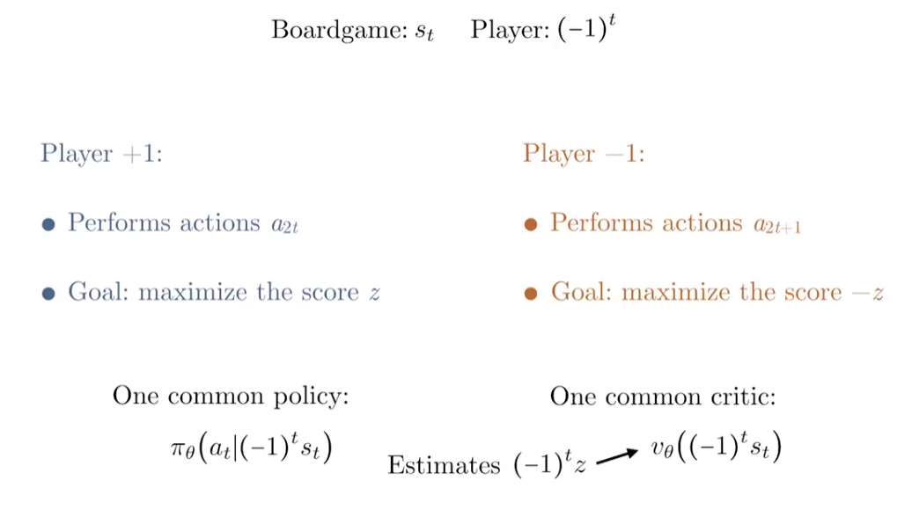

# Multi-Agent Reinforcement Learning

## Approaches to MARL

### Papers: 
> - [A Survey on Multi-Agent Reinforcement Learning](https://arxiv.org/abs/1812.11794)

> - [Multi-Agent Actor-Critic for Mixed Cooperative-Competitive Environments](https://proceedings.neurips.cc/paper_files/paper/2017/file/68a9750337a418a86fe06c1991a1d64c-Paper.pdf)

The paper that you've chosen implements a multi-agent version of DDPG. DDPG, as you might remember, is an off policy actor-critic algorithm that uses the concept of target networks. The input of the action network is the current state while the output is a real value or a vector representing an action chosen from a continuous action space. Open AI has created a multi-agent environment called multi-agent particle. It consists of particles that is agents and some landmarks. A lot of interesting experimental scenarios have been laid out in this environment. We've chosen one of the many scenarios called physical deception. Here, any agents cooperate to reach the target landmark out of end landmarks. There is an adversary which is also trying to reach the target landmark, but it doesn't know which out of the end landmarks is the target landmark.

The normal agents are rewarded based on the least distance of any of the agents to the landmark, and penalized based on the distance between the adversary and the target landmark. Under this reward structure, the agents cooperate to spread out across all the landmarks, so as to deceive the adversary. The framework of centralized trading with decentralized execution has been adopted in this paper. This implies that some extra information is used to ease dreaming, but that information is not used during the testing time. This framework can be naturally implemented using an actor-critic algorithm. Let me explain why. During training, the pretext for each agent uses extra information like state's observed and actions taken by all the other regions. As for the actor, you'll notice that there is one for each agent. Each actor has access to only its agent's observation and actions. During execution time, only the actors are present, and hence, on observations and actions are used. Learning critic for each agent allows us to use a different reward structure for each. Hence, the algorithm can be used in all, cooperative, competitive, and mixed scenarios.

##### Summary: 
We began by introducing ourselves to the multi-agent systems present in our surroundings. We reasoned why multi-agent systems are an important puzzle to solving AI, and decided to pursue this complex topic. We also studied the Markov games framework, which is a generalization of MDPs to the multi- agent case. We talked about using single-agent RL algorithms, as they are in the multi-agent case. This either leads to non-stationarity, or a large joint action space. We saw the interesting kinds of environments present in the multi-agent case namely: cooperative, competitive, and mixed. Towards the end, we implemented the multi-agent DDPG algorithm which is a centralized training, and decentralized execution algorithm that can be used in any of the above environments. That was all from my side. I hope it was a great learning experience for you. Thanks a lot for being with me through this journey. Bye-bye.

## Lab Instructions - Physical Deception Problem

## Multi-Agent Exploration Project

This is an ungraded project. Feel free to explore various parameters and see how they affect the way agents approach the problem.

### Goal of the Environment

Blue dots are the **"good agents"**, and the red dot is an **"adversary"**.

All of the agents' goals are to move near the green target.

The blue agents know which target is green, but the red agent is color-blind and does not know which target is green or black.

The optimal solution is for the red agent to chase one of the blue agents, while the blue agents split up and move toward each of the targets.

### Running Within the Workspace (Recommended Option)

1. No explicit setup commands need to be run. All necessary installations have already been taken care of in this lab, so you can start exploring directly.

2. Run:

   `./run_training.sh`

   This lets you run the program based on the parameters provided in the main program.

3. Run:

   `./run_tensorboard.sh`

   This provides a URL for the TensorBoard dashboard, where you can visualize how your agents are performing. Use this as a guide to understand how your changes affect the program.

4. The `Model_dir` folder stores the `episode-XXX.gif` files, which visualize how your agents are performing.

### Running on Your Own Computer

1. If you choose to run the program on your own computer, download the files from the workspace. All of the commands above should work in the same way, except that you will need to install a few dependencies listed below.

2. Using a GPU does not significantly affect the training time for this program. Instead, multicore environments are a better choice for increasing training speed.

### Requirements

1. [OpenAI Baselines](https://github.com/openai/baselines)  
   Commit: `98257ef8c9bd23a24a330731ae54ed086d9ce4a7`

2. [PyTorch](http://pytorch.org/)  
   Version: `0.3.0.post4`

3. [OpenAI Gym](https://github.com/openai/gym)  
   Version: `0.9.4`

4. [TensorBoard](https://github.com/tensorflow/tensorboard)  
   Version: `0.4.0rc3`

   [TensorBoard-PyTorch](https://github.com/lanpa/tensorboard-pytorch)  
   Version: `1.0`  
   
   Used for logging.

### To Experiment

1. Feel free to clear the `model_dir` and `log` folders and start training on your own to see how your agents perform.

   Run:

   `./clean.sh`

   This should help you clear the existing training data.

2. This lab is meant to prepare you for the final project. Writing your own functions in `maddpg.py` will help improve your understanding of the MADDPG implementation.

3. Experiment with parameter tuning in `main.py`.

   Keep in mind that increasing the number of training episodes will also increase the overall training time.

4. Depending on the selected parameters, the lab may take **more than one hour to train**.

## Collaborative Learning

### Collaboration and Competition Project
(tennis env github repo)[https://github.com/jcrudy/drlnd_p3]

## Project Submission Feedback - Further Reinforcement Learning Approaches

You have implemented and trained the agent successfully.

All functions were implemented correctly, and the [MADDPG (Multi-Agent Deep Deterministic Policy Gradient)](https://arxiv.org/abs/1706.02275) algorithm seems to work quite well.

Your agents solve the environment quite stably.

The following resources provide insight into other reinforcement learning algorithms that can be used to solve the environment:

1. [Proximal Policy Optimization by OpenAI](https://blog.openai.com/openai-baselines-ppo/)
2. [PPO Implementation](https://github.com/Cozmo25/drlnd-continuous-control/tree/master/PPO)
3. [Introduction to Various Reinforcement Learning Algorithms, Part II: TRPO and PPO](https://towardsdatascience.com/introduction-to-various-reinforcement-learning-algorithms-part-ii-trpo-ppo-87f2c5919bb9)
4. [Asynchronous Actor-Critic Agents (A3C)](https://medium.com/emergent-future/simple-reinforcement-learning-with-tensorflow-part-8-asynchronous-actor-critic-agents-a3c-c88f72a5e9f2)

Another interesting algorithm that could be used here is [A0C](https://liacs.leidenuniv.nl/~plaata1/papers/pal2018.pdf), which extends **AlphaZero** to continuous action spaces.

## AlphaGo, AlphaGo Zero, and AlphaZero

In 2016, researchers at **DeepMind** announced a major breakthrough with the development of a new AI system, **AlphaGo**, for the game of Go.

AlphaGo was able to defeat professional Go player **Lee Sedol**. The breakthrough was significant because Go is far more complex than chess. The number of possible games is extraordinarily large, and developing a professional-level Go engine had previously been considered out of reach. Human intuition was also believed to be a key component of professional-level play.

However, AlphaGo's performance still depended on expert input during training. As a result, the algorithm could not easily be transferred to other domains.

### AlphaGo Zero

This changed in 2017, when the team at **DeepMind** updated their approach and developed a new system called **AlphaGo Zero**.

Instead of depending on expert gameplay during training, AlphaGo Zero learned by **playing against itself**, starting with only the rules of the game.

More impressively, the underlying approach was sufficiently general to later be adapted to other games, including:

- **Chess**
- **Shogi**, also known as Japanese chess

This development led to a more general framework for developing game-playing AI systems, called **AlphaZero**.

### The AlphaZero Algorithm

One of the most interesting aspects of the AlphaZero algorithm is its conceptual simplicity.

It combines:

1. **Monte Carlo Tree Search (MCTS)** for planning and exploring possible future actions.
2. A **deep neural network** for evaluating positions and guiding the search.

Conceptually, this is analogous to how humans might approach complex board games: explicit calculation and exploration are guided by learned intuition about which positions and actions are promising.

In the following lesson, we will explore how the **AlphaZero algorithm** works and implement it to play an advanced version of **Tic-Tac-Toe**.

So, let's get started!

## Further Reading

Much of the lesson material is derived from the original research papers by the researchers at **DeepMind**:

- [Mastering the Game of Go without Human Knowledge – AlphaGo Zero](https://www.nature.com/articles/nature24270)
- [Mastering Chess and Shogi by Self-Play with a General Reinforcement Learning Algorithm – AlphaZero](https://arxiv.org/abs/1712.01815)

I encourage you to visit these links and explore the original papers for a more detailed description of the algorithms.

## Zero-Sum Game

In order to talk about AlphaZero, we first need to formalize the concepts of games that AlphaZero specializes in, Zero-Sum games. We start with a board game environment, a grid for example, then two competing agents take turns to perform actions to try to win the game. In the end, one agent's win is another agent's loss. Usually, we also assumed that the game contains no hidden information, so there's no element of luck, and winning or losing is entirely determined by skill. This concept is applicable to games as simple as tic-tac-toe to more complicated games such as chess and go. Let's go back to our tic-tac-toe example. The goal is to get three in a row, so the first player might make a move, say at the center, then the second player makes a move. Now, there are usually multiple possibilities at each step. In this case, there are eight. Focusing on one of these possibilities, we might have a game sequence like this. Now, in this case, the first player wins. We can represent all this information mathematically. The board can be represented by a matrix where zero indicates empty space and plus or minus one indicates the pieces of player one and player two. Given that there are only circles and crosses in tic-tac-toe, each entry can then only be zero, plus one, or minus one. We can also encode the final outcome by a score, where plus one indicates a win by the first player, and negative one indicates a win by the second player, and zero indicates a draw. This way of representing the board is convenient because the board can easily be fed into a neural network. Also, if you want to switch other player's pieces, we can just multiply the matrix by negative one. We can also flip the score by multiplying it by negative one. This property will come in handy when we build an agent to play the game. Now that we've encoded the game mathematically, we can rephrase everything in the language of reinforcement learning. We have a sequence of states for the board game denoted by a sub t, and we have two players denoted by plus or minus one. Here, I've simplified the negative one to the power of t, assuming we start with t equals zero. Player plus one performs actions at all the even timesteps and tries to maximize the final score plus z, while player negative one performs actions at all the odd timesteps and tries to maximize negative one times the final score. Now, imagine we've constructed an intelligent agent who is able to play a perfect game as player plus one, then it should be able to play a perfect game as player negative one as well as long as we flipped the state, s of t, at all the odd timestep. Then we can have the agent play against itself with a common policy. Now, besides having a common policy, we can also have a common critic that can evaluate the expected outcome from the perspective of the current player. This essentially estimates the expected value of negative one to the t power times a score z. We will see later that this is the basic idea behind AlphaZero, where we have one agent playing against itself along with one critic that self-improves as more and more games are played.

<figure align="center">
    
</figure>

## Monte Carlo Tree Search 1 - Random Sampling

