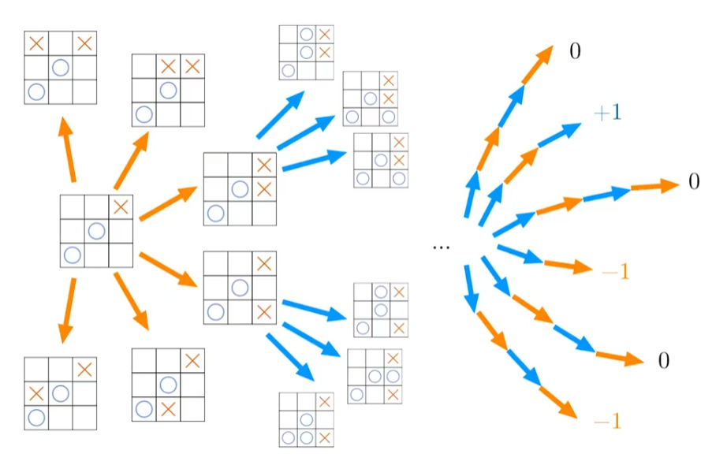
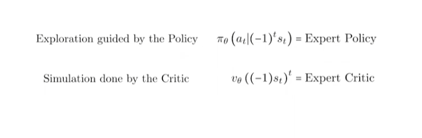
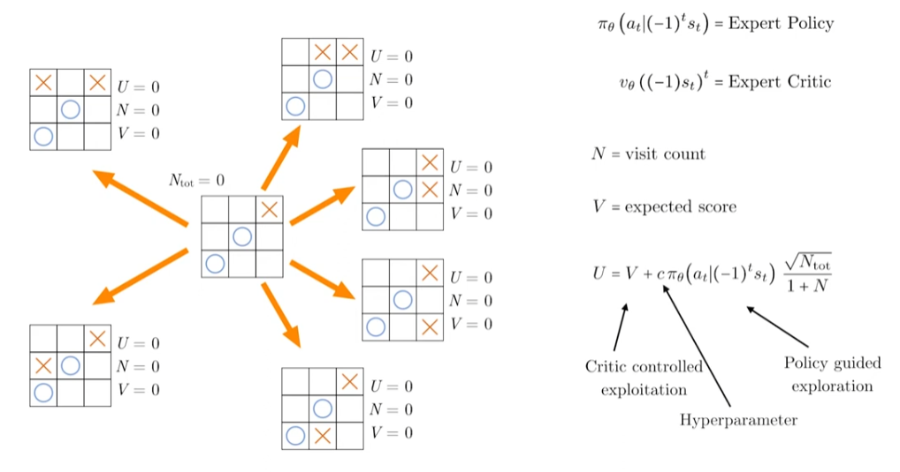
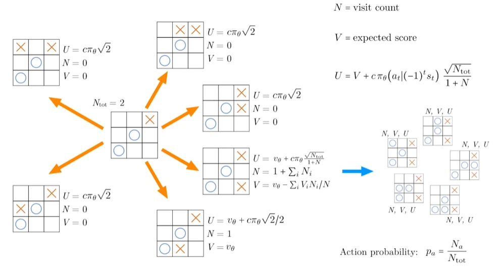
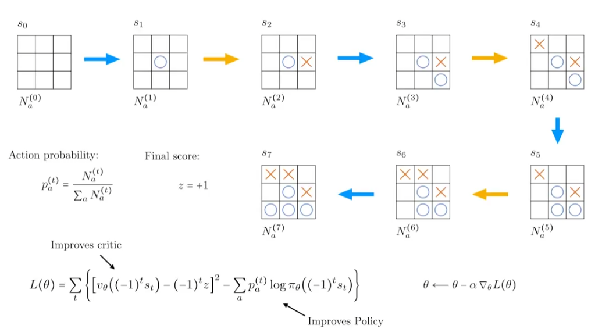
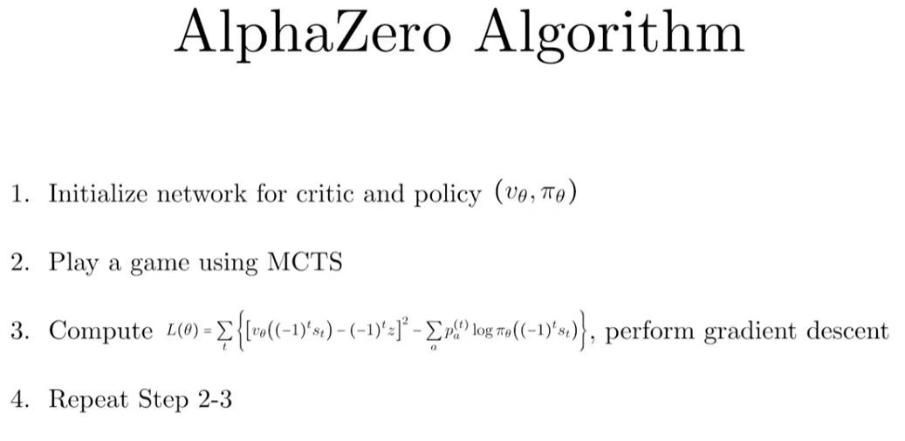

# Multi-Agent Reinforcement Learning

## Approaches to MARL

### Papers: 
> - [A Survey on Multi-Agent Reinforcement Learning](https://arxiv.org/abs/1812.11794)

> - [Multi-Agent Actor-Critic for Mixed Cooperative-Competitive Environments](https://proceedings.neurips.cc/paper_files/paper/2017/file/68a9750337a418a86fe06c1991a1d64c-Paper.pdf)

The paper that you've chosen implements a multi-agent version of DDPG. DDPG, as you might remember, is an off policy actor-critic algorithm that uses the concept of target networks. The input of the action network is the current state while the output is a real value or a vector representing an action chosen from a continuous action space. Open AI has created a multi-agent environment called multi-agent particle. It consists of particles that is agents and some landmarks. A lot of interesting experimental scenarios have been laid out in this environment. We've chosen one of the many scenarios called physical deception. Here, any agents cooperate to reach the target landmark out of end landmarks. There is an adversary which is also trying to reach the target landmark, but it doesn't know which out of the end landmarks is the target landmark.

The normal agents are rewarded based on the least distance of any of the agents to the landmark, and penalized based on the distance between the adversary and the target landmark. Under this reward structure, the agents cooperate to spread out across all the landmarks, so as to deceive the adversary. The framework of centralized trading with decentralized execution has been adopted in this paper. This implies that some extra information is used to ease dreaming, but that information is not used during the testing time. This framework can be naturally implemented using an actor-critic algorithm. Let me explain why. During training, the pretext for each agent uses extra information like state's observed and actions taken by all the other regions. As for the actor, you'll notice that there is one for each agent. Each actor has access to only its agent's observation and actions. During execution time, only the actors are present, and hence, on observations and actions are used. Learning critic for each agent allows us to use a different reward structure for each. Hence, the algorithm can be used in all, cooperative, competitive, and mixed scenarios.

##### Summary: 
We began by introducing ourselves to the multi-agent systems present in our surroundings. We reasoned why multi-agent systems are an important puzzle to solving AI, and decided to pursue this complex topic. We also studied the Markov games framework, which is a generalization of MDPs to the multi- agent case. We talked about using single-agent RL algorithms, as they are in the multi-agent case. This either leads to non-stationarity, or a large joint action space. We saw the interesting kinds of environments present in the multi-agent case namely: cooperative, competitive, and mixed. Towards the end, we implemented the multi-agent DDPG algorithm which is a centralized training, and decentralized execution algorithm that can be used in any of the above environments. That was all from my side. I hope it was a great learning experience for you. Thanks a lot for being with me through this journey. Bye-bye.

## Lab Instructions - Physical Deception Problem

## Multi-Agent Exploration Project

This is an ungraded project. Feel free to explore various parameters and see how they affect the way agents approach the problem.

### Goal of the Environment

Blue dots are the **"good agents"**, and the red dot is an **"adversary"**.

All of the agents' goals are to move near the green target.

The blue agents know which target is green, but the red agent is color-blind and does not know which target is green or black.

The optimal solution is for the red agent to chase one of the blue agents, while the blue agents split up and move toward each of the targets.

### Running Within the Workspace (Recommended Option)

1. No explicit setup commands need to be run. All necessary installations have already been taken care of in this lab, so you can start exploring directly.

2. Run:

   `./run_training.sh`

   This lets you run the program based on the parameters provided in the main program.

3. Run:

   `./run_tensorboard.sh`

   This provides a URL for the TensorBoard dashboard, where you can visualize how your agents are performing. Use this as a guide to understand how your changes affect the program.

4. The `Model_dir` folder stores the `episode-XXX.gif` files, which visualize how your agents are performing.

### Running on Your Own Computer

1. If you choose to run the program on your own computer, download the files from the workspace. All of the commands above should work in the same way, except that you will need to install a few dependencies listed below.

2. Using a GPU does not significantly affect the training time for this program. Instead, multicore environments are a better choice for increasing training speed.

### Requirements

1. [OpenAI Baselines](https://github.com/openai/baselines)  
   Commit: `98257ef8c9bd23a24a330731ae54ed086d9ce4a7`

2. [PyTorch](http://pytorch.org/)  
   Version: `0.3.0.post4`

3. [OpenAI Gym](https://github.com/openai/gym)  
   Version: `0.9.4`

4. [TensorBoard](https://github.com/tensorflow/tensorboard)  
   Version: `0.4.0rc3`

   [TensorBoard-PyTorch](https://github.com/lanpa/tensorboard-pytorch)  
   Version: `1.0`  
   
   Used for logging.

### To Experiment

1. Feel free to clear the `model_dir` and `log` folders and start training on your own to see how your agents perform.

   Run:

   `./clean.sh`

   This should help you clear the existing training data.

2. This lab is meant to prepare you for the final project. Writing your own functions in `maddpg.py` will help improve your understanding of the MADDPG implementation.

3. Experiment with parameter tuning in `main.py`.

   Keep in mind that increasing the number of training episodes will also increase the overall training time.

4. Depending on the selected parameters, the lab may take **more than one hour to train**.

## Collaborative Learning

### Collaboration and Competition Project
(tennis env github repo)[https://github.com/jcrudy/drlnd_p3]

## Project Submission Feedback - Further Reinforcement Learning Approaches

You have implemented and trained the agent successfully.

All functions were implemented correctly, and the [MADDPG (Multi-Agent Deep Deterministic Policy Gradient)](https://arxiv.org/abs/1706.02275) algorithm seems to work quite well.

Your agents solve the environment quite stably.

The following resources provide insight into other reinforcement learning algorithms that can be used to solve the environment:

1. [Proximal Policy Optimization by OpenAI](https://blog.openai.com/openai-baselines-ppo/)
2. [PPO Implementation](https://github.com/Cozmo25/drlnd-continuous-control/tree/master/PPO)
3. [Introduction to Various Reinforcement Learning Algorithms, Part II: TRPO and PPO](https://towardsdatascience.com/introduction-to-various-reinforcement-learning-algorithms-part-ii-trpo-ppo-87f2c5919bb9)
4. [Asynchronous Actor-Critic Agents (A3C)](https://medium.com/emergent-future/simple-reinforcement-learning-with-tensorflow-part-8-asynchronous-actor-critic-agents-a3c-c88f72a5e9f2)

Another interesting algorithm that could be used here is [A0C](https://liacs.leidenuniv.nl/~plaata1/papers/pal2018.pdf), which extends **AlphaZero** to continuous action spaces.

## AlphaGo, AlphaGo Zero, and AlphaZero

In 2016, researchers at **DeepMind** announced a major breakthrough with the development of a new AI system, **AlphaGo**, for the game of Go.

AlphaGo was able to defeat professional Go player **Lee Sedol**. The breakthrough was significant because Go is far more complex than chess. The number of possible games is extraordinarily large, and developing a professional-level Go engine had previously been considered out of reach. Human intuition was also believed to be a key component of professional-level play.

However, AlphaGo's performance still depended on expert input during training. As a result, the algorithm could not easily be transferred to other domains.

### AlphaGo Zero

This changed in 2017, when the team at **DeepMind** updated their approach and developed a new system called **AlphaGo Zero**.

Instead of depending on expert gameplay during training, AlphaGo Zero learned by **playing against itself**, starting with only the rules of the game.

More impressively, the underlying approach was sufficiently general to later be adapted to other games, including:

- **Chess**
- **Shogi**, also known as Japanese chess

This development led to a more general framework for developing game-playing AI systems, called **AlphaZero**.

### The AlphaZero Algorithm

One of the most interesting aspects of the AlphaZero algorithm is its conceptual simplicity.

It combines:

1. **Monte Carlo Tree Search (MCTS)** for planning and exploring possible future actions.
2. A **deep neural network** for evaluating positions and guiding the search.

Conceptually, this is analogous to how humans might approach complex board games: explicit calculation and exploration are guided by learned intuition about which positions and actions are promising.

In the following lesson, we will explore how the **AlphaZero algorithm** works and implement it to play an advanced version of **Tic-Tac-Toe**.

So, let's get started!

## Further Reading

Much of the lesson material is derived from the original research papers by the researchers at **DeepMind**:

- [Mastering the Game of Go without Human Knowledge – AlphaGo Zero](https://www.nature.com/articles/nature24270)
- [Mastering Chess and Shogi by Self-Play with a General Reinforcement Learning Algorithm – AlphaZero](https://arxiv.org/abs/1712.01815)

I encourage you to visit these links and explore the original papers for a more detailed description of the algorithms.

## Zero-Sum Game

In order to talk about AlphaZero, we first need to formalize the concepts of games that AlphaZero specializes in, Zero-Sum games. We start with a board game environment, a grid for example, then two competing agents take turns to perform actions to try to win the game. In the end, one agent's win is another agent's loss. Usually, we also assumed that the game contains no hidden information, so there's no element of luck, and winning or losing is entirely determined by skill. This concept is applicable to games as simple as tic-tac-toe to more complicated games such as chess and go. Let's go back to our tic-tac-toe example. The goal is to get three in a row, so the first player might make a move, say at the center, then the second player makes a move. Now, there are usually multiple possibilities at each step. In this case, there are eight. Focusing on one of these possibilities, we might have a game sequence like this. Now, in this case, the first player wins. We can represent all this information mathematically. The board can be represented by a matrix where zero indicates empty space and plus or minus one indicates the pieces of player one and player two. Given that there are only circles and crosses in tic-tac-toe, each entry can then only be zero, plus one, or minus one. We can also encode the final outcome by a score, where plus one indicates a win by the first player, and negative one indicates a win by the second player, and zero indicates a draw. This way of representing the board is convenient because the board can easily be fed into a neural network. Also, if you want to switch other player's pieces, we can just multiply the matrix by negative one. We can also flip the score by multiplying it by negative one. This property will come in handy when we build an agent to play the game. Now that we've encoded the game mathematically, we can rephrase everything in the language of reinforcement learning. We have a sequence of states for the board game denoted by a sub t, and we have two players denoted by plus or minus one. Here, I've simplified the negative one to the power of t, assuming we start with t equals zero. Player plus one performs actions at all the even timesteps and tries to maximize the final score plus z, while player negative one performs actions at all the odd timesteps and tries to maximize negative one times the final score. Now, imagine we've constructed an intelligent agent who is able to play a perfect game as player plus one, then it should be able to play a perfect game as player negative one as well as long as we flipped the state, s of t, at all the odd timestep. Then we can have the agent play against itself with a common policy. Now, besides having a common policy, we can also have a common critic that can evaluate the expected outcome from the perspective of the current player. This essentially estimates the expected value of negative one to the t power times a score z. We will see later that this is the basic idea behind AlphaZero, where we have one agent playing against itself along with one critic that self-improves as more and more games are played.

<figure align="center">
    
</figure>

## Monte Carlo Tree Search 1 - Random Sampling

Given a state in a zero sum game, how do we find an optimal policy? In theory, this is simple, because we could just perform a brute force search, and going through all the possible moves and all the possible games that can be played, and then we can choose the ones with the best possible outcomes. The possibilities are numerous, so I'm only showing a few examples here. We already see that in practice, this brute force method can become infeasible. Even for tic-tac-toe, things are complicated, as there are nine possible first moves, eight possible second moves, seven possible third moves and so forth. Can we do better? One possibility is that we can randomly sample a subset of all the possible games. Then for each action, we can compute the expected outcome by taking the average of all the subsequent play outs like this. For convenience we also add an extra negative sign so that the expected outcome is from the perspective of the current player. Then we would choose the action with the largest expected score, in this case who plays across at the bottom corner. This procedure sounds a little bit familiar. Trying to compute the expected outcome is analogous to estimating the Q function, and we know that a completely random search isn't ideal. It would be better to have some guidance. So, we can better balance random explorations with exploitations. Let's get systematic then, and look at all the possible moves player two can take given the current state. There are six possibilities. We can think of all the possibilities as part of a tree structure. The goal is we want to look at each branch of this tree and focus most of the random play outs on the actions that are more promising as opposed to just sample completely randomly. To do this we define three numbers for each branch of this tree: U, N, and V. All the values are initialized to zero. N is the number of times I've played a random game starting from that branch, and V is an estimate of the expected outcome starting from that branch and from the perspective of the current player. The variable U is computed from V and N given by the formula on the right. In each iteration I need to choose to play a random game starting from a selective branch. This is where the variable U comes in. The branch with the highest value of U will be chosen. This U function contains two pieces. The first one is V. So when the current expected outcome is large, U will be large, and this helps exploitation. Meanwhile the second piece is inversely proportional to one plus N. So, it encourages visits to branches with low visit counts, and this helps with exploration. Now that we have defined all the variables, let's see how a search may play out in action. Initially, all the U's are zero, so we just randomly choose one of the six possible actions. Now, we play a random game, and this time player two lost. So, V is updated to be negative one, and the number of visit increased to one. Before we start the next gameplay, notice that the total number of gameplay is now one. So, the exploration part of the U function needs to be updated for all the other branches, like this. The largest U is now one, so going to the next iteration of gameplay, we need to choose one of the other five actions. We can then repeat this procedure until a fixed number of total gameplays, say 100 games is reached, and we might end up with something like this. How do we decide what the next move is then? We could choose the action with the highest U or V, but sometimes they might not be that reliable, especially if the visit counts are low. So instead, we choose an action with the highest visit counts, which is usually associated with good expected outcome anyway, and it's a little bit more reliable. In this case the highest visit count is 21, and this is the move that we will choose according to the tree search.

<figure align="center">
    
</figure>

## Monte Carlo Tree Search 2 - Expansion and Back-propagation

Starting with a state, we learned previously how to search systematically through one layer of a game tree using the variables U, N, and V. Can we generalize this to go deeper into the tree so that we can better anticipate a long sequence of moves? This is possible through what's called expansion and back-propagation. Let's see how it works in action. First, we choose an action that maximizes U. U is zero, so we randomly choose an action. We play a random game and this time to current player one. So, we update V to one, and the visit count to one. Afterward, the total number of gameplay needs to be updated as well. Then, all the U values in all the branches will need to be updated like this. For the next iteration, we choose the branch with the maximum U, 1.5 in this case. This time, the node has already been visited previously and we would like to get some more information by exploring deeper into the tree structure. So, instead of just playing another random game, we consider all the possible next moves. All the expanded nodes come with their own variables U, N, and V. Again, we choose the action with the maximum U, they're all zero in this case. So, we randomly choose an action and play a random game. This time, the blue player won. So we update V and N. Now, the total number of visits for this cluster of nodes has been updated, so we need to update N total to one. This changes U for all the branches and so we need to update them. After all the second level nodes are up to date, we need to update the statistics on the previous node this procedure is called back-propagation, where we go back up the tree to update all the variables. First, the total number of visits, N, needs to be increased. Second, the expected outcome, V, needs to be updated. We replace it by the average outcome of all the games that are played from this node keeping in mind that the outcome is from the perspective of the current player, orange in this case. This gives N equals two, and V equals zero. Because in the previous play out, the blue player won. With the increase visit counts, N total needs to be updated as well, and then all the Us also needs to be updated. Now, we can repeat this process again and again until a fixed number of total games are played. We might get something like this for example. Then to choose the next move, we pick the node with the highest visit count, 21 in this case. One advantage of expansion and propagation is that if we want to utilize Monte Carlo tree search again after making a move, we don't need to start from scratch. As we can reuse previous results by replacing the top node with the chosen node for the next move like this, and we can continue our Monte Carlo tree search. So, that's it. We can finally summarize the Monte Carlo tree search algorithm. First, we initialize the top node, then we loop over N total times the following search procedure. Starting from the top node, which reverse to gain tree as far as possible by repeatedly going into the child node with the largest U. Next, if the node hasn't been visited yet, we play a random game. Otherwise, we expand the node and play a game from one of the child node randomly. Next, we update statistics on that node based on the outcome of the gameplay. We also back-propagate the results to the parent nodes and update visit counts, and the dual variables if necessary. After the iteration is done, we simply pick the move with the highest visit counts. So, that's it. This summarizes how can choose a move. Using Monte Carlo tree search on a zero-sum game. Generally speaking, the more random games we play during the search, the deeper we will search in the tree and the better the resulting moves will be.

## AlphaZero 1: Guided Tree Search

We know that tree searches can become intractable very quickly, even when we utilize Monte Carlo methods. Take the game of Go for example. The game board is a 19 by 19 grid, and that means 361 possible first moves. The number of possible second moves is tiny bit smaller, 360. For the third move, 359. Already, there are around 50 million possibilities just for the first three moves. Now, there are some redundancies, as we can rotate and flip the board without changing the game. But still, a Monte Carlo search would never be able to accumulate enough statistics to be reliable. So, we need to find a better way to improve Monte Carlo tree search. Not surprisingly, this can be done using deep neural networks. [...]

### Pi-Theta Expert Policy, Expert Critic

<figure align="center">
    
</figure>

Here, we introduce an expert policy, pi theta. That roughly tells us the probability of the next move by an expert player, and an expert critic, v theta, that tells us what the expected score is from the perspective of the current player. The idea is that using the policy, we can focus on exploring moves that an expert is likely to play. The critic will allow us to estimate the outcome of a game without running a simulation. In the AlphaZero paper, both the policy and the critic come from a single neural network, and thus, they share the same weights, theta. Now, we can choose a move using only the policy, but we don't just want to use the policy, we want to find moves that are better than the current policy so that it can improve. To do this, we perform a Monte Carlo tree search, utilizing both the policy and the critic, so that the resulting moves are stronger than the policy alone, then we can use it to update the policy. Let's see how that works in a game of Tic-tac-toe. Given a state, we want to find out what the best move is. Just like the case of Monte-Carlo tree search, we consider all the possible actions, and assign three numbers, U, N, and V to each of them. Just like before, N is the total visit counts for the action, V is the expected score, and U, a value that guides the Monte Carlo tree search. The U function is a bit different from the ones from normal Monte Carlo tree search. We have the same first term, V again, and it controls exploitation. We'll see that this V will largely come from the critic. The second term is the exploration term that encourages visiting nodes with small visit counts. This is proportional to the policy. so that moves that are more likely to be played by an expert will be favored. Notice that we also introduced a hyperparameter C, that controls the level of exploration. Let's see the search in action. In the beginning, all the U's are zero. So we randomly choose an action. Then we can compute an estimated outcome using the critic, V theta, and update all the values in that node. The total number of visits is now one. So, the exploration terms for all the other branches need to be updated like this. To iterate this process, we need to compare all the U's, and visit the branch with the largest U again. The search may lead us to a different branch. Again, we update the expected outcome using the critic, and the U function for the other branches. As this process is repeated, we may revisit the same branch again, what do we do then? In order to get more information, we can expand this node into all the possible subsequent states, each with their own values U, N, and V, all initialized to zero. Then we can choose an action with the maximum U, and compute the expected outcome from the critic. Afterward, we can go back to the original node and update the expected outcome. The V can be computed as the average of the initial estimate through the critic, together with the results of exploring all the children nodes. Notice that when computing the average for V, there's a negative sign in front of the contributions from the children nodes. This is necessary, because by convention, V is an estimate from the perspective of the current player and going to a trial node, changes the player. After many iterations, and as we go deeper into the game tree, we might reach a terminal state where the game ends. Then, instead of using the critic for estimating the expected outcome, we simply use the actual outcome. We can repeat this process for a fixed number of games and total. Just like in Monte Carlo tree search, to choose the best moves, we can simply pick the action with the highest visit counts, or if we want to encourage more exploration, we can choose an action stochastically with a probability proportional to the number of visits for each action, like the equation here.

<figure align="center">
    
</figure>

<figure align="center">
    
</figure>

## AlphaZero 2: Self-Play Training

Now that we have an improved Monte-Carlo Tree Search guided by an expert policy and critic, how do we update them? Well, start with an empty board of Tic-Tac-Toe, we perform Monte-Carlo Tree Search using the current policy and critic. The end result is a list of visit counts for each actions N sub a, which can be converted into a list of probabilities for each action at every time step. After choosing the first move, we can perform Monte-Carlo Tree Search again. Now, we don't have to start from scratch because this current state is likely to have a very high visit counts and many of the subsequent states should have been explored already. So, we can iterate the Monte-Carlo Tree Search algorithm fairly efficiently. Eventually, we repeat this process and arrive at the end gain. In this case, the final score is z equals plus one. The final outcome can be compared to the expected outcome computed at each time step using the critic. We also computed the probability of performing an action through the Monte-Carlo Tree Search at each time step, and that can be compared to the expert policy as well. Together, we can compute a loss function, L Theta. This L Theta contains two terms. The first term is the square of the difference between the prediction from the critic and the actual outcome. Notice that I've included a factor of negative one to the t to make sure that the comparison is always from the perspective of the current player. The second term involving the logarithm of the policy can be interpreted as an entropy loss between the current policy and the probabilities computed through Monte-Carlo Tree Search. Minimizing this term, we forced the policy to be closer to the results of Monte-Carlo Tree Search, and thus, strengthening the moves predicted by the policy. Using the loss function, we can perform gradient descent to update both the policy and the critic. Finally, we're able to summarize the AlphaZero algorithm. First, we initialize a neural network that includes both the critic and the policy. Then we play again using Monte-Carlo Tree Search for choosing moves. Afterward, we compute the loss function and perform gradient descent. Repeating step two to three, the agent is able to play better and better. You may ask, how does learning happen intuitively? Starting from random critic and policy, the Monte-Carlo Tree Search in AlphaZero should be no better than a standard Monte-Carlo Tree Search. How does it learn then? Well, in the beginning, the critic is able to improve because whenever we reach end game during the Tree Search, the end game outcome is propagated in the tree and the critic will be able to predict this outcome better and better. After the critic becomes less random, the policy will start to improve as well. As training goes on, the AlphaZero agent will first learn how to play the end game very well. As the end game improves, the mid game will improve as well. Eventually, the algorithm will be able to anticipate long sequences of expert moves, leading to an expert level of gameplay. The AlphaZero algorithm is a very general framework that can be applied to many different games, and it has been shown to achieve superhuman performance in Go, Chess, and Shogi.

<figure align="center">
    
</figure>

<figure align="center">
    
</figure>

## TicTacToe using AlphaZero - walkthrough

### TicTacToe using AlphaZero - notebook walkthrough

Hi, welcome to the screencast. Today, I'll share with you how to train an alphazero agent to play a game of TicTacToe. Before I go into the Jupiter notebook, let's go back up that directory to check out all the files available to you in the workspace. So, you should see something like this, it will be working with the alphazero TicTacToe Jupiter notebook. I'll cover the more advanced version later. The important files are these Python files. ConnectN.py implements a gameplay environment. It's a class that contains the game state, the game score, the game player. MCTS implements a Monte-Carlo Tree Search algorithm for the alphazero. Inside this class, there are functions such as explore that explores the tree, you can pick a move from the tree, and so forth. The play.py class implements an interactive environment for you to play the game. So, you can play a game against yourself, just to see, get a feeling of the structure of the game. You can play a game against a given AI or you can watch two AI, play against each other to see who wins. Now, let's go back to our Jupiter notebook here. The first step is we can initialize a game. To do that, we simply initialize a ConnectN object. The inputs are the board size and the winning condition. Now, the ConnectN can accommodate a much larger board size with much more winning conditions, but for the case of TicTacToe, we'll go for the simplest non trivial game, a three-by-three board with a winning condition win three three in a row, so we can do that. Initialize the game. Now, what does the game object contain? It contains members such as the state, which is a three-by-three matrix depending on the board size, and the player, the player alternates as you perform moves. So, the first player is player plus one, and the second player is player negative one, and so forth. Also, it keeps track of the game score. Every time you make a move, it tries the computer game score. When the game is not over yet, the game score is simply none. If it's zero, that means a draw has been reached. If it's plus one, the first player wins. If it's negative one, the second player wins. So, let's see what happens when we make a move. Now, notice that the game that the player was player one, so when I make a move zero one, player one plays a piece at the zero, one location. The player is automatically advanced to negative one. The game has not ended yet still, so the score is still none and the state has been updated. So, what happens when I make a sequence of move like this? You can see that, now, player one has successfully created three in a row, so the game has been automatically updated to game score equals one and the game has ended. Now, the next step is, let's try to play a game interactively. We can do that by first, supplying this matplotlib notebook magic command in Jupiter. Then, you can use the play cat class from the play.py file. To initialize it, you simply feed in a game environment like this, you can initialize a new one, and you can supply the player. When the players are none, basically means that they are from mouse click, their moves are registered by mouse clicks, although, you could supply different AI agent, and I'll cover that later. So, let's play a game against ourselves to see how it looks. So, you have a game board, and I can click, and play a piece in the middle, where I always starts first. Then, I can place another piece. If I get three in a row, I win and the game is terminated. You can play with this just got a feel. Now, the next step is we need to initialize an AI to play the game. To do that, I create a neural network using PyTorch and I call this the policy. Although in alphazero, the neural network can actually contains both the policy and the critic. This is what we'll follow here as well. So, I've already prepared a neural network for you, it contains a convolutional layer, fully linear layer, and the important parts are they are separate layers for the policy and the critic after these convolutional and linear layers. I encourage you to play with this to try to come up with even simpler policy that can learn to play TicTacToe. So, next step is we look at the forward function. The way this works is it takes in first, you use the convolutional layer, the fully connected layer, then they're separate policy head and critic head that needs to be computed separately. Now, you can easily use a Softmax on a nine-by-nine matrix to get the probability, but this doesn't work quite that well. Given that not all the moves are available because say, player one plays a piece in a position, then player negative one could not place another piece in that same location. To fix it, I compute this thing called the availability matrix, which basically gives zero when the move is unavailable in that location, and it gives one when a move is available. So, during the Softmax operation, when I compute the exponential, I can multiply that by the availability matrix and then compute the probability. Doing it this way will ensure that when a move is not legal, the probability will be exactly zero. So, it will make coding up the rest of the functions a little easier. Now, the critic head is fairly straightforward, I just feed it through some fully connected layers and output a value using the tanh functions, so that the value is in between negative one and one. Now, for training to work, I have to initialize a policy using our favorite optimizer. A learning ray and also include a regularization weight decay and feel free to play around with the numbers here. The next step is I need to code up a player that can use Monte Carlo tree search to play a game. So, this is defined here. Basically, each time I have a game I make a copy and I initialize a Monte Carlo tree search class. You can explore this tree by simply invoking this explore function by supplying a policy. This function will compute all the U's, pick the branch with maximal U, search, expand, back-propagate and then increase the VisiCalc and after that you can use the next function and tell the tree to choose a next move. We'll cover what these are later, these are useful for training but this function is only used for visualization so we don't care about these. Then, what it does is it returns the move that was played after this increment, incrementing the tree. Now you might wonder what is this temperature parameter doing here. Well remember that in our lessons we mentioned that in Monte Carlo tree search especially during training we choose the next action based on the VisiCalc, and to encourage exploration we choose a VisiCalc based on a probability that's proportional to the VisiCalc. But when we play a game we want to find the strongest move. So we don't really want to make it too random. To do that we include this temperature parameter. Basically when temperatures approaches zero we're essentially choosing the node with dot largest VisiCalc. So 0.1 is that it's more or less good enough so that's why we put this temperature equals 0.1 here. I've also supply you a random player that just makes random moves. So let's see what this function does, so given that you initialize a game, the game board is all zero, the policy player will spit out a move that gives you the corner on where to place the next piece, so 1, 2 in this case. So, let's see how well this policy does by play a game against it, so player one is none so that's me, so policy player will play against me so let's see. So clearly if you know tic-tac-toe you know that this is not an optimal move. So this is more or less random and I can easily beat, you see? So it does know how to block given that there is a tree search component, so it's able to find moves that will stop it from losing. So notice that it's able to block me, but it doesn't know slightly more advanced strategy namely that you shouldn't put a piece in the edge middle here when I put a piece in the center. Now let's try to improve this agent, to do that you can initialize your policy and your optimizer here, and your optimizer here, I think that's redundant if given that I already done it here, but you can do it again and then you can train your agent. Let's go to the training loop, here I've included a progress bar just to tell you the estimated time remaining. Now let's go through the training loop, for each episode I have to initialize a top node for the Monte Carlo tree search and whenever the game is not over yet, meaning the outcome is still none, I explore the tree 50 steps, after I explore the tree, I keep track of the player and then increment to the next tree. So in this step the tree was to choose an action based on the VisiCalc and these are the outputs that will be used to update my policy. V is the expected outcome computed from the tree search but it's not going to be useful here, nn v is the critic value evaluating the current board. P is a list of probability of taking each action computed from Monte Carlo tree search, nn p is the same thing but with dot Monte Carlo tree search basically coming straight from the policy. So we need to compute a loss function by comparing p with nn p and also comparing the critic value to the actual outcome of the game which will be recorded when the game is over in the dot outcome. Now let's go through how to calculate the loss function. First we compute the probability times log policy. This will contribute to part of the loss function, I've also included a constant term here, this is not necessary at all, given that this does not contain any of the policy information and will not change the back propagation. But the reason why I include this term which is essentially log p times p is such that when the policy probability is exactly equal to the Monte Carlo tree search probability, this will give zero, and that's not the case when you just compute probability times log policy. Doing it this way I can keep track of the loss function as training happens given that it's not so easy to keep track of whether learning has occurred in alpha zero, since we're performing self play, there's no metric to really see that learning has happened. So the loss function is a useful proxy after adding in this constant. So that we know that the smaller this whole term is, the more we sort of roughly speaking has learned. I've also included the critic value in the list but I have to multiply that by the current player. The reason I do this is because whenever a critic evaluates a board, the outcome is with respect to the current player. But at the end of the day the game outcome is with respect to the first player only. So in order to compare apples to apples I have to do this multiplication. Now the next step is the game has ended, I've saved the outcome then I compute the loss function and it contains two terms; The first term is the difference squared of the prediction from the critic minus the actual outcome. Pretty straightforward, and the second term is the cross entropy loss that's computed here and I'm just adding them up, then I can perform back propagation and update my policy. Now, I've already done the training, it shouldn't take long at all, roughly a minute or two, you see that I've kept track of mean loss, the loss is sort of decreasing and outcomes even from the get-go is already mostly draws and player one wins a majority of the time. It's not obvious that training was done, but given that during training the policy will still choose move somewhat randomly. We just have to play a game and see it if that's learned. So let's plot the losses and you see that it's sort of decreasing so something has happened, now let's play a game using the policy that we've just trained like this, initialize the game and put player one and player two both as the policy player MCTS, let's see what happens. You see that the first player puts the piece in the center, which is the strongest position possible, the second player knows how to stop it by placing a piece at the corner. So it's all sensible. Play a few more games. Now you see that it more or less leads to a draw. Let's try something more interesting, let's see how I do against this policy. If I place a piece at the center it blocks, and if I miss this it wins, obviously. Let's try again, okay, so it's pretty good. Now to make things even more interesting let it be the first player and see what happens if I place a suboptimal move like this. You see that it knows how to take advantage of the suboptimal move and it's now guaranteed to win. Let's try again, okay it consistently knows how to exploit my suboptimal move to win and there we go, we've trained an alpha zero agent to play a game of tic-tac-toe.

Hello, welcome. In this screencast, I want to walk you through how I implement some of the gaming environment and the tree search environment so that in case you want to edit the files, you can get an understanding of how they are implemented. So let's go to the ConnectN.py to look at how the game class is implemented. So, the important pieces this class, the ConnectN class. When it initialize, it keeps track of the size of the game board, the winning conditions, the state is a bunch of stuff with a bunch of zeros, it also saves the last move whether there's a pie_rule, whether the pie_rule switch side was applied. So, I also supply a copy function that allows the class to be copied more quickly. This is very useful when using the Monte Carlo tree search to explore. Now, whenever a move is placed, the code will try to compute a score. To speed things up, it only computes scores from the last move. Given that if you play the game sequentially, you can't win a game without involving the last move. So, what it does is it takes the last move and compute the horizontal, vertical, diagonal lines around that last move to see how many of the same pieces are in a row and compute a score here. So, this is very fast, all this function. Now, there's also a function that's useful. It's mostly for rendering that when the game has been finished, a player has won, it will return precisely the location of the pieces that won the game. So this is useful for displaying the graphics. Now, you can see the moves here is the function that advanced the game by one step. Now, it's fairly straightforward it checks whether the locations are in range and whether the current location is zero. Although there is one subtlety here is the pie_rule. So, when the first player makes a move, the second player can overtake that piece. The way I've implemented is that, in the first move, if pie_rule is enabled, the first player will place instead of one, it will place 0.5, half, on the location and this code checks for that. If the second player decide to overtake that place, the 0.5 will become a negative one. Otherwise, the original move, 0.5, will turn into a legitimate piece plus one. There are also some useful function, available_moves just tells you which pieces are available. So that's it for the ConnectN file. Let's go back. Now, let me go to the Play.py file that does the rendering. There's quite a bit of bookkeeping, and here there are a lot of functions that utilize matplotlib plotting functions. Now, the interesting part is when you initialize a class, it automatically calls play which tackles the rendering. Now, if one of the players none or one of them is human, I have to add in an interactive element when a button is clicked such that a move is registered. So, I have to do this when there's a human player in in the play class, and you can check out the click function that will display a circle in a move. There's also a draw_winner. So, every time you make a move, the game checks whether someone won, and then the draw winner will put an extra marker on the winning pieces to indicate that the game ends in a win and loss. Now, when both players are AIs, the function is slightly different. Instead of having an interactive element, I use a function animation that basically draws each move as each move is played. So you can check that out. You can also modify the coloring scheme, the sizes of things if you would like when you edit this function. Now, let's go back and walk through the most important part of the code, the Monte Carlo tree search implementation. Now, the first subtlety is that I've included a bunch of transformation T0 to T7. Basically, when you have a square board and the board is symmetric under rotations and flips, the board shouldn't change when I do different combinations of rotations and flip, and also the inversion operation. So, every time I put the game state to the neural network, I randomly choose one transformation together with one inverse transformation to apply to this state. This speed sub training by a little bit and it's helpful. So, and this policy, this process_policy is a bridge between turning the policy in a game and compute the output that's properly fed into the Monte Carlo tree search class. Now, let's look at the implementation of the Monte Carlo tree. I've defined a node class. The node class contains children nodes, and U value, and the V value, and the N value. It also contains the V value evaluated from the neural network for bookkeeping. Also, probability evaluated from the neural network, and this is torch so such that later on when we compute the loss function for backpropagation. You can retrieve it from here. Now, a lot of this is bookkeeping wanted to know is that there's this create_child function that will expand the current node into children and store it in the self.child member, and sometimes a children might be a winning move. So, in the create_child, it acknowledges that by telling the tree to always pick the winning move. So, all winning moves have U values equal to plus infinity, and that speed things up. Such that if there's a winning move, I don't have to explore all the other non-winning moves. It's not necessary but it's useful for training, especially given that training takes quite a while. Now, let's look through the explore function. So, each time you explore, you have to play a new game simulated by the critic. So, you start from the top of the node. So, we start from the current node, it's the self, and you then you keep going through the children, and then you pick the ones with maximum U. Sometimes there are multiple nodes with the same maximum U. In that case, I randomly choose an action, so random.choice. Now, as I mentioned before, there are some nice speedups we can obtain. For example, if all the moves are losing, then I've bookept it to be negative infinity so it knows that, and then it will convert the current U value to be infinite. You might wonder why if the maximum U is negative infinity, why that U is positive infinity? Well, because every time we go to the next level, the player gets changed. So, if right now, the maximum U for all the children are negative infinity, meaning they're all losing, then it means previously the previous player made a really good move, and that's a winning move for the previous player. So, I have this condition here and also update the V to be 1.0. Now, the same thing is true for when the maximum U is in infinite. It's a winning move for the current player, but from the perspective of the previous player, that's a losing game, given that the current player can win. So then, the current.U has to be negative infinity and also current.V is negative one. So this is not strictly necessary, but it saves time. Whenever we encounter winning move, we don't have to explore the other possibilities. That's useful. Now, as you go through this code, it's essentially whenever I also keep these conditions when checking for winning conditions, and then you increment the V's count, and you go backpropagation, you go back to the mother, increment the V's count for the mother, and you also update the average V for the mother. Notice that there's an extra negative sign here. This is because every time when I go to the next or previous layer, the player is switched and current.V is from the perspective of the current player. So, that's why when I update the average, there is a negative current.V. Then after that, I can update all the U values in all the sibling branches. Now, onward to the next step, this next function basically choose the next action for the tree. You see that I find the maximum U. If the maximum U is infinite, that means there's a winning move. I speed things up by telling the agent to always choose one the winning move, there's no reason to not to. Now, when that doesn't happen, then I have to look at the V's count like this, and there's a temperature parameter, it's basically fixed to one by default so that the probabilities is simply proportional to the V's counts. After that, it increments to the next step. You can see here the next day, I went on the choose the children based on the probability, the random.choices give you a list that has one element, so I just choose the zero element, and it outputs other useful values for the updating the policy. So, that's it. That's all the classes that are implemented for the AlphaZero agent.

## TicTacToe using AlphaZero - advanced notebook walkthrough

Hi. Today, I'm going to show you how to use Alpha zero to train an agent to play a more advanced version of tic-tac-toe. Hopefully, by now you've gotten the chance to play with the basic version and successfully training a Alpha zero tic-tac-toe agent. This time, we're going to initialize a slightly more complicated game that is played on a six by six board and in order to win, we need to have four pieces in a row, and also I've included an extra new rule called the pie rule which I'll explain later. Now, let's play a game, interactive game here. Now, the reason why a six by six board, four in a row game is not that interesting is because there's a strong advantage for the first player. What I mean by is this if I've placed the first piece here, the second player probably needs to start defending right away. Say put a piece here. Now, if red puts another piece here, blue has to defend already because if red plays in other move, there'll be both side, they're both side, they can go to four piece in a row and red will win. So, blue has to defend this by placing a move here or there. So, this is more sensible because now blue can attack as well. Now, red can continue to do this, blue has to defend. Now, red has to block this and then blue has to block this and continue and so forth. You see that already. Blue has to block this move, but red has another move here that can get three in a row, so now blue will lose. But, the pie rule makes this interesting. Now, how it does that is that if the first player plays a very strong move, the second player can choose to change rows compare to player one or in a more simple way, player two can just place another piece on top of the piece of player one, say this. Now, player two has the advantage now. So, in order to avoid this, player one has to play an opening move. That's quite a bit weaker, so that player two won't take advantage of this. Now, this is called the pie rule. This turns the table around and basically give a slight advantage to player two given that player two can always choose the better of two option. Either to switch player with player one or place a new piece and player one continues. Now, the next step is to define a random policy. Now, this is very similar to the tic-tac-toe except they're more convolutional layers and linear layers. There also the policy hat and the critic hat. Now, I've also played with leaky, rectified, linear unit. You can try rectified linear unit. I haven't really tested which one's better, but you can give it a shot and there's also the availability matrix just like before and so you can initialize a policy like this. Now, we define our Monte Carlo Tree Search player that can be fed into the play class to play an interactive game. I recommend you to choose somewhere around a 1,000 or 2,000 for the tree search and this is definitely not going to be enough for a random policy. So, let's initialize it. Now, let's play a game against a random policy and see how we do. Now, the first this is more or less random, so I choose to play a strong move here. Let's see what happens. So, this is more or less useless. See if red knows how to defend. Let's see. Okay. It doesn't know how to defend yet, and now I'm able to win. So, clearly this policy when it's random, it hasn't even learn. It doesn't know how to defend this three in a row attack yet. So, it definitely needs to be trained to learn that and training does take quite a while. You can go through the training loop here, set up your optimizer, weight decay learning ray is the same as the tic-tac-toe as before. You can try different numbers of N max the number to explore the policy. I've also included an extra step here that saves you a little bit of time is that whenever I increment to the next tree, I only explore enough such that the branches, the total visit count for the branch is N max. This saves a little bit of time given that each time you go to the subsequent branch,some of the moves have been explored previously, so you don't have to explore the entire 2,000. This saves a little bit of time and also I've added an extra condition that saves your policy periodically, so you don't lose your progress, so feel free to edit this to be more frequent, less frequent, change the name of the policy. Now, training takes quite a while. It took me like a day or so to get my policy and I play with training a few different epoch and then at the end, I come up with a very strong policy that you can try to beat. So, let's initialize this. I've included it in your Jupyter Notebook. You can see here the 6-6-4 pie rule policy. You can load it and play a game and see if you can beat it given that second player has an advantage. Let's give it a shot. So, I'm going to try to be careful in playing this game and see if I can defeat this agent. Now, let's play a game against the policy that I've trained given that it takes a bit of time for the agent to think for the next moves, I'm going to speed this part of the video here. So, the first player has played a first move. I think I overtake it. Now, as you can see, I was really trying to initiate an attack and try to defend and try to initiate another attack, but then I missed the fact that red already has some winning moves. So, you can see that this agent is quite strong and training seems to have succeeded. It's pretty good at challenging the human player. So, I encourage you to play around with this and see maybe you come up with an even better policy.

