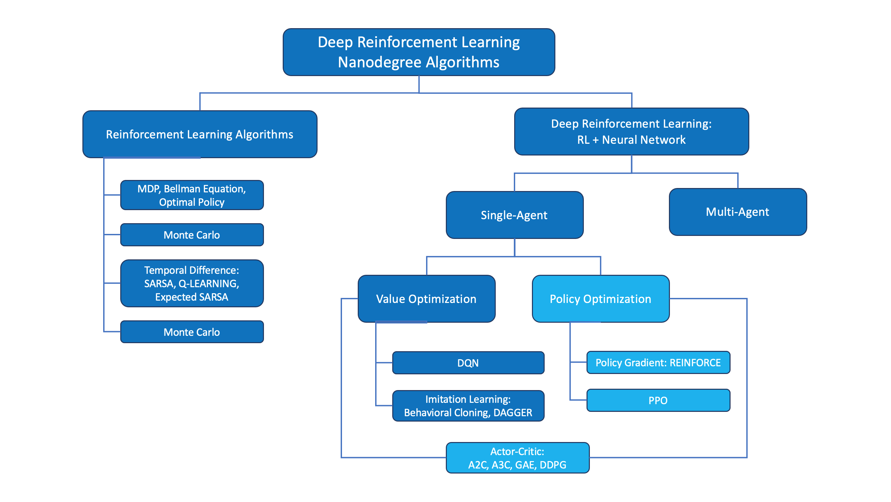

# Deep RL for Finance (Optional)
In this optional lesson, you will learn how to apply deep reinforcement learning techniques for optimal execution of portfolio transactions.

## Resources:

Read the most famous [blog post](http://karpathy.github.io/2016/05/31/rl/) on policy gradient methods.
Implement a policy gradient method to win at Pong in this [Medium post](https://medium.com/@dhruvp/how-to-write-a-neural-network-to-play-pong-from-scratch-956b57d4f6e0).
Learn more about [evolution strategies](https://blog.openai.com/evolution-strategies/) from OpenAI.

<figure align="center">

</figure>

## Policies:

Neural network that encodes action probabilities ([Source](https://openai.com/index/evolution-strategies/))
