# Dynamic Programming

## Introduction

Follow the instructions in `Dynamic_Programming.ipynb` to write your own implementations of many dynamic programming algorithms!  The corresponding solutions can be found in `Dynamic_Programming_Solution.ipynb`.  

In the dynamic programming setting, the agent has full knowledge of the Markov decision process (MDP) that characterizes the environment. (This is much easier than the reinforcement learning setting, where the agent initially knows nothing about how the environment decides state and reward and must learn entirely from interaction how to select actions.)

This lesson covers material in Chapter 4 (especially 4.1-4.4) of the textbook(RL Book - SuttonBartoI).

---

# OpenAI Gym: FrozenLakeEnv

## FrozenLake Environment

In this lesson, you will write your own Python implementations of all of the algorithms that we discuss. While your algorithms will be designed to work with any OpenAI Gym environment, you will test your code with the **FrozenLake** environment.

Source: [Frozen Lake image](http://eskipaper.com/images/frozen-lake-6.jpg)

In the FrozenLake environment, the agent navigates a **4 × 4 gridworld**. You can read more about the environment in its corresponding [GitHub file](https://github.com/openai/gym/blob/master/gym/envs/toy_text/frozen_lake.py), by reading the commented block in the `FrozenLakeEnv` class. For clarity, we have also pasted the description of the environment below:

```text
Winter is here. You and your friends were tossing around a frisbee at the park
when you made a wild throw that left the frisbee out in the middle of the lake.
The water is mostly frozen, but there are a few holes where the ice has melted.
If you step into one of those holes, you'll fall into the freezing water.
At this time, there's an international frisbee shortage, so it's absolutely imperative that
you navigate across the lake and retrieve the disc.
However, the ice is slippery, so you won't always move in the direction you intend.

The surface is described using a grid like the following:

    SFFF
    FHFH
    FFFH
    HFFG

S : starting point, safe
F : frozen surface, safe
H : hole, fall to your doom
G : goal, where the frisbee is located

The episode ends when you reach the goal or fall in a hole.
You receive a reward of 1 if you reach the goal, and zero otherwise.
```

## The Dynamic Programming Setting

Environments in OpenAI Gym are designed with the reinforcement learning setting in mind. For this reason, OpenAI Gym does not allow easy access to the underlying one-step dynamics of the Markov Decision Process (MDP).

Towards using the FrozenLake environment for the dynamic programming setting, we had to first download the [file](https://github.com/openai/gym/blob/master/gym/envs/toy_text/frozen_lake.py) containing the `FrozenLakeEnv` class. Then, we added a single line of code to share the one-step dynamics of the MDP with the agent.

```python
# obtain one-step dynamics for dynamic programming setting
self.P = P
```

The new `FrozenLakeEnv` class was then saved in a Python file **`frozenlake.py`**, which we will use instead of the original OpenAI Gym file to create an instance of the environment.

---

# An Iterative Method

In this concept, we will examine some ideas from the last video in more detail.

<figure>
  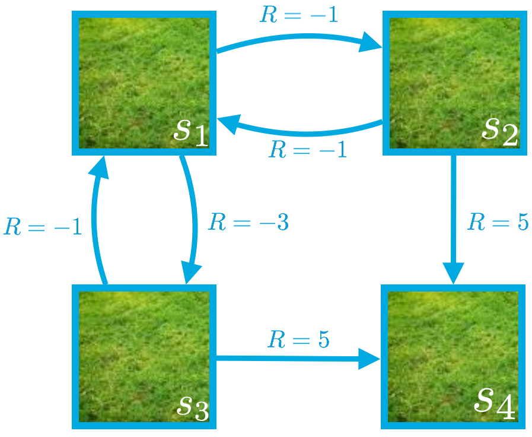
  <figcaption>Figure 1: An iterative method for computing the value function.</figcaption>
</figure>

## Notes on the Bellman Expectation Equation

In the previous video, we derived one equation for each environment state. For instance, for state $s_1$, we saw that:

$$v_\pi(s_1) = \frac{1}{2}\left(-1 + v_\pi(s_2)\right) + \frac{1}{2}\left(-3 + v_\pi(s_3)\right)$$

We mentioned that this equation follows directly from the Bellman expectation equation for $v_\pi$.

$$v_\pi(s) = \mathbb{E}_\pi\left[R_{t+1} + \gamma v_\pi(S_{t+1}) \mid S_t=s\right] = \sum_{a \in \mathcal{A}(s)} \pi(a \mid s) \sum_{s' \in \mathcal{S},\, r \in \mathcal{R}} p(s',r \mid s,a)\left(r+\gamma v_\pi(s')\right)$$

**The Bellman expectation equation for $v_\pi$**

In order to see this, we can begin by looking at what the Bellman expectation equation tells us about the value of state $s_1$ (where we just need to plug in $s_1$ for state $s$).

$$v_\pi(s_1) = \sum_{a \in \mathcal{A}(s_1)} \pi(a \mid s_1) \sum_{s' \in \mathcal{S},\, r \in \mathcal{R}} p(s',r \mid s_1,a)\left(r+\gamma v_\pi(s')\right)$$

Then, it's possible to derive the equation for state $s_1$ by using the following:

1. $\mathcal{A}(s_1)=\{\text{down},\text{right}\}$  
   *(When in state $s_1$, the agent only has two potential actions: down or right.)*

2. $\pi(\text{down}\mid s_1)=\pi(\text{right}\mid s_1)=\frac{1}{2}$  
   *(We are currently examining the policy where the agent goes down with 50% probability and right with 50% probability when in state $s_1$.)*

3. $p(s_3,-3\mid s_1,\text{down})=1$ and $p(s',r\mid s_1,\text{down})=0$ if $s'\neq s_3$ or $r\neq -3$.  
   *(If the agent chooses to go down in state $s_1$, then with 100% probability, the next state is $s_3$, and the agent receives a reward of -3.)*

4. $p(s_2,-1\mid s_1,\text{right})=1$ and $p(s',r\mid s_1,\text{right})=0$ if $s'\neq s_2$ or $r\neq -1$.  
   *(If the agent chooses to go right in state $s_1$, then with 100% probability, the next state is $s_2$, and the agent receives a reward of -1.)*

5. $\gamma=1$  
   *(We chose to set the discount rate to 1 in this gridworld example.)*

If this is not entirely clear to you, please take the time now to plug in the values to derive the equation from the video. Then, you are encouraged to repeat the same process for the other states.

## Notes on Solving the System of Equations

In the video, we mentioned that you can directly solve the system of equations:

$$v_\pi(s_1) = \frac{1}{2}\left(-1+v_\pi(s_2)\right) + \frac{1}{2}\left(-3+v_\pi(s_3)\right)$$

$$v_\pi(s_2) = \frac{1}{2}\left(-1+v_\pi(s_1)\right) + \frac{1}{2}\left(5+v_\pi(s_4)\right)$$

$$v_\pi(s_3) = \frac{1}{2}\left(-1+v_\pi(s_1)\right) + \frac{1}{2}\left(5+v_\pi(s_4)\right)$$

$$v_\pi(s_4)=0$$

Since the equations for $v_\pi(s_2)$ and $v_\pi(s_3)$ are identical, we must have that:

$$v_\pi(s_2)=v_\pi(s_3)$$

Thus, the equations for $v_\pi(s_1)$ and $v_\pi(s_2)$ can be changed to:

$$v_\pi(s_1) = \frac{1}{2}\left(-1+v_\pi(s_2)\right) + \frac{1}{2}\left(-3+v_\pi(s_2)\right) = -2+v_\pi(s_2)$$

$$v_\pi(s_2) = \frac{1}{2}\left(-1+v_\pi(s_1)\right) + \frac{1}{2}(5+0) = 2+\frac{1}{2}v_\pi(s_1)$$

Combining the two latest equations yields:

$$v_\pi(s_1) = -2+2+\frac{1}{2}v_\pi(s_1) = \frac{1}{2}v_\pi(s_1)$$

which implies:

$$v_\pi(s_1)=0$$

Furthermore:

$$v_\pi(s_3)=v_\pi(s_2)=2+\frac{1}{2}v_\pi(s_1)=2+0=2$$

Thus, the state-value function is given by:

$$v_\pi(s_1)=0$$

$$v_\pi(s_2)=2$$

$$v_\pi(s_3)=2$$

$$v_\pi(s_4)=0$$

**Note.** This example serves to illustrate the fact that it is **possible** to *directly* solve the system of equations given by the Bellman expectation equation for $v_\pi$. However, in practice, and especially for much larger Markov decision processes (MDPs), we will instead use an *iterative* solution approach.

---

# Quiz

So far in this lesson, we have discussed how an agent might obtain the state-value function $v_\pi$ corresponding to a policy $\pi$.

In the dynamic programming setting, the agent has full knowledge of the Markov decision process (MDP). In this case, it's possible to use the one-step dynamics $p(s',r \mid s,a)$ of the MDP to obtain a system of equations corresponding to the Bellman expectation equation for $v_\pi$.

In the gridworld example, the system of equations corresponding to the equiprobable random policy was given by:

$$v_\pi(s_1)=\frac{1}{2}\left(-1+v_\pi(s_2)\right)+\frac{1}{2}\left(-3+v_\pi(s_3)\right)$$

$$v_\pi(s_2)=\frac{1}{2}\left(-1+v_\pi(s_1)\right)+\frac{1}{2}\left(5+v_\pi(s_4)\right)$$

$$v_\pi(s_3)=\frac{1}{2}\left(-1+v_\pi(s_1)\right)+\frac{1}{2}\left(5+v_\pi(s_4)\right)$$

$$v_\pi(s_4)=0$$

In order to obtain the state-value function, we need only solve the system of equations.

While it is always possible to *directly* solve the system, we will instead use an *iterative* solution approach.

## An Iterative Method

The iterative method begins with an initial guess for the value of each state. In particular, we began by assuming that the value of each state was zero.

Then, we looped over the state space and amended the estimate for the state-value function through applying successive update equations.

Recall that $V$ denotes the most recent guess for the state-value function, and the update equations are:

$$V(s_1)\leftarrow\frac{1}{2}\left(-1+V(s_2)\right)+\frac{1}{2}\left(-3+V(s_3)\right)$$

$$V(s_2)\leftarrow\frac{1}{2}\left(-1+V(s_1)\right)+\frac{1}{2}(5)$$

$$V(s_3)\leftarrow\frac{1}{2}\left(-1+V(s_1)\right)+\frac{1}{2}(5)$$

## Quiz Question

Say that the most recent guess for the state-value function is given in the figure below.

<figure>
  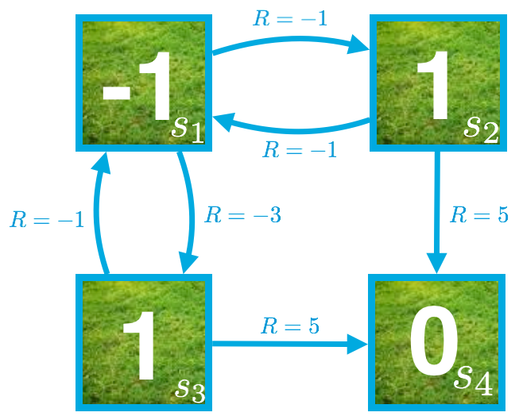
</figure>

Currently, the estimate for $v_\pi(s_2)$ is given by:

$$V(s_2)=1$$

Say that the next step in the algorithm is to update $V(s_2)$.

What is the new value for $V(s_2)$ after applying the update step once?

---

# Iterative Policy Evaluation

## Implementation: Iterative Policy Evaluation

The pseudocode for **iterative policy evaluation** can be found below.

<figure>
  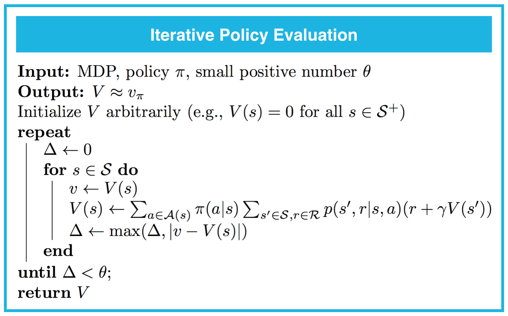
</figure>

Note that policy evaluation is guaranteed to converge to the state-value function $v_\pi$ corresponding to a policy $\pi$, as long as $v_\pi(s)$ is finite for each state $s \in \mathcal{S}$.

For a finite Markov decision process (MDP), this is guaranteed as long as either:

1. $\gamma < 1$, or
2. if the agent starts in any state $s \in \mathcal{S}$, it is guaranteed to eventually reach a terminal state if it follows policy $\pi$.

Please use the next concept to complete **Part 0: Explore FrozenLakeEnv** and **Part 1: Iterative Policy Evaluation** of `Dynamic_Programming.ipynb`. Remember to save your work!

If you'd like to reference the pseudocode while working on the notebook, you are encouraged to open [this sheet](https://github.com/udacity/rl-cheatsheet/blob/master/cheatsheet.pdf) in a new window.

Feel free to check your solution by looking at the corresponding sections in `Dynamic_Programming_Solution.ipynb`.

> **Note:** In order to access this file, you need only click on "jupyter" in the top-left corner to return to the Notebook dashboard.

To find `Dynamic_Programming_Solution.ipynb`, return to the Notebook dashboard.

## Optional: Additional Note on the Convergence Conditions

To see intuitively *why* the conditions for convergence make sense, consider the case that neither of the conditions is satisfied, so:

1. $\gamma = 1$, and
2. there is some state $s \in \mathcal{S}$ where, if the agent starts in that state, it will never encounter a terminal state if it follows policy $\pi$.

In this case:

1. reward is not discounted, and
2. an episode may never finish.

Then, it is possible that iterative policy evaluation will not converge, and this is because the state-value function may not be well-defined!

To see this, note that in this case, calculating a state value could involve adding up an infinite number of expected rewards, where the sum may not [converge](https://en.wikipedia.org/wiki/Convergent_series).

### Concrete Example

Consider an MDP with:

1. two states $s_1$ and $s_2$, where $s_2$ is a terminal state,
2. one action $a$,
3. $p(s_1, 1 \mid s_1, a) = 1$.

> **Note:** An MDP with only one action can also be referred to as a **Markov Reward Process (MRP)**.

In this case, say the agent's policy $\pi$ is to "select" the only action that's available, so:

$$\pi(s_1) = a$$

Say:

$$\gamma = 1$$

According to the one-step dynamics, if the agent starts in state $s_1$, it will stay in that state forever and never encounter the terminal state $s_2$.

In this case, **$v_\pi(s_1)$ is not well-defined**.

To see this, remember that $v_\pi(s_1)$ is the expected return after visiting state $s_1$, and we have:

$$v_\pi(s_1) = 1 + 1 + 1 + 1 + \cdots$$

which [diverges](https://en.wikipedia.org/wiki/Divergent_series) to infinity.

Take the time now to convince yourself that if either of the two convergence conditions were satisfied in this example, then $v_\pi(s_1)$ would be well-defined.

As a **very optional** next step, if you want to verify this mathematically, you may find it useful to review [geometric series](https://en.wikipedia.org/wiki/Geometric_series) and the [negative binomial distribution](https://en.wikipedia.org/wiki/Negative_binomial_distribution).

---

# Action Values

In a previous concept, you wrote your own implementation of iterative policy evaluation to estimate the state-value function $v_\pi$ for a policy $\pi$.

In this concept, you will use the simple gridworld from the videos to practice converting a state-value function $v_\pi$ to an action-value function $q_\pi$.

Consider the small gridworld that we used to illustrate iterative policy evaluation. The **state-value function** for the equiprobable random policy is visualized below.


<figure>
  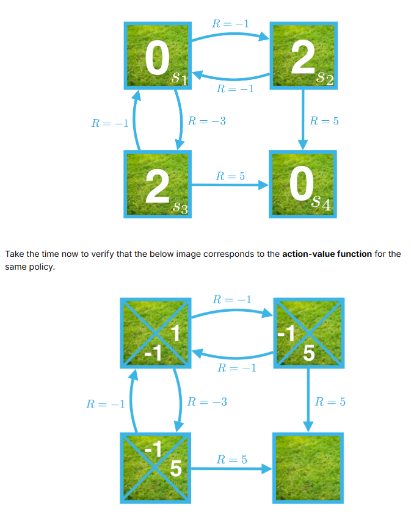
</figure>

As an example, consider $q_\pi(s_1,\text{right})$. This action value can be calculated as:

$$q_\pi(s_1,\text{right}) = -1 + v_\pi(s_2) = -1 + 2 = 1$$

where we just use the fact that we can express the value of the state-action pair $(s_1,\text{right})$ as the sum of two quantities:

1. the immediate reward after moving right and landing on state $s_2$, and
2. the cumulative reward obtained if the agent begins in state $s_2$ and follows the policy.

Please now use the state-value function $v_\pi$ to calculate:

- $q_\pi(s_1,\text{down})$
- $q_\pi(s_2,\text{left})$
- $q_\pi(s_2,\text{down})$
- $q_\pi(s_3,\text{up})$
- $q_\pi(s_3,\text{right})$

## For More Complex Environments

In this simple gridworld example, the environment is **deterministic**. In other words, after the agent selects an action, the next state and reward are 100% guaranteed and non-random.

For deterministic environments:

$$p(s',r\mid s,a) \in \{0,1\}$$

for all $s',r,s,a$.

In this case, when the agent is in state $s$ and takes action $a$, the next state $s'$ and reward $r$ can be predicted with certainty, and we must have:

$$q_\pi(s,a) = r + \gamma v_\pi(s')$$

In general, the environment need not be deterministic and may instead be **stochastic**.

This is the default behavior of the `FrozenLake` environment from the mini project. In this case, once the agent selects an action, the next state and reward cannot be predicted with certainty and instead are random draws from a conditional probability distribution:

$$p(s',r\mid s,a)$$

When the agent is in state $s$ and takes action $a$, the probability of each possible next state $s'$ and reward $r$ is given by $p(s',r\mid s,a)$.

In this case, we must have:

$$q_\pi(s,a) = \sum_{s' \in \mathcal{S}^+,\,r \in \mathcal{R}} p(s',r\mid s,a)\left(r+\gamma v_\pi(s')\right)$$

where we take the expected value of:

$$r+\gamma v_\pi(s')$$

The important difference is therefore:

- **Deterministic environment:** there is one certain $(s',r)$ outcome, so $q_\pi(s,a)=r+\gamma v_\pi(s')$.
- **Stochastic environment:** there can be multiple $(s',r)$ outcomes, so their values are weighted by their transition probabilities $p(s',r\mid s,a)$ and summed.

Over the next couple concepts, you'll use this equation to write a function that yields an action-value function $q_\pi$ corresponding to a policy $\pi$ for the `FrozenLake` environment.

---

# Implementation

## Estimation of Action Values

In the next concept, you will write an algorithm that accepts an estimate $V$ of the state-value function $v_\pi$, along with the one-step dynamics of the MDP $p(s',r\mid s,a)$, and returns an estimate $Q$ of the action-value function $q_\pi$.

In order to do this, you will need to use the equation discussed in the previous concept, which uses the one-step dynamics $p(s',r\mid s,a)$ of the Markov decision process (MDP) to obtain $q_\pi$ from $v_\pi$.

Namely,

$$q_\pi(s,a)=\sum_{s'\in\mathcal{S}^+,\,r\in\mathcal{R}}p(s',r\mid s,a)\left(r+\gamma v_\pi(s')\right)$$

holds for all $s\in\mathcal{S}$ and $a\in\mathcal{A}(s)$.

You can find the associated pseudocode below.

<figure>
  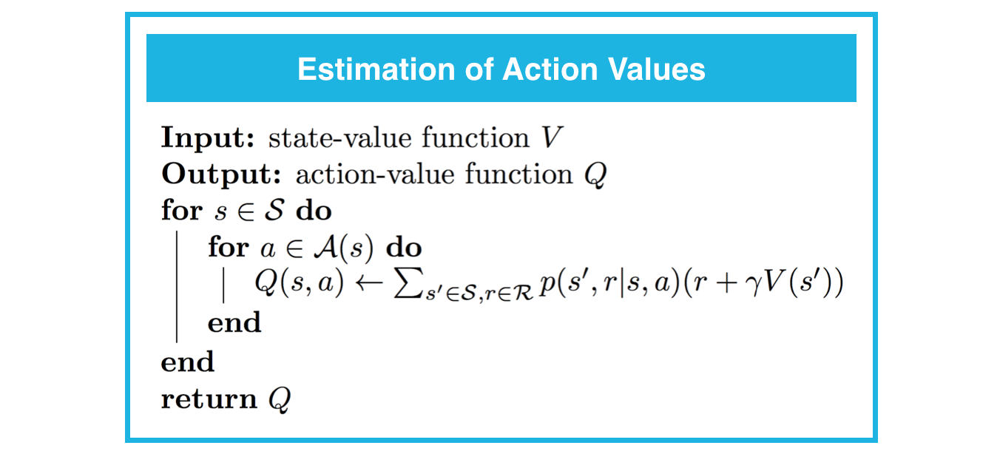
</figure>

Please use the next concept to complete **Part 2: Obtain $q_\pi$ from $v_\pi$** of `Dynamic_Programming.ipynb`. Remember to save your work!

If you'd like to reference the pseudocode while working on the notebook, you are encouraged to open [this sheet](https://github.com/udacity/rl-cheatsheet/blob/master/cheatsheet.pdf) in a new window.

Feel free to check your solution by looking at the corresponding section in `Dynamic_Programming_Solution.ipynb`.

---

# Policy Improvement

## Implementation

In the last lesson, you learned that given an estimate $Q$ of the action-value function $q_\pi$ corresponding to a policy $\pi$, it is possible to construct an improved (or equivalent) policy $\pi'$, where $\pi' \geq \pi$.

For each state $s \in \mathcal{S}$, you need only select the action that maximizes the action-value function estimate. In other words,

$$\pi'(s)=\arg\max_{a\in\mathcal{A}(s)}Q(s,a)$$

for all $s \in \mathcal{S}$.

The full pseudocode for **policy improvement** can be found below.

<figure>
  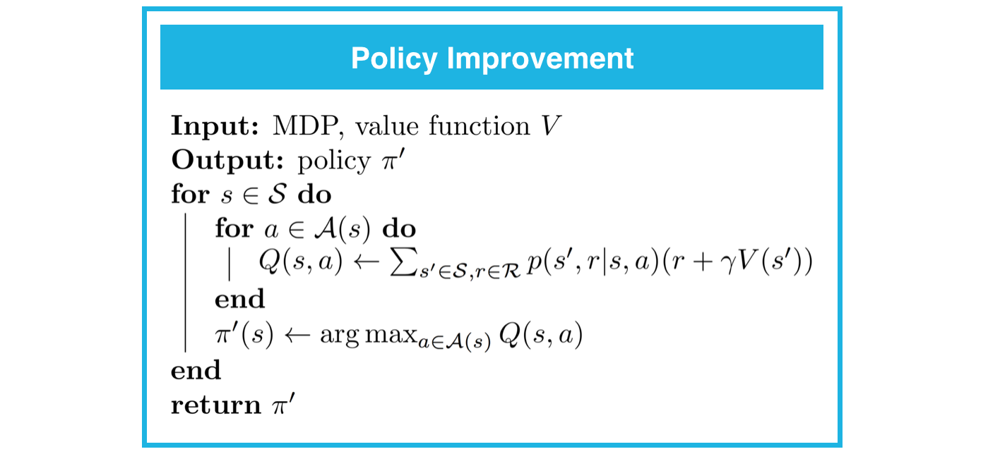
</figure>

In the event that there is some state $s \in \mathcal{S}$ for which

$$\arg\max_{a\in\mathcal{A}(s)}Q(s,a)$$

is not unique, there is some flexibility in how the improved policy $\pi'$ is constructed.

In fact, as long as the policy $\pi'$ satisfies, for each $s \in \mathcal{S}$ and $a \in \mathcal{A}(s)$:

$$\pi'(a\mid s)=0 \quad \text{if} \quad a\notin\arg\max_{a'\in\mathcal{A}(s)}Q(s,a')$$

it is an improved policy.

In other words, any policy that, for each state, assigns zero probability to the actions that do not maximize the action-value function estimate for that state is an improved policy.

Feel free to play around with this in your implementation!

Please use the next concept to complete **Part 3: Policy Improvement** of `Dynamic_Programming.ipynb`. Remember to save your work!

If you'd like to reference the pseudocode while working on the notebook, you are encouraged to open [this sheet](https://github.com/udacity/rl-cheatsheet/blob/master/cheatsheet.pdf) in a new window.

Feel free to check your solution by looking at the corresponding section in `Dynamic_Programming_Solution.ipynb`.

---

# Policy Iteration

### Implementation

In the previous concept, you learned about **policy iteration**, which proceeds as a series of alternating policy evaluation and improvement steps.

Policy iteration is guaranteed to find the optimal policy for any finite Markov decision process (MDP) in a finite number of iterations.

The pseudocode can be found below.

<figure>
  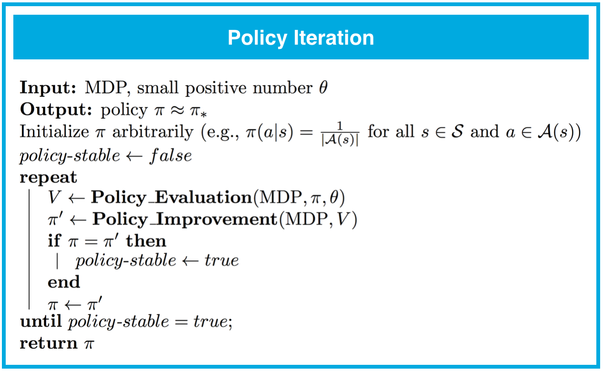
</figure>

Please use the next concept to complete **Part 4: Policy Iteration** of `Dynamic_Programming.ipynb`. Remember to save your work!

If you'd like to reference the pseudocode while working on the notebook, you are encouraged to open [this sheet](https://github.com/udacity/rl-cheatsheet/blob/master/cheatsheet.pdf) in a new window.

Feel free to check your solution by looking at the corresponding section in `Dynamic_Programming_Solution.ipynb`.

---

# Truncated Policy Iteration

## Implementation

In the previous concept, you learned about **truncated policy evaluation**. Whereas (iterative) policy evaluation applies as many Bellman updates as needed to attain convergence, truncated policy evaluation only performs a fixed number of sweeps through the state space.

The pseudocode can be found below.

<figure>
  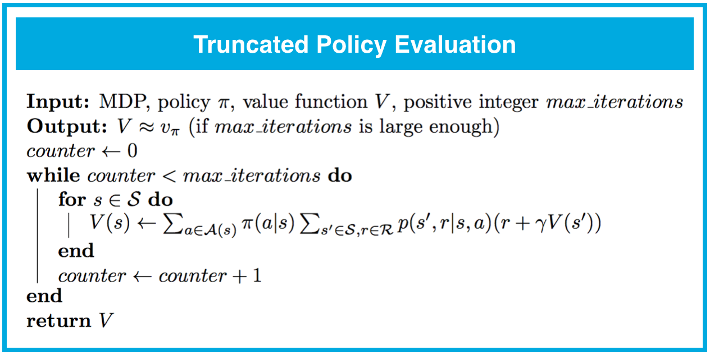
</figure>

We can incorporate this amended policy evaluation algorithm into an algorithm similar to policy iteration, called **truncated policy iteration**.

The pseudocode can be found below.

<figure>
  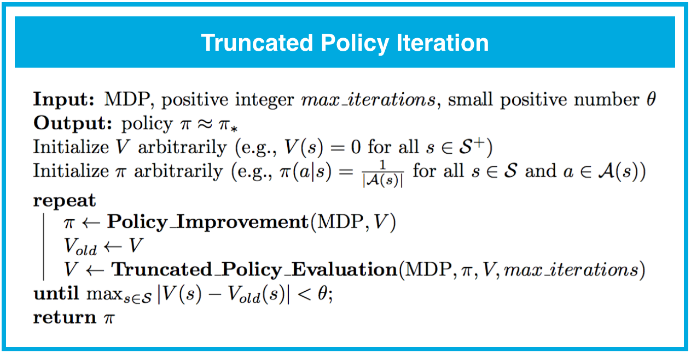
</figure>

You may also notice that the stopping criterion for truncated policy iteration differs from that of policy iteration.

In policy iteration, we terminated the loop when the policy was unchanged after a single policy improvement step. In truncated policy iteration, we stop the loop only when the value function estimate has converged.

You are strongly encouraged to try out both stopping criteria to build your intuition. However, we note that checking for an unchanged policy is unlikely to work if the hyperparameter `max_iterations` is set too small.

To see this, consider the case that `max_iterations` is set to a small value. Then, even if the algorithm is far from convergence to the optimal value function $v_*$ or optimal policy $\pi_*$, you can imagine that updates to the value function estimate $V$ may be too small to result in any updates to its corresponding policy.

Please use the next concept to complete **Part 5: Truncated Policy Iteration** of `Dynamic_Programming.ipynb`. Remember to save your work!

If you'd like to reference the pseudocode while working on the notebook, you are encouraged to open [this sheet](https://github.com/udacity/rl-cheatsheet/blob/master/cheatsheet.pdf) in a new window.

Feel free to check your solution by looking at the corresponding section in `Dynamic_Programming_Solution.ipynb`.

---

# Value Iteration

## Implementation

In the previous concept, you learned about **value iteration**. In this algorithm, each sweep over the state space effectively performs both policy evaluation and policy improvement. Value iteration is guaranteed to find the optimal policy $\pi_*$ for any finite MDP.

The pseudocode can be found below.

<figure>
  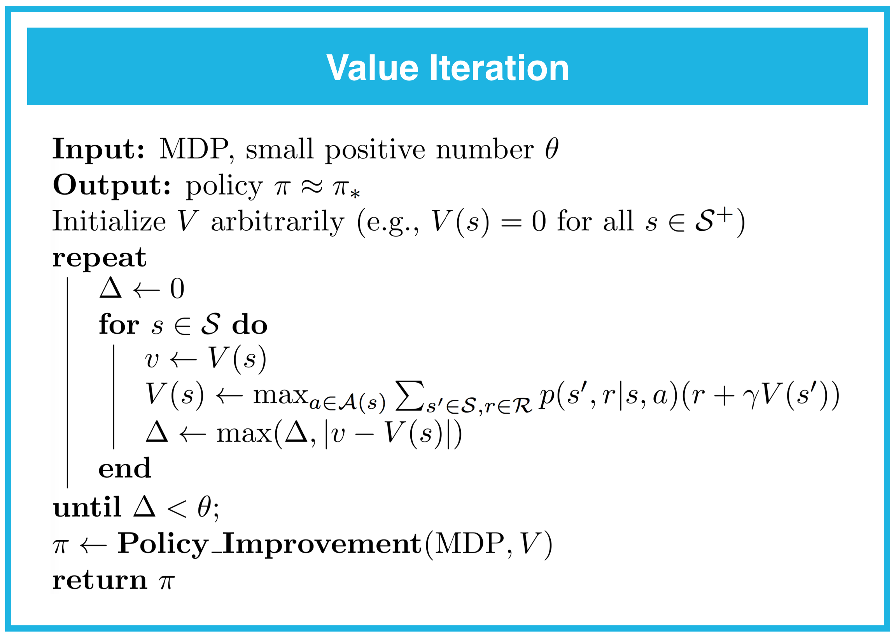
</figure>

Note that the stopping criterion is satisfied when the difference between successive value function estimates is sufficiently small. In particular, the loop terminates if the difference is less than $\theta$ for each state.

And, the closer we want the final value function estimate to be to the optimal value function, the smaller we need to set the value of $\theta$.

Feel free to play around with the value of $\theta$ in your implementation; note that in the case of the `FrozenLake` environment, values around `1e-8` seem to work reasonably well.

For those of you who are interested in *more rigorous* guidelines on how exactly to set the value of $\theta$, you might be interested in perusing [this paper](http://www.leemon.com/papers/1993wb2.pdf), where you are encouraged to pay particular attention to Theorem 3.2.

Their main result of interest can be summarized as follows:

Let $V_{\text{final}}$ denote the final value function estimate that is calculated by the algorithm. Then it can be shown that $V_{\text{final}}$ differs from the optimal value function $v_*$ by at most:

$$\frac{2\theta\gamma}{1-\gamma}$$

In other words,

$$\max_{s\in\mathcal{S}}\left|V_{\text{final}}(s)-v_*(s)\right| < \frac{2\theta\gamma}{1-\gamma}$$

Please use the next concept to complete **Part 6: Value Iteration** of `Dynamic_Programming.ipynb`. Remember to save your work!

If you'd like to reference the pseudocode while working on the notebook, you are encouraged to open [this sheet](https://github.com/udacity/rl-cheatsheet/blob/master/cheatsheet.pdf) in a new window.

Feel free to check your solution by looking at the corresponding section in `Dynamic_Programming_Solution.ipynb`.

---

# Summary

<figure>
  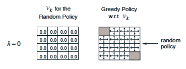
</figure>

## Introduction

- In the **dynamic programming** setting, the agent has full knowledge of the MDP. (This is much easier than the **reinforcement learning** setting, where the agent initially knows nothing about how the environment decides state and reward and must learn entirely from interaction how to select actions.)

## An Iterative Method

- In order to obtain the state-value function $v_\pi$ corresponding to a policy $\pi$, we need only solve the system of equations corresponding to the Bellman expectation equation for $v_\pi$.
- While it is possible to analytically solve the system, we will focus on an iterative solution approach.

## Iterative Policy Evaluation

- **Iterative policy evaluation** is an algorithm used in the dynamic programming setting to estimate the state-value function $v_\pi$ corresponding to a policy $\pi$. In this approach, a Bellman update is applied to the value function estimate until the changes to the estimate are nearly imperceptible.

<figure>
  
</figure>

## Estimation of Action Values

- In the dynamic programming setting, it is possible to quickly obtain the action-value function $q_\pi$ from the state-value function $v_\pi$ with the equation:

$$q_\pi(s,a)=\sum_{s'\in\mathcal{S},\,r\in\mathcal{R}}p(s',r\mid s,a)\left(r+\gamma v_\pi(s')\right)$$

<figure>
  
</figure>

## Policy Improvement

- **Policy improvement** takes an estimate $V$ of the state-value function $v_\pi$ corresponding to a policy $\pi$, and returns an improved (or equivalent) policy $\pi'$, where $\pi' \geq \pi$. The algorithm first constructs the action-value function estimate $Q$. Then, for each state $s\in\mathcal{S}$, you need only select the action $a$ that maximizes $Q(s,a)$. In other words:

$$\pi'(s)=\arg\max_{a\in\mathcal{A}(s)}Q(s,a)$$

for all $s\in\mathcal{S}$.

<figure>
  
</figure>

## Policy Iteration

- **Policy iteration** is an algorithm that can solve an MDP in the dynamic programming setting. It proceeds as a sequence of policy evaluation and improvement steps, and is guaranteed to converge to the optimal policy for an arbitrary *finite* MDP.

<figure>
  
</figure>

## Truncated Policy Iteration

- **Truncated policy iteration** is an algorithm used in the dynamic programming setting in which the policy evaluation step is stopped after a fixed number of sweeps through the state space. We refer to the algorithm in the evaluation step as **truncated policy evaluation**.

<figure>
  
</figure>

<figure>
  
</figure>

## Value Iteration

- **Value iteration** is an algorithm used in the dynamic programming setting to obtain the optimal value function and corresponding optimal policy. In this approach, each sweep over the state space simultaneously performs policy evaluation and policy improvement.

<figure>
  
</figure>