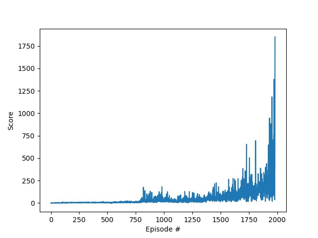

# Project 2: Continuous Control
## Crawler Report

This report documents training the Unity Crawler environment with Soft Actor-Critic
(SAC). Crawler is the optional, more difficult continuous-control challenge
described in the [project README](README.md).

## Environment

Crawler contains 10 parallel agents, each controlling a four-legged creature.
Each agent receives a 172-value vector observation and outputs 20 continuous
actions, bounded to `[-1, 1]`. The goal is to move forward in the target
direction while staying upright. Rewards encourage both matching the target
velocity and aligning the body with the target direction.

The training driver averages the total reward of the 10 agents to produce one
score per episode. Its solve condition is a mean score of at least `+300` over
100 consecutive episodes.

## Learning Algorithm

The training uses SAC, an off-policy actor-critic method. The actor represents a
Gaussian action distribution and applies `tanh` to keep actions within the
environment bounds. Two critics estimate action values; the smaller of their
estimates is used in the target and actor objective to reduce overestimation.
SAC optimizes both expected return and policy entropy, with the entropy
temperature automatically tuned during training.

At each environment step:

1. The actor samples actions for all agents and the Unity environment returns
   next states, rewards, and episode-completion flags.
2. Each agent's transition is added to a shared replay buffer.
3. On the configured update schedule, minibatches are sampled to update both
   critics and the actor. The target critics are soft-updated toward the local
   critics.
4. The temperature is updated to encourage the target policy entropy.

The default run uses uniform replay. Prioritized replay can be enabled with
`--prioritized_replay`.

## Hyperparameters

Defaults from `main.py` used by the training driver:

| Parameter | Value |
| --- | ---: |
| Replay buffer capacity | 100,000 transitions |
| Minibatch size | 128 |
| Discount factor (`gamma`) | 0.99 |
| Soft-update factor (`tau`) | 0.005 |
| Actor learning rate | 0.0001 |
| Critic learning rate | 0.001 |
| Learning-rate step size | 50 episodes |
| Learning-rate decay (`lr_gamma`) | 0.95 |
| Update interval | 20 environment steps |
| Updates per interval | 10 |
| Episodes shown in training plot | 2,000 |
| Maximum steps per episode | 1,000 |

The SAC network's actor and each critic use two hidden layers of 400 and 300
units. The policy's log standard deviation is clamped to `[-5, 2]`; the
automatically tuned target entropy is `-0.5` times the action dimension.

## Results

The training score plot shows per-episode mean reward across the parallel
agents. Scores are low early in training, then trend upward with substantial
episode-to-episode variation; later episodes include scores above 1,000, with a
peak near 1,850.



This plot displays individual episode scores, not their 100-episode moving
average. It therefore illustrates learning progress but does not by itself
establish that the training driver's `+300` solve condition was met.

## Reproducibility

From the repository root, install the project environment as described in the
[project README](README.md), download and extract the Windows 64-bit Crawler
environment at
`p2_continuous-control/crawler/Crawler_Windows_x86_64/Crawler.exe`, then run:

```powershell
python p2_continuous-control/crawler/main.py --algorithm SAC --n_episodes 2000 --max_t 1000
```

The driver seeds Python, NumPy, and PyTorch with `0`. It saves SAC network
weights to `crawler/checkpoint_sac.pth` every 100 episodes (and on reaching its
solve condition), and writes the score plot to
`crawler/reports/crawler_sac_score.png`.
