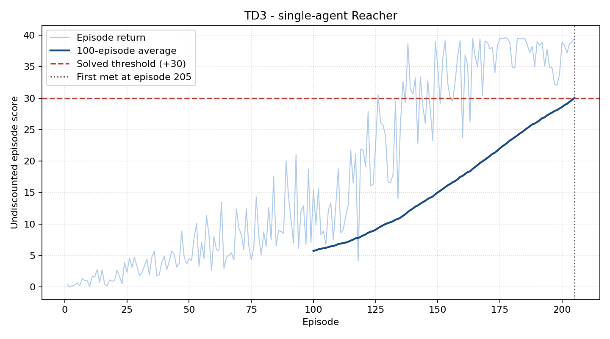
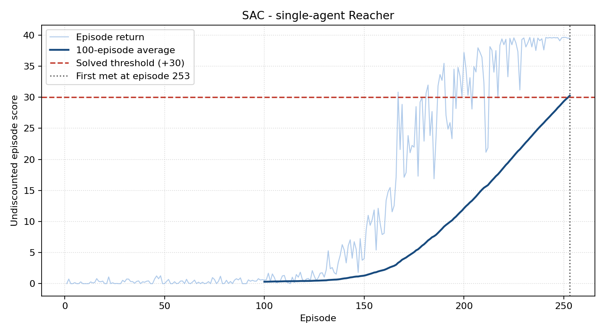

# Project 2: Continuous Control
## Single-Agent Reacher Report

This report covers the **one-agent Reacher environment** and the TD3 and SAC
training runs. The environment and success criteria follow the
[project README](README.md).

## Usage and Environment Setup

The project Conda environment is named `drl_env_py_3_9`. Its configuration
pins Python to 3.9; the environment used for this report runs **Python 3.9.23**.

From the repository root, initialize the shell for Conda if needed, create the
environment, and activate it:

```powershell
conda init powershell
# Restart PowerShell after initialization, if prompted.
conda env create -f environment.yml
conda activate drl_env_py_3_9
python --version
```

Download and extract the **Windows 64-bit, one-agent Reacher** build as
described in the [README](README.md). The training script expects the executable
at `p2_continuous-control/reacher_one_agent/Reacher_Windows_x86_64/Reacher.exe`.
Run the commands below from the repository root:

```powershell
python p2_continuous-control/reacher_one_agent/main.py --algorithm TD3 --n_episodes 500 --max_t 1000
python p2_continuous-control/reacher_one_agent/main.py --algorithm SAC --n_episodes 500 --max_t 1000
```

Add `--prioritized_replay` to enable prioritized experience replay; omit it to
use uniform replay. Other training parameters, including buffer size, batch
size, learning rates, and device, can be overridden with the script's
corresponding command-line options.

## Environment and Success Criterion

The agent controls a double-jointed arm and receives an undiscounted reward of
`+0.1` for each step its hand remains in the target. Each observation contains
33 values, and the continuous action consists of four values in `[-1, 1]`.

For the **single-agent** setup, the environment is solved when the average
score over **100 consecutive episodes** is at least `+30`. An episode score is
the sum of rewards collected during that episode.

## Results

| Algorithm | Episodes completed when criterion was first met | First qualifying 100-episode average |
| --- | ---: | ---: |
| TD3 | 205 | 30.04 |
| SAC | 253 | 30.25 |

Both runs met the single-agent success criterion. “Episodes completed” is the
total number of training episodes through the first threshold crossing. The
training script's success message reports `i_episode - 100` (105 for TD3 and
153 for SAC), which excludes the 100-episode evaluation window; the table uses
the full episode count.

### TD3

The 100-episode moving average first reached `+30` at episode **205** (30.04).



### SAC

The 100-episode moving average first reached `+30` at episode **253** (30.25).



The refreshed plots show per-episode return, its 100-episode moving average,
the `+30` success threshold, and the first episode at which the criterion was
met.