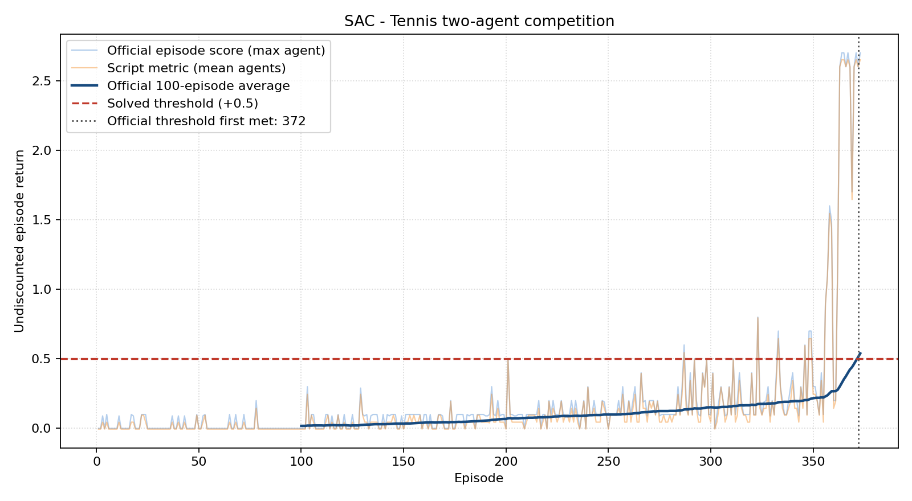
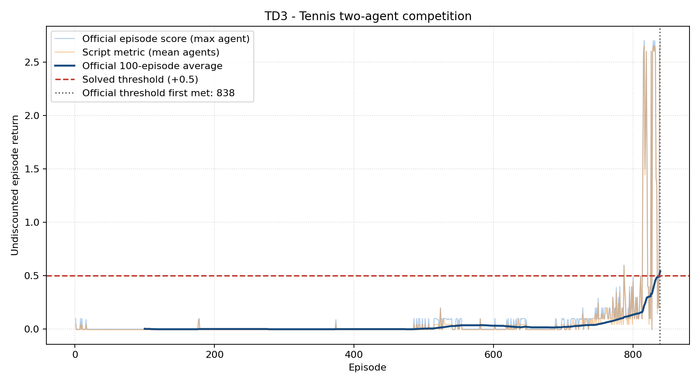

# Project 3: Collaboration and Competition
## Tennis Training Report

This report covers the two-agent Tennis environment and the TD3 and SAC
training runs. Environment details and the success criterion are based on the
[project README](../README.md).

## Usage and Environment Setup

The project Conda environment is named `drl_env_py_3_9`. The environment file
specifies Python 3.9; the available project interpreter is **Python 3.9.23**.

From the repository root, initialize Conda for PowerShell if needed, create the
environment, and activate it:

```powershell
conda init powershell
# Restart PowerShell after initialization, if prompted.
conda env create -f environment.yml
conda activate drl_env_py_3_9
python --version
```

Download and extract the **Windows 64-bit Tennis** build as described in the
[project README](../README.md). The training script expects the executable at
`p3_collab-compet/tennis/Tennis_Windows_x86_64/Tennis.exe`. Run from the
repository root:

```powershell
python p3_collab-compet/tennis/main.py --algorithm SAC --n_episodes 1000 --max_t 1000
python p3_collab-compet/tennis/main.py --algorithm TD3 --n_episodes 1000 --max_t 1000
```

Add `--prioritized_replay` to enable prioritized experience replay; omit it to
use uniform replay. The other training parameters can be overridden with the
script's corresponding command-line options.

## Environment and Success Criterion

Two agents control rackets and each receives its own local observation of eight
values. Each agent has two continuous actions for racket movement and jumping.
A successful hit over the net gives `+0.1`; letting the ball hit the ground or
hitting it out of bounds gives `-0.01`.

For each episode, sum the rewards for each agent separately and take the
**maximum** of those two returns. The environment is solved when the average of
that per-episode score over **100 consecutive episodes** is at least `+0.5`.

## Results

| Algorithm | Episodes recorded (script stop) | First episode meeting the README criterion | 100-episode average at that episode |
| --- | ---: | ---: | ---: |
| SAC | 373 | 372 | 0.5132 |
| TD3 | 839 | 838 | 0.5162 |

Both runs met the README success criterion. The training code currently stops
using the **mean** of the two agents' episode returns, whereas the README
defines the score as their **maximum**. The TensorBoard logs record both
metrics. The max-based README criterion was first met one episode before the
script's mean-based stopping condition in each run. Consequently, the script's
`i_episode - 100` success message reports 273 episodes for SAC and 739 for TD3;
the table shows the full episodes recorded by the runs.

The plots show the per-episode maximum score used by the README, the mean score
used by the training script, the max-score 100-episode average, and the `+0.5`
success threshold.

### SAC



### TD3

